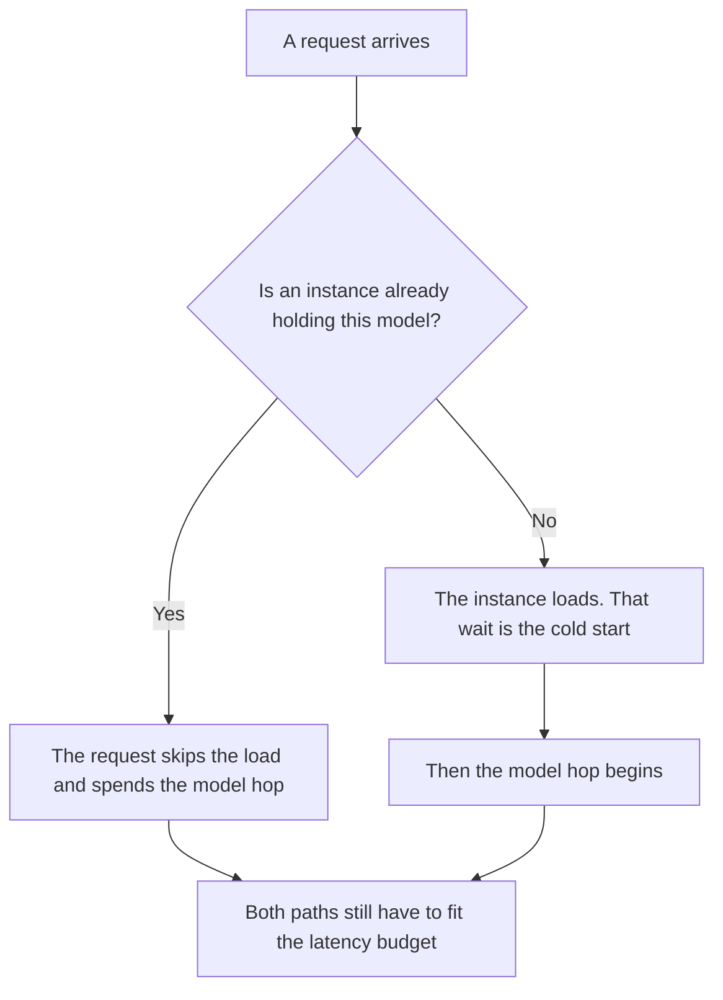

**An AI cold start is the extra wait on a request that arrives when no ready instance is already holding the model.** Something has to load the weights, or a worker has to wake, before the first token. The wait is the cold start. Keeping a minimum number of instances loaded so the next request skips that wait is [what an AI warm pool is](/blog/what-is-ai-warm-pool-2026/).

The path from request to answer is [what model serving is](/blog/what-is-model-serving-2026/). The allowance you gave each hop, including this one, is [what an AI latency budget is](/blog/what-is-ai-latency-budget-2026/). Attention state a server may reuse for a repeated prefix is [what a KV cache is](/blog/what-is-kv-cache-2026/). A KV cache does not remove a cold start. There is nothing to reuse until an instance is up.

Prices are US list prices excluding tax from directory pages checked October 16, 2026. Published October 24, 2026. We did not measure cold starts. This page does not recommend a millisecond target.

## What you might be looking at

| What you see | What it might be | What it is not |
|---|---|---|
| The first request after idle is slower than the next ones | A cold start on your instances | A permanent property of the model |
| A newly scaled worker's first request is slow | A cold start on that worker | Proof the model is "bad at latency" |
| A chat product pauses | Their capacity, your network, or both | A number you can publish as their cold start |
| The first request after you deploy | A cold start you can measure on your fleet | A vendor SLO, unless they wrote one |

Treat the cold start as its own hop in the budget when you run the instances. If you only buy a chat seat, you do not get a hop diagram. You get a wait you either tolerate or you tell the user the request failed. Do not label a vendor's ordinary pause "their cold start" without a measurement they published. We do not have one to repeat.

## Seats that hide the fleet

[ChatGPT](/tools/chatgpt/) Plus is $20 a month. [Claude](/tools/claude/) Pro is $20 a month, or $17 billed annually. [Gemini](/tools/gemini/) is free with a Google account. Google AI Plus is $4.99 a month and Google AI Pro is $19.99 a month, on the October 16 card. None of those prices is a cold-start figure. The vendor absorbs the load, including whatever they do about idle capacity. Your job, on a seat, is the timeout you will accept in the product you wrapped around the chat.

[DeepSeek](/tools/deepseek/) records token prices on the October 16 card, not a statement about idle instances. If you call an API from a feature that scales to zero to save money, the first user after idle pays the cold start in waiting. That trade is real. Write it next to the dollar you saved. A warm pool is the opposite trade: you pay for idle capacity. Pick one, and put the choice where on-call can read it.

Order still matters once instances exist. Which job runs first is [what AI request prioritization is](/blog/what-is-ai-request-prioritization-2026/). A cold worker with a fair queue is still cold.

## What to measure, if you operate it

Measure the gap between "no instance ready" and "first token," on your fleet, after a deploy and after an idle window you define. Replace any example number with that measurement. An illustration is not a benchmark. Do not copy a figure from a blog, including this one, into an SLO.

A scale-from-zero design will cold-start. That can be the right bill for a nightly job. It is a poor fit for a person waiting in a checkout flow. Say which product paths are allowed to be cold.

## FAQ

### Is a cold start the same as a slow model?

No. A slow model is the time to generate once the instance is serving. A cold start is the time before that generation can begin. Adding them together and calling both "the model" hides the lever. You fix a cold start with readiness. You fix a slow generation with the model hop, the prompt, or the deadline.

### Does a warm pool delete cold starts?

It deletes them for requests that find a ready instance. A surge past the minimum, or a deploy that restarts the pool, creates cold starts again. The pool is a floor, not a promise that every request is warm.

### Should we put a cold start in the user-facing SLO?

Put the user-facing wait in the SLO. Break out the cold start in the budget so you can see it. Users do not care which hop it was. You do, because the fix is different.

### Are chat subscriptions cold-start free?

They hide the fleet. The user can still wait. You do not get to claim the vendor never cold-starts, and you do not get a knob unless the contract gives you one.

## Last verified

October 16, 2026 for ChatGPT, Claude, Gemini, and DeepSeek. No latency figures from those cards are repeated as scores. Published October 24, 2026.

**Sources:** [ChatGPT pricing](https://chatgpt.com/pricing/), [Claude pricing](https://claude.com/pricing), [Gemini](https://gemini.google.com), [DeepSeek API docs](https://api-docs.deepseek.com/).

*Published by Andrew for [AI Tools Optimizer](https://aitoolsoptimizer.com).*

[DeepSeek](/tools/deepseek/) is in the [chatbots and assistants directory](/tools/category/chatbots-assistants/). Directory pages may use affiliate links. A purchase through them may earn us a commission at no extra cost to you.
