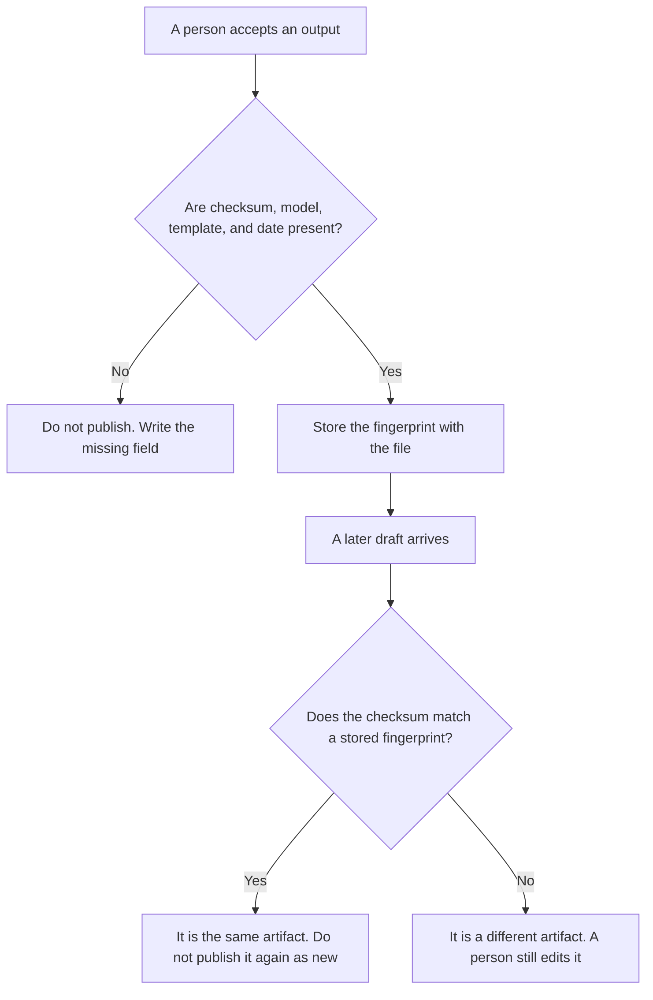

**An AI content fingerprint is a record you store with a finished output so you can tell later whether this paragraph, image, or file is the same generation you already published.** The record has a checksum of the bytes or the exact text, the model id, the template id, and the date. It answers "is this the same artifact?" It does not answer "is this similar?"

A numeric fingerprint used to search for nearby passages is [what embeddings are](/blog/what-is-embeddings-in-ai-2026/). The cut of a document before those numbers are stored is [what vector chunking is](/blog/what-is-vector-chunking-2026/). The wording of the prompt that produced the output, with a version number, is [what prompt versioning is](/blog/what-is-prompt-versioning-2026/). The check that the output still matches a rule you wrote is [what AI output validation is](/blog/what-is-ai-output-validation-2026/).

Prices are US list prices excluding tax from directory pages checked October 16, 2026. Published October 24, 2026. The directory does not list a fingerprint product fee, so this page does not invent one. We did not test detectors, and we do not publish a score for "how AI this text looks."

## What the record contains

| Field | Why it is there | What it is not |
|---|---|---|
| Checksum | The exact text or file, so a later paste can be matched | A similarity score |
| Model id | Which model produced it | A claim that the model is the author |
| Template id | Which versioned prompt was used | The full prompt, unless your policy stores that too |
| Date | When this generation was accepted | A copyright opinion |
| Owner | Who approved publishing it | A detector's label |

Two paragraphs can share a topic and fail the checksum. That is a new draft, and it still needs an editor. Two paragraphs that match the checksum are the same generation, even if someone changed the headline around them. Do not use a public "AI detector" percentage as this record. A detector is a guess. A checksum is a comparison you can rerun.

## Where the record is kept

**The draft.** [Claude](/tools/claude/) Pro is $20 a month, or $17 billed annually, when the fingerprint fields are a block at the top of a long page. The model may copy the model id you pasted. It may not invent a model. The review is [Claude review](/blog/claude-review-2026/).

**A short card.** [ChatGPT](/tools/chatgpt/) Plus is $20 a month when the habit is a project that appends the four fields. Free can format one card. The review is [ChatGPT review](/blog/chatgpt-review-2026/).

**The page that ships.** [Notion AI](/tools/notion-ai/) Business is $20 a seat a month when the published page and the fingerprint live in the same wiki. The chat is not the record. The page is. The card is [Notion AI pricing explained](/blog/notion-ai-pricing-explained-2026/).

**A brand voice seat, if the words are marketing.** [Jasper](/tools/jasper/) Pro is $59 a seat a month billed yearly, or $69 monthly. Jasper does not compute this checksum for you. If you publish from Jasper, you still store the fingerprint next to the file. The invoice is [Jasper pricing explained](/blog/jasper-pricing-explained-2026/).

A prompt that holds the line:

"Add a fingerprint block with the checksum method, model id, template id, and date I pasted. Do not invent a model. Do not write a detector score. If a field is missing, write Missing and stop."

## What not to delegate

Do not ask the model whether a competitor's page was "written by AI" and store that guess as a fingerprint. Do not hash a draft and then edit it without a new checksum. The edited file is a new artifact. The factual pass on the words, which is a different job, is [how to fact-check AI writing](/blog/how-to-fact-check-ai-writing-2026/).

## FAQ

### Is a content fingerprint the same as an embedding?

No. An embedding is a list of numbers for similarity search. A content fingerprint is a checksum plus the provenance fields for one accepted output. You can store both. They answer different questions.

### Does the fingerprint prove a human wrote it?

It proves you stored who approved this file and which model and template produced the generation you accepted. It does not prove authorship, and it does not replace your publisher's or client's AI policy.

### Should I fingerprint every chat message?

Fingerprint the artifact you publish or file: the page, the image, the deck. A scratch chat does not need a checksum until something leaves it. If you fingerprint everything, you will stop checking the fields.

### What if two tools edited the same paragraph?

Store the fingerprint of the file you will ship, and name every model that touched it if your policy requires that list. A checksum of an intermediate paste will not match the shipped file. That mismatch is the point.

## Last verified

October 16, 2026 for Claude, ChatGPT, Notion AI, and Jasper. No content-fingerprint fee is recorded in the directory. Published October 24, 2026.

**Sources:** [Claude pricing](https://claude.com/pricing), [ChatGPT pricing](https://chatgpt.com/pricing/), [Notion pricing](https://www.notion.com/pricing), [Jasper pricing](https://www.jasper.ai/pricing).

*Published by Andrew for [AI Tools Optimizer](https://aitoolsoptimizer.com).*

[Claude](/tools/claude/) is in the [chatbots and assistants directory](/tools/category/chatbots-assistants/). Directory pages may use affiliate links. A purchase through them may earn us a commission at no extra cost to you.
