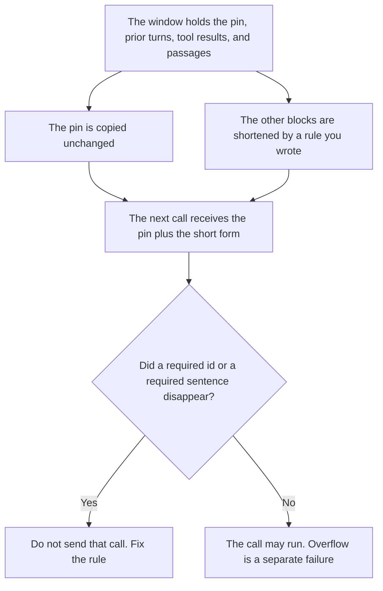

**AI context compaction is the step that shortens material already in the window: prior turns, tool results, or retrieved passages, while a pinned instruction stays whole.** The next model call receives the short form plus the pin. Shrinking the prompt template itself is [what prompt compaction is](/blog/what-is-prompt-compaction-2026/). The failure when nothing fits is [what AI context window overflow is](/blog/what-is-ai-context-window-overflow-2026/). A block that must not be shortened is [what AI context pinning is](/blog/what-is-ai-context-pinning-2026/).

The limit you are trying to fit is [what a context window is](/blog/what-is-a-context-window-2026/). This page does not invent a token count for any model. If a product prints a limit, use that product's page. Do not copy a number from memory into this definition.

Claude's prices are from claude.com/pricing on October 24, 2026. ChatGPT Plus is $20 a month on learn.chatgpt.com/docs/pricing that day. Gemini and Notion prices are from directory pages checked October 16, 2026. Published October 24, 2026. We did not measure truncation. The directory does not list a compaction fee.

## What may be shortened

| Block | Compaction may | Compaction may not |
|---|---|---|
| Prior turns | Replace them with a short form you can audit | Drop a turn the pin says to keep verbatim |
| Tool results | Keep the fields you named | Keep a secret the redaction pass should have masked |
| Retrieved passages | Keep the ids and the lines you marked | Replace a passage with a paraphrase and still cite the id as if the words were original |
| Pinned instructions | Leave them whole | Summarize the refusal rule to save space |

A summary written for a person is a document they will read. Context compaction is an input to a machine. If the machine loses the constraint, the shorter window failed, even if a person would have understood the summary.

## Where the rule is kept

**The rule.** [Claude](/tools/claude/) Pro is $17 a month billed annually, $200 up front, or $20 monthly. The Project holds what may be shortened and what the pin contains. The review is [Claude review](/blog/claude-review-2026/).

**One draft of the rule from a paste.** [ChatGPT](/tools/chatgpt/) Plus is $20 a month. Discard a version that summarizes the pin. The ladder is [ChatGPT pricing explained](/blog/chatgpt-pricing-explained-2026/).

**A long doc that already lives in Google's tools, when you are deciding what to pin.** [Gemini](/tools/gemini/) Google AI Plus is $4.99 a month on the October 16 card. Google AI Pro is $19.99 a month on that card. The doc is the source. Compaction is not a reason to skip opening it. The ladder is [Gemini pricing explained](/blog/gemini-pricing-explained-2026/).

**The register of pins.** [Notion AI](/tools/notion-ai/) Business is $20 a seat a month. One row per workflow: what is pinned, what may be shortened, who owns the rule. The invoice is [Notion AI pricing explained](/blog/notion-ai-pricing-explained-2026/).

A prompt that holds the line:

"Draft the context-compaction rule from the blocks I said may be shortened and the pin I pasted. Leave the pin verbatim. If I did not name a pin, write Pin not set. Do not summarize the pin."

## What not to delegate

Do not ask the model to compact "whatever does not fit" with no pin. Do not paraphrase a cited passage and keep the citation. Do not store the full secret-bearing tool result in the short form because the summary "needed detail." Mask first. The pass is [what an AI output redaction pass is](/blog/what-is-ai-output-redaction-pass-2026/) when the text is about to leave. The same list applies to what you keep inside the window.

## FAQ

### How is this different from prompt compaction?

Prompt compaction shrinks the prompt template so the task and the instructions still fit a budget. Context compaction shrinks history that accumulated after the template: turns, tools, passages. You can compact the prompt and still overflow on the transcript. You can compact the transcript and still need the template shortened. They are two steps.

### How is this different from pinning?

Pinning names a block that stays byte-for-byte. Compaction is what you do to the rest. A pin with no compaction rule just sits at the top until the window overflows. A compaction rule with no pin will shorten the instruction you meant to keep.

### How is this different from overflow?

Overflow is the failure: the request no longer fits, and the product drops text, summarizes it, or errors. Compaction is a step you run on purpose before that failure, with a rule. If you did not choose the rule, the product's overflow behavior is not compaction. It is a drop you did not audit.

### Who may change what the pin contains?

The owner of the workflow. A shorter pin that drops a refusal is a product change, not a savings. Record the version. The next call uses the new pin only after that owner accepts it.

## Last verified

October 24, 2026 for Claude and for ChatGPT's plan page. October 16, 2026 for Gemini and Notion. Published October 24, 2026.

**Sources:** [Claude pricing](https://claude.com/pricing), [ChatGPT and Codex pricing](https://learn.chatgpt.com/docs/pricing), [Gemini](https://gemini.google.com), [Notion pricing](https://www.notion.com/pricing).

*Published by Andrew for [AI Tools Optimizer](https://aitoolsoptimizer.com).*

[Claude](/tools/claude/) is in the [chatbots and assistants directory](/tools/category/chatbots-assistants/). Directory pages may use affiliate links. A purchase through them may earn us a commission at no extra cost to you.
