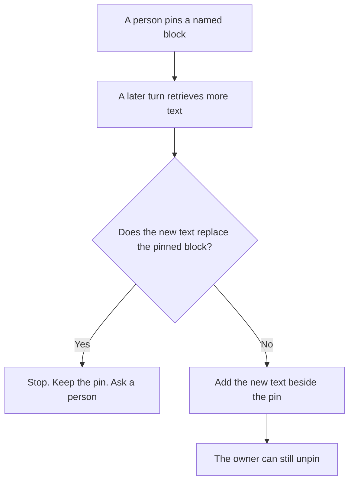

**AI context pinning is a control that marks a named block of text as fixed for a task. Later turns may add material around that block. They may replace it only when a person removes the pin.** The block is usually a policy paragraph, a schema, or a file a person chose. A pin is a rule about what stays. A cache is a billing and speed trick for a repeated prefix. That neighbor is [what a context cache is](/blog/what-is-a-context-cache-2026/). How old a retrieved page may be is [what an AI retrieval freshness SLA is](/blog/what-is-ai-retrieval-freshness-sla-2026/).

Claude's prices are from claude.com/pricing on October 24, 2026. Cursor, Notion, and ChatGPT seat notes below use the October 16, 2026 directory cards, except ChatGPT Plus, which is $20 a month on learn.chatgpt.com/docs/pricing the same October 24. Published October 24, 2026. We did not score answers. The directory does not list a context-pinning SKU.

## What a pin holds

| The pin | What may happen later | What a person must do to change it |
|---|---|---|
| A policy paragraph the owner pasted | New notes may sit under it | Remove the pin, or edit the paragraph and pin the new text |
| A schema the task must keep | The model may fill fields | A wider schema is a new pin. The shape lock is [what an AI output schema lock is](/blog/what-is-ai-output-schema-lock-2026/) |
| A file path the owner named | Retrieval may add other files beside it | Swapping the file is a new pin |
| A retrieved chunk with a time | A fresher chunk may be added | Replacing the pinned chunk requires a person |

A system prompt that says "always follow the policy" is a hope. A pin is a check you can point at: this block is still the one the owner marked, byte for byte, or the task stops. If the product you use has no pin control, write the block at the top of the task and reject any draft that contradicts it. That workaround is a procedure. It is a weaker control than a pin the software enforces.

## Where people set it

**The project that holds the policy.** [Claude](/tools/claude/) Pro is $17 a month billed annually, $200 up front, or $20 monthly. Put the pinned paragraph in the Project instructions and treat an edit to that paragraph as a change request. The review is [Claude review](/blog/claude-review-2026/).

**The editor task.** [Cursor](/tools/cursor/) Plus is $8 a month, or $80 a year, on the October 16 card. Pin the file the agent must not rewrite, and still read the diff. The ladder is [Cursor pricing explained](/blog/cursor-pricing-explained-2026/).

**The page the company will keep.** [Notion AI](/tools/notion-ai/) Business is $20 a seat a month if the pinned source is a wiki page. Plus at $10 is not the full AI tier on that card. The invoice is [Notion AI pricing explained](/blog/notion-ai-pricing-explained-2026/).

**One paste.** [ChatGPT](/tools/chatgpt/) Plus is $20 a month. A custom instruction is not a pin unless you check that the draft still quotes the block you marked. The review is [ChatGPT review](/blog/chatgpt-review-2026/).

A prompt that holds the line:

"This block is pinned. Repeat it unchanged at the top of your draft. If a later source conflicts with it, stop and quote the conflict. Do not merge the two."

## What not to delegate

Do not let a retrieval step unpin a block because a newer page scored higher. Do not pin a secret you would not paste into the tool. Do not describe a long chat memory as a pin. Memory can change. A pin changes when a person changes it.

## FAQ

### How is pinning different from a context cache?

A cache reuses a prefix so a later call can cost less or start faster. A pin decides which text is still authoritative. You can cache a prefix that nobody pinned, and you can pin a paragraph that the bill still counts in full.

### How is pinning different from retrieval freshness?

Freshness says how old a retrieved page may be. A pin says this particular block stays even when a fresher page arrives. The fresh page can be added. It does not overwrite the pin by itself.

### Can the model pin its own earlier answer?

Only if a person accepts that answer and marks it. An earlier draft is not a pin because the model wrote it. The owner pins the text they are willing to keep.

### Who may remove a pin?

The owner of the task. A tool result that says the policy "seems outdated" is a reason to ask that owner. It is not a removal.

## Last verified

October 24, 2026 for Claude and for ChatGPT Plus. October 16, 2026 for Cursor and Notion. No context-pinning fee is recorded in the directory. Published October 24, 2026.

**Sources:** [Claude pricing](https://claude.com/pricing), [ChatGPT and Codex pricing](https://learn.chatgpt.com/docs/pricing), [Cursor pricing](https://cursor.com/help/account-and-billing/pricing), [Notion pricing](https://www.notion.com/pricing).

*Published by Andrew for [AI Tools Optimizer](https://aitoolsoptimizer.com).*

[Claude](/tools/claude/) is in the [chatbots and assistants directory](/tools/category/chatbots-assistants/). Directory pages may use affiliate links. A purchase through them may earn us a commission at no extra cost to you.
