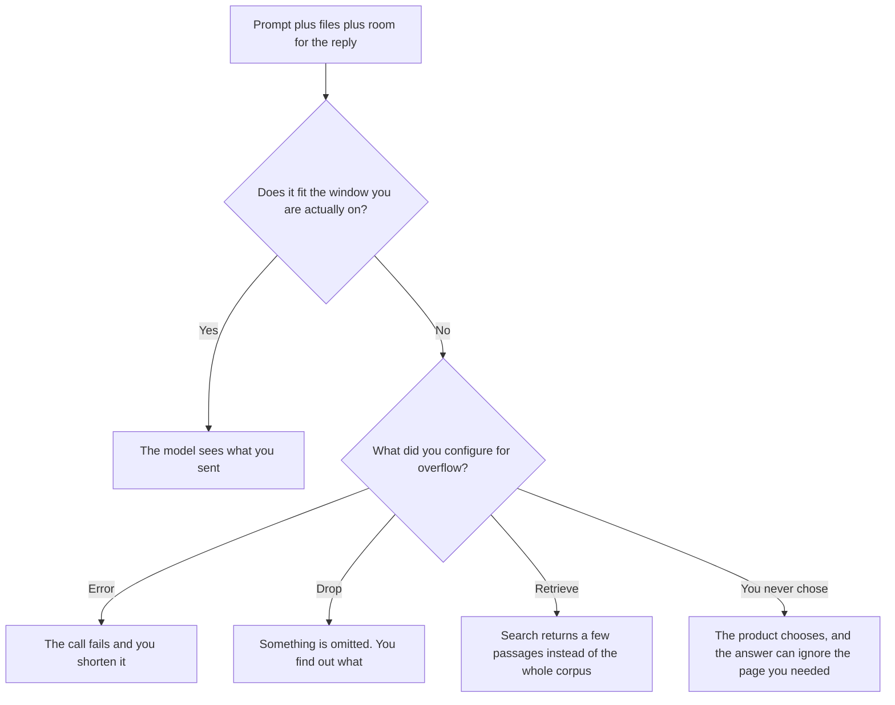

**AI context window overflow is what you get when the prompt, the files attached to it, and the reply the model still has to write no longer fit in one request.** The product then drops text, summarizes it, or errors. If you did not choose which of those happens, the model will choose by omission, and the answer will ignore the page you needed.

The limit itself is [what a context window is](/blog/what-is-a-context-window-2026/). The pattern that fetches a few passages instead of pasting the corpus is [what RAG is](/blog/what-is-rag-explained-2026/). The cut of a long file before it is stored for that search is [what vector chunking is](/blog/what-is-vector-chunking-2026/). A wrong answer that sounds specific, which overflow can cause and other bugs can cause too, is [what an AI hallucination is](/blog/what-is-ai-hallucination-2026/).

Prices are US list prices excluding tax from directory pages checked October 16, 2026. Published October 24, 2026. This page does not invent a token count. Where this site has recorded a figure, it lives on the context-window explainer. We did not measure how each product truncates.

## What overflow looks like in the product

| What you see | A likely cause | What you do |
|---|---|---|
| The answer ignores the last file | That file fell off the end of the request | Send the file alone, or retrieve the passage |
| The answer ignores the brief from an hour ago | The chat history filled the window | Start a new chat and paste the brief |
| The API returns an error about length | The call refused to truncate | Shorten the prompt, or the product errors on purpose |
| A summary appears that you did not ask for | The product compressed the input | Read what was dropped before you trust the summary |
| The bill jumped | Every call resent a huge prompt | Cut the repeated prefix, or cache what your policy allows |

A bigger subscription sometimes raises a file-upload cap. It does not, by itself, mean the window now holds your whole wiki. Read the plan card before you buy a seat to "fix" overflow.

## Seats, and what they do not fix

**A long page in a project.** [Claude](/tools/claude/) Pro is $20 a month, or $17 billed annually. Pro is a seat. It is not a promise that every PDF fits. If the answer skips a section, split the file. The review is [Claude review](/blog/claude-review-2026/).

**A reusable paste.** [ChatGPT](/tools/chatgpt/) Plus is $20 a month. Plus is the seat when this is weekly work. It does not raise the window to "the whole folder." The review is [ChatGPT review](/blog/chatgpt-review-2026/).

**A file that already lives in Google.** [Gemini](/tools/gemini/) is free with a Google account. Google AI Plus is $4.99 a month. Google AI Pro is $19.99 a month. Pro is the directory's row for Gemini in Gmail and Docs and 5 TB. A Drive folder that is larger than one request still needs retrieval or a split. The ladder is [Gemini pricing explained](/blog/gemini-pricing-explained-2026/).

**A cited answer instead of a paste.** [Perplexity](/tools/perplexity/) Pro is $17 a month billed annually when the job is a sourced scan, not a private corpus you must paste. The invoice is [Perplexity pricing explained](/blog/perplexity-pricing-explained-2026/).

A prompt that holds the line:

"If the material I pasted is too long for one answer, say Overflow and list which sections you did not use. Do not summarize those sections as if you read them. Do not invent a token count."

## What not to delegate

Do not ask the model to "keep everything in mind." Do not paste a secret archive into a consumer chat to test the limit. Do not treat a confident answer as proof the dropped pages were empty. The person who accepts the answer is [what human-in-the-loop AI is](/blog/what-is-human-in-the-loop-ai-2026/).

## FAQ

### Is overflow the same as a small context window?

The window is the size. Overflow is the moment your request exceeds it. A large window can still overflow if you attach a folder. A small window overflows sooner. Name both.

### Should I buy a higher plan when answers ignore a file?

Buy the higher plan when the vendor documents a larger window or a larger upload on that plan, and your file fits the new number. If the vendor does not print the number, a higher seat is a guess. Split the file first. It is cheaper than a plan you cannot audit.

### What should the product do when the request does not fit?

Pick one behavior and show it: error, or a list of what was omitted. A silent summary is the behavior that hides the miss. If you build the product, log the input size and the truncation. If you only use a chat, start a new thread and paste less.

### Can retrieval overflow too?

Yes. If you stuff every retrieved passage into the prompt, you have rebuilt the paste. Retrieval helps when the passages are few and you can open them. The chunk size is the chunking explainer, not a reason to attach the index.

## Last verified

October 16, 2026 for Claude, ChatGPT, Gemini, and Perplexity. No overflow fee is recorded in the directory. Published October 24, 2026. Token counts are not invented on this page.

**Sources:** [Claude pricing](https://claude.com/pricing), [ChatGPT pricing](https://chatgpt.com/pricing/), [Google AI pricing](https://gemini.google/subscriptions/), [Perplexity pricing](https://www.perplexity.ai/pro).

*Published by Andrew for [AI Tools Optimizer](https://aitoolsoptimizer.com).*

[Gemini](/tools/gemini/) is in the [chatbots and assistants directory](/tools/category/chatbots-assistants/). Directory pages may use affiliate links. A purchase through them may earn us a commission at no extra cost to you.
