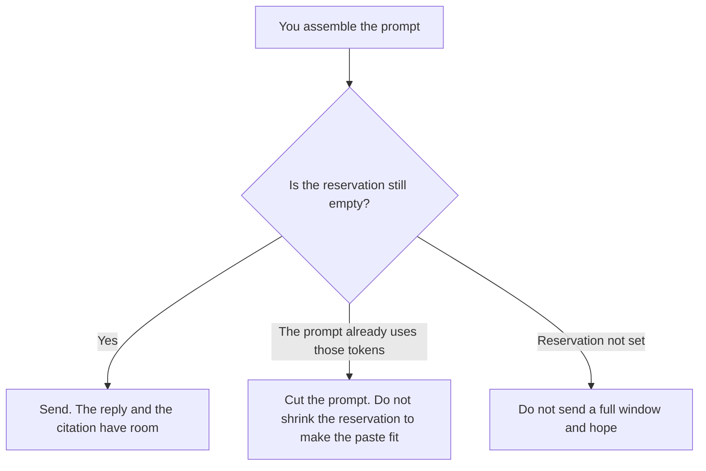

**An AI context-window reservation is a number of tokens you hold back from the prompt so the reply, a tool result, or a citation you required still fits inside the window.** The window is the model's limit. The reservation is the part of that limit you refuse to fill with more instructions. If you paste until the window is full, the answer has nowhere to land.

The size of the window is [what a context window is](/blog/what-is-a-context-window-2026/). What happens when the material is longer than that size is [what AI context-window overflow is](/blog/what-is-ai-context-window-overflow-2026/). A rule that an answer must carry a source you can open is [what AI grounding citation-required is](/blog/what-is-ai-grounding-citation-required-2026/).

Claude's prices are the October 24, 2026 read of claude.com/pricing recorded in [Claude pricing explained](/blog/claude-pricing-explained-2026/). ChatGPT's Plus price is the October 24 plan-page figure recorded in [ChatGPT pricing explained](/blog/chatgpt-pricing-explained-2026/). Gemini's prices are the October 16 directory card recorded in [Gemini pricing explained](/blog/gemini-pricing-explained-2026/). Cursor's Plus price is the October 24 help-center figure recorded in [Cursor pricing explained](/blog/cursor-pricing-explained-2026/). Published October 24, 2026. We did not measure token counts in a lab. The directory does not list a reservation fee.

## What you hold back

| You reserve room for | Who sets the number | If you fill it with prompt text |
|---|---|---|
| The reply | You | The answer truncates or the call fails |
| A tool result you still expect | You | The tool output is dropped or the call errors |
| A citation you required | You | The model writes the claim and has no room for the source |
| A second turn you already planned | You, or Turns not reserved | The next message starts by evicting the brief |

A longer subscription sometimes buys a larger window. It does not reserve the tail of that window for you. If the product's window is 200,000 tokens and you paste 200,000 tokens of notes, the reservation is zero, whatever you paid. Overflow is the failure after that. The reservation is the decision before you send.

Holding back tokens is not the same as summarizing. A summary can be the way you free the reservation. The summary still has to be something a person accepted. A model that shortens the brief so it can answer has not reserved room. It has replaced the brief.

## Where the number is kept

**A long document you will answer from.** [Claude](/tools/claude/) Pro is $17 a month billed annually, $200 up front, or $20 monthly. Put the reservation in the Project next to the file: leave room for the reply and for the citation. The review is [Claude review](/blog/claude-review-2026/).

**One paste, one answer.** [ChatGPT](/tools/chatgpt/) Plus is $20 a month. If the file fills the window, split the file. Do not ask the model to "use whatever is left" as if that were a reservation. The ladder is [ChatGPT pricing explained](/blog/chatgpt-pricing-explained-2026/).

**A Doc that is already long.** [Gemini](/tools/gemini/) on Google AI Pro is $19.99 a month on the October 16 card, which includes Gemini in Docs. The Doc's length is not a reservation. Leave room in the request you send. The invoice is [Gemini pricing explained](/blog/gemini-pricing-explained-2026/).

**The code that builds the request.** [Cursor](/tools/cursor/) Plus is $8 a month, or $80 a year. You review a diff that sets the completion budget to zero so a larger file will send. The individual ladder is [Cursor pricing explained](/blog/cursor-pricing-explained-2026/).

A prompt that holds the line:

"Tell me whether the prompt I pasted leaves the reservation I wrote for the reply and the citation. If I did not write a reservation, say Reservation not set. Do not shorten my source to make it fit."

## What not to delegate

Do not let the model choose how many tokens the answer "should" need. Do not drop the citation to save room after you required a citation. Do not treat a bigger plan as a reservation. The person who sends the request writes the holdback.

## FAQ

### How is this different from the context window?

The window is how much text the model can consider in one request, including the reply. The reservation is the part of that window you keep empty on purpose. A large window with no reservation can still truncate the answer if you fill it with the prompt.

### How is this different from overflow?

Overflow is the failure when the material does not fit. The reservation is the budget you set so that failure does not arrive as a surprise. You can overflow a request that had a reservation if you ignore the number. You can also send a short prompt with no reservation and get lucky.

### Does a citation need its own reservation?

If you required a source a person can open, the source has to fit. A claim that fills the window and leaves the citation out has not met that rule. Hold the tokens before you ask for the claim.

### Who sets the number?

The person who owns the request. A generated "use 10 percent" is not a reservation until that person writes it down. Reservation not set stays unset.

## Last verified

October 24, 2026 for Claude, for ChatGPT's plan page, and for Cursor's help page, via the posts cited above. October 16, 2026 for Gemini. Published October 24, 2026. No reservation fee is recorded in the directory.

**Sources:** [Claude pricing](https://claude.com/pricing), [ChatGPT and Codex pricing](https://learn.chatgpt.com/docs/pricing), [Google Gemini subscriptions](https://gemini.google/subscriptions/), [Cursor pricing](https://cursor.com/help/account-and-billing/pricing).

*Published by Andrew for [AI Tools Optimizer](https://aitoolsoptimizer.com).*

[Claude](/tools/claude/) is in the [chatbots and assistants directory](/tools/category/chatbots-assistants/). Directory pages may use affiliate links. A purchase through them may earn us a commission at no extra cost to you.
