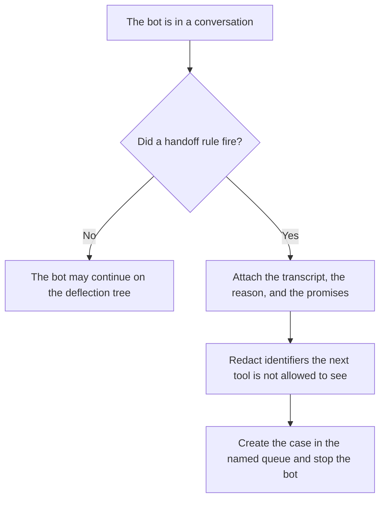

**An AI conversation handoff is the recorded moment a bot stops replying and a named queue receives the transcript, the reason the bot stopped, and every promise the bot already made.** A sentence that says "let me get you to an agent" is not the handoff. The handoff is the case the person can see, with those three things filled in.

Logging what the bot would have done, without doing it, is [what AI shadow mode is](/blog/what-is-ai-shadow-mode-2026/). The paths a bot is allowed to offer before any handoff is [how to create a support deflection tree with AI](/blog/how-to-create-a-support-deflection-tree-with-ai-2026/). Removing identifiers before the transcript is pasted anywhere else is [what AI PII redaction is](/blog/what-is-ai-pii-redaction-2026/). The inbox where a person accepts a draft is [what an AI human review queue is](/blog/what-is-ai-human-review-queue-2026/).

Prices are US list prices excluding tax from directory pages checked October 16, 2026. A live fetch of vendor pricing pages on October 24, 2026 returned HTTP 401, so this page stays on the directory record. Published October 24, 2026. The directory does not list a conversation-handoff fee. We did not measure handle time.

## What the person must receive

| Field | Who may write it | If it is missing |
|---|---|---|
| Transcript so far | The product, from the messages that were sent | The person starts blind. Do not summarize away a promise |
| Reason | The rule that fired: refund above a cap, angry language you listed, two failed lookups | "The user asked for a human" is a reason only if that sentence was the rule |
| Promises already made | Copied from the bot's sent messages | The person must not discover a credit the bot offered by reading the thread later |
| Queue and owner | The routing rule you wrote | The case sits in a named queue. It does not float |
| What the bot will not do next | The stop rule | The bot keeps talking and contradicts the person |

Shadow mode would have logged the refund and not issued it. A handoff is the opposite shape: something already happened in the conversation, and a person has to continue it. The deflection tree is the map of answers the bot may still give. The handoff rule is the edge that leaves the map. The review queue is what you use when a draft must be accepted before it sends. A handoff is a case, not a draft sitting in a database nobody watches.

Write the promises as quotes from messages that were actually sent. A summary that says "the bot was helpful" drops the credit amount.

## Where the handoff is specified

**The desk that will own the case.** [Zendesk AI](/tools/zendesk-ai/) Suite Team is $55 per agent per month paid yearly on the directory card, which is where AI agents are listed. Support Team at $19 per agent per month paid yearly does not include them. The handoff still has to land in whatever desk you already run. Do not add a second desk so the bot has somewhere to escalate.

**The rule text.** [Claude](/tools/claude/) Pro is $20 a month, or $17 billed annually, when the reasons and the promise-capture lines are a long note. The model may format rules you paste. It may not add a reason. The review is [Claude review](/blog/claude-review-2026/).

**The runbook the next shift inherits.** [Notion AI](/tools/notion-ai/) Business is $20 a seat a month if that is the wiki. The invoice is [Notion AI pricing explained](/blog/notion-ai-pricing-explained-2026/).

**One rule, as a draft.** [ChatGPT](/tools/chatgpt/) Plus is $20 a month. Discard a rule that hands off "whenever the user seems frustrated" without a definition you can log.

A prompt that holds the line:

"Format a handoff record from the transcript, the rule id, and the promises I pasted. Quote the promises. Do not add a promise. If the queue is missing, write Queue missing and stop."

## What not to delegate

Do not let the bot keep answering after the case is created. Do not paste the raw transcript into a general chat tool the whole company can see. Do not describe a handoff as successful because the customer stopped typing. The person still has to pick up the case. The lead who changes these rules is [best AI tools for support ops leads](/blog/best-ai-tools-for-support-ops-leads-2026/).

## FAQ

### How is a handoff different from deflection?

Deflection is a path that answers inside the bot, from an article you approved. A handoff is the path that leaves the bot. If the article does not cover the case, the tree should say so and hand off. It should not invent a policy paragraph.

### How is it different from a human review queue?

The review queue holds a draft a person accepts before it goes out. The handoff holds a live conversation that already contains sent messages. The person continues the case. They are not approving a single outbound draft, though a later reply might go through that queue.

### What belongs in the reason field?

The rule id you can find in the config: amount over the cap, tool error, explicit request for a person, or a topic on the deny list. "Sentiment" is a reason only if you wrote the words or the score that fire it. A vibe is not a log line.

### Should the bot summarize the chat for the agent?

Only as a convenience under the transcript, and only from lines that were sent. The transcript remains. A summary that drops a promise is the defect. The person should be able to ignore the summary and still see the promise.

## Last verified

October 16, 2026 for Zendesk, Claude, Notion, and ChatGPT. No conversation-handoff product fee is recorded in the directory. Published October 24, 2026.

**Sources:** [Zendesk](https://www.zendesk.com), [Claude pricing](https://claude.com/pricing), [Notion pricing](https://www.notion.com/pricing), [ChatGPT pricing](https://chatgpt.com/pricing/).

*Published by Andrew for [AI Tools Optimizer](https://aitoolsoptimizer.com).*

[Zendesk AI](/tools/zendesk-ai/) is in the [customer support directory](/tools/category/customer-support/). Directory pages may use affiliate links. A purchase through them may earn us a commission at no extra cost to you.
