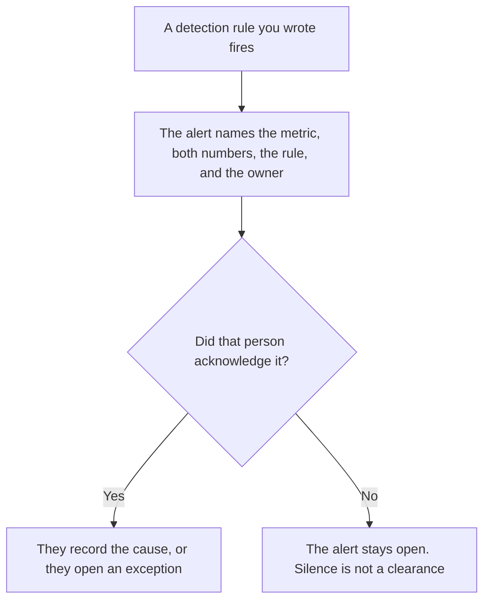

**An AI cost anomaly alert is the message a named person receives when AI spend breaks a rule they already wrote: the metric, the baseline, the current number, the time, and where to look.** The check that compares the numbers is [what AI cost anomaly detection is](/blog/what-is-ai-cost-anomaly-detection-2026/). The alert is the page or the chat message that leaves the dashboard. A chart nobody opens is detection without an alert. A message that says "spend looks high" and omits the number is not an alert.

The ceiling that can stop work, which is a different control, is [what an AI budget cap is](/blog/what-is-ai-budget-caps-2026/). The team the dollars belong to is [what AI cost attribution is](/blog/what-is-ai-cost-attribution-2026/). The request to exceed a quota, after a person decides, is [how to create a quota exception request with AI](/blog/how-to-create-a-quota-exception-request-with-ai-2026/).

Prices below are US list prices. Hex, Zapier, and ChatGPT are from directory pages checked October 16, 2026. Claude's prices are from claude.com/pricing on October 24. chatgpt.com/pricing returned HTTP 403 that day. Published October 24, 2026. The directory does not list a cost-anomaly product, so this page does not invent a fee for the alert. We did not score finance tools. This page is not accounting advice.

## What the message contains

| Line | Who supplies it | The model may |
|---|---|---|
| Metric and window | The owner of the rule | Copy them. It may not rename "daily tokens" to "monthly waste" |
| Baseline and current value | The query you ran | Copy both numbers. It may not round them into a story |
| The rule that fired | The threshold you wrote | Name the rule. It may not invent a second threshold |
| The owner and the channel | You | Copy the name and the channel. A blank owner stays blank |
| The link to the chart | The system that fired | Paste the link. It may not claim the chart was reviewed |

Detection can be true and still fail if the message goes to a channel nobody reads. Write the channel on the rule. An alert that pages the whole company for a $4 spike will be muted. An alert that waits for a weekly meeting will miss a key that is spending now. The rule picks the channel. The model does not.

## Where the message is drafted

**The numbers.** [Hex](/tools/hex/) Professional is $36 an editor a month on the October 16 card. The query is the source of the baseline and the current value. A sentence in a notebook is not the alert until it is sent. The invoice is [Hex pricing explained](/blog/hex-pricing-explained-2026/).

**The route.** [Zapier](/tools/zapier/) Professional is $19.99 a month billed annually on that card, at the 750-task tier. Free is 100 tasks a month. The Zap may deliver the message. It may not decide the threshold. The invoice is [Zapier pricing explained](/blog/zapier-pricing-explained-2026/).

**The wording, after the numbers exist.** [Claude](/tools/claude/) Pro is $17 a month billed annually, $200 up front, or $20 monthly, when the same alert format should match last month's. The review is [Claude review](/blog/claude-review-2026/).

**One message, from a paste.** [ChatGPT](/tools/chatgpt/) Plus is $20 a month on the October 16 card. Paste the four numbers. Discard a version that adds a cause. The review is [ChatGPT review](/blog/chatgpt-review-2026/).

A prompt that holds the line:

"Write the alert from the metric, baseline, current value, rule, owner, and link I pasted. Do not explain the cause. Do not change the numbers. If the owner is blank, write Owner missing."

## What not to delegate

Do not let the model pick a new threshold because the last alert was noisy. Do not auto-close an alert because a later hour was cheaper. Do not paste a customer invoice into the prompt. The seat prices the alert is about, when the spike is a ChatGPT or Claude bill, are [ChatGPT pricing explained](/blog/chatgpt-pricing-explained-2026/) and [Claude pricing explained](/blog/claude-pricing-explained-2026/).

## FAQ

### How is an alert different from detection?

Detection is the comparison and the rule. The alert is the message that leaves that system. You can detect a spike on a dashboard and still have no alert, if nobody is told. You can send an alert that is false if the rule is wrong. Fix the rule. Do not ask the model to soften the message.

### How is an alert different from a budget cap?

A cap is a ceiling that warns or stops spend. An alert is the notice that a rule fired. The rule might be a cap. It might be a percent change with no stop. The message should say which one it is.

### Who acknowledges it?

The owner named on the message. A model reply in the same channel is not an acknowledgement. If the owner is out, the rule should name a second person. Do not invent that person in the draft.

### Can the alert recommend a fix?

Only if you paste the allowed fixes. "Buy a higher tier" is a recommendation. It belongs in the exception request, after a person decides the spike is real.

## Last verified

October 24, 2026 for Claude. October 16, 2026 for Hex, Zapier, and ChatGPT. No anomaly-alert fee is recorded in the directory. Published October 24, 2026.

**Sources:** [Hex pricing](https://hex.tech/pricing), [Zapier pricing](https://zapier.com/pricing), [Claude pricing](https://claude.com/pricing), [ChatGPT pricing](https://chatgpt.com/pricing/).

*Published by Andrew for [AI Tools Optimizer](https://aitoolsoptimizer.com).*

[Hex](/tools/hex/) is in the [data and analytics directory](/tools/category/data-analytics/). Directory pages may use affiliate links. A purchase through them may earn us a commission at no extra cost to you.
