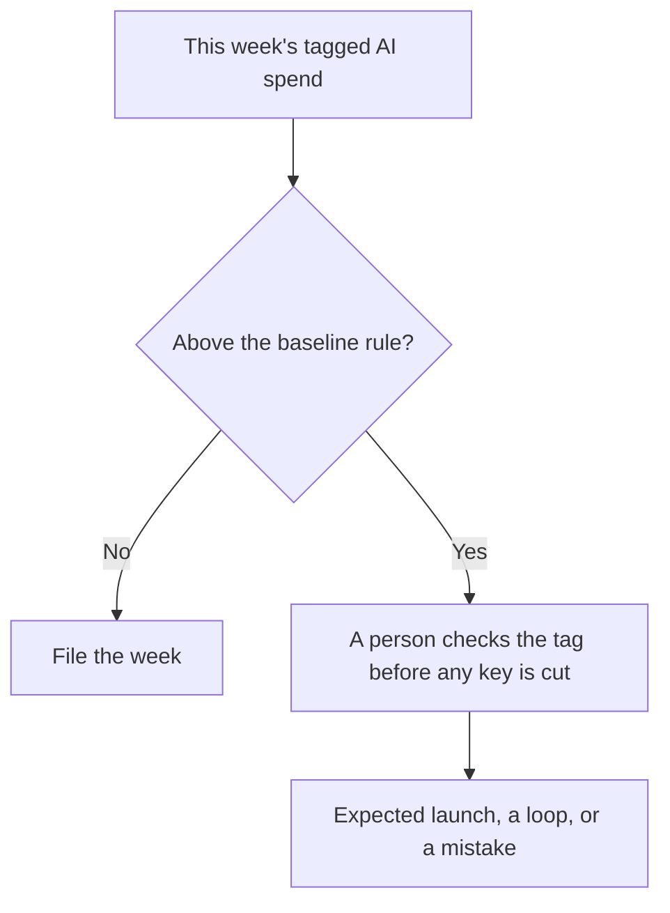

**AI cost anomaly detection is a check that compares this period's AI spend with a baseline you already trust, and asks a person to look when the gap is larger than the rule you wrote.** A baseline without an owner is a chart. A spike without a tag is a surprise invoice. Detection is the rule, the tag, and the person. It is not a model that "watches the budget" with no numbers underneath.

The tag itself is [what AI cost attribution is](/blog/what-is-ai-cost-attribution-2026/). The unit is [what AI tokens are](/blog/what-are-ai-tokens-explained-2026/). The trace, when the vendor logs one, is [what AI observability is](/blog/what-is-ai-observability-2026/). The promise about uptime, which is a different miss, is [what AI SLA monitoring is](/blog/what-is-ai-sla-monitoring-2026/).

Prices below are US list prices from directory pages checked October 16, 2026. Published October 24, 2026. The directory does not list a cost-anomaly product, so this page does not invent a fee for one. We did not score finance tools. This page is not accounting advice.

## A spike you can name

| What moved | A rule that can fire | A rule that will page you forever |
|---|---|---|
| One feature's tokens doubled week over week | Page the feature owner above a percent you picked | "Tell me if anything changes" |
| A new seat count | Page when seats grow without a ticket | Alerting on the whole company AI line |
| A cache that stopped hitting | Compare hit rate and dollars together | Treating every cache miss as fraud |
| A trial that converted | Expect the step-up. Note it | Calling the first paid month an anomaly |

Cutting an API key because a chart turned red is how you take down a launch. The person in the loop is [what human-in-the-loop AI is](/blog/what-is-human-in-the-loop-ai-2026/). A retry loop that searches again on purpose is [what agentic RAG is](/blog/what-is-agentic-rag-2026/). Cap those retries so the anomaly is rare.

## Where the numbers can sit

**The chart.** [Hex](/tools/hex/) Professional is $36 an editor a month. Team is $75 an editor a month. Import the export you trust. A missing team column should stay blank. Hex should not guess "marketing." The card is [Hex pricing explained](/blog/hex-pricing-explained-2026/).

**The page.** [Zapier](/tools/zapier/) Professional is $19.99 a month billed annually for 750 tasks. It can post the row that crossed the threshold. It cannot decide the threshold. The three-way is [Zapier vs Make vs n8n](/blog/zapier-vs-make-vs-n8n/).

**Seat bills that look smooth until they are not.** [ChatGPT](/tools/chatgpt/) Business is $20 a user a month billed annually, or $25 monthly, minimum two users. Five annual seats are 5 × $20 = $100 a month. A sixth seat is a $20 step, not a mystery, if the directory of humans is right. Plus at $20 is an individual line. The ladder is [ChatGPT Go vs Plus vs Pro](/blog/chatgpt-go-vs-plus-vs-pro-2026/).

**A usage band that is supposed to be large.** [Claude](/tools/claude/) Max at $100 or $200 is a usage band for a person. A jump from Pro at $20 to Max is a purchase, and it should have a ticket. Do not detect it as leakage after the fact if someone approved it. The review is [Claude review](/blog/claude-review-2026/).

**An editor pool.** [Cursor](/tools/cursor/) Plus for new individuals is $8 a month, or $80 a year. Team seats on the new card are $30, $100, or $200 a month. A team that moves from the $30 seat to the $200 seat should see that as a plan change. The group math is [Cursor vs GitHub Copilot for teams](/blog/cursor-vs-github-copilot-for-teams-2026/).

The people who run this as a workflow are the audience of [best AI tools for finance ops](/blog/best-ai-tools-for-finance-ops-2026/).

## A minimum rule

Pick one grain: feature, team, or key. Pick one window: day or week. Pick one threshold you can explain, such as "more than double the trailing four-week median, and at least $50." Ignore the noise floor so a $2 test does not page anyone. Write the expected events, launches and migrations, on a calendar so they do not look like incidents.

Show the raw rows with the alert. A model that summarizes the spike can draft the note after a person has seen the rows. It should not be the only reader.

## FAQ

### Is anomaly detection the same as attribution?

Attribution names the owner of every dollar. Anomaly detection asks whether this owner's dollars moved past a rule. You can attribute perfectly and still want the alert. You cannot alert well on an unlabeled bill.

### Should I auto-disable a key when it fires?

Not from this page's rule. Auto-disable is an incident switch you design on purpose, with a fallback for customers. Detection only creates the review.

### What about a slow leak, a few dollars a day?

A week-over-week spike rule will miss it. Add a second rule on the monthly total against the budget. Two rules are enough. Ten rules are a second product.

### Can the model set the threshold?

It can suggest one from history you paste. A person publishes the number. A threshold that moves itself every night will train the team to ignore it.

## Last verified

October 16, 2026 for Hex, Zapier, ChatGPT, Claude, and Cursor prices named above. No standalone anomaly-detection fee is recorded in the directory. Published October 24, 2026.

**Sources:** [Hex](https://hex.tech), [ChatGPT pricing](https://chatgpt.com/pricing), [Claude pricing](https://claude.com/pricing).

*Published by Andrew for [AI Tools Optimizer](https://aitoolsoptimizer.com).*

[Hex](/tools/hex/) is in the [data and analytics directory](/tools/category/data-analytics/). Directory pages may use affiliate links. A purchase through them may earn us a commission at no extra cost to you.
