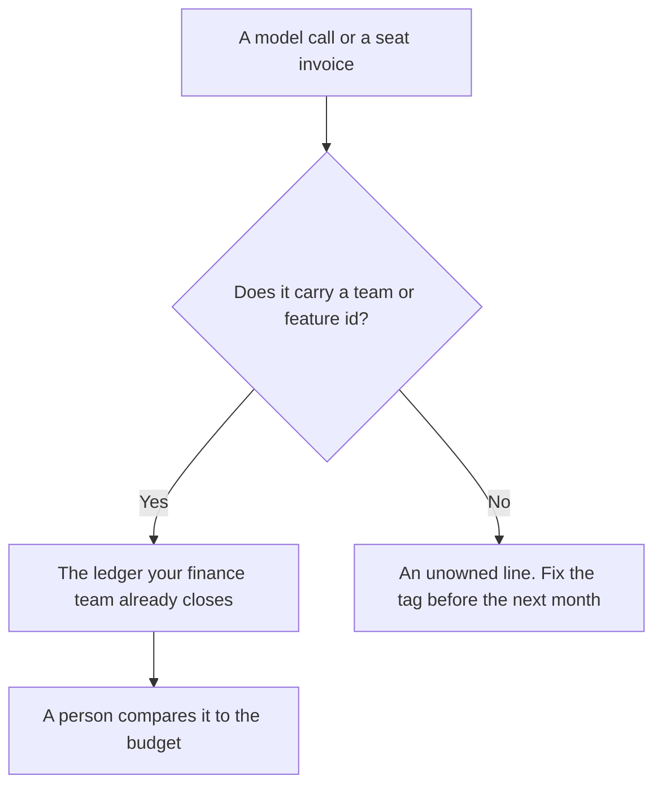

**AI cost attribution is the practice of labeling each AI dollar with the team, feature, or customer that caused it, then reading that label on a schedule you already keep.** A shared ChatGPT login and one API key with no tag both produce a bill. Neither produces an owner. Attribution is the tag, the export, and the person who checks the total against the budget.

The unit on an API bill is still [what AI tokens are](/blog/what-are-ai-tokens-explained-2026/). The choice of which model runs is [what AI routing is](/blog/what-is-ai-routing-2026/). The door those calls pass through, when you have one, is [what a model gateway is](/blog/what-is-a-model-gateway-2026/). Training versus the calls you pay for every day is [inference versus training](/blog/what-is-ai-inference-vs-training-2026/).

Prices below are US list prices from directory pages checked October 16, 2026. Published October 24, 2026. This page does not publish a cost-attribution product fee, because the directory does not list one. We did not score finance tools.

## What you can actually attach a dollar to

| What you already have | A label that can sit on it | A label that will lie |
|---|---|---|
| An API key per product | The product name on every invoice line | One company key, then a guess at month-end |
| A seat with a named person | That person's team in the directory you trust | A shared password called "marketing" |
| A request log with a feature id | Tokens in, tokens out, model name, feature id | A dashboard that only shows "AI" |
| A customer id on a support bot | Cost of that bot's outcomes, if the vendor meters them | Dividing the whole bill by customer count |

A spreadsheet of vibes is not attribution. The trace you can open, including cost when the vendor logs it, is [what AI observability is](/blog/what-is-ai-observability-2026/). The place a fact is allowed to live after you agree it is [what a system of record for AI is](/blog/what-is-a-system-of-record-for-ai-2026/).

## Where the dollars show up in tools this site already prices

**A seat, billed per person.** [ChatGPT](/tools/chatgpt/) Plus is $20 a month. Business is $20 a user a month billed annually, or $25 monthly, for two or more users, and does not train on business data by default. Five Business seats on the annual card are 5 × $20 = $100 a month. That math attributes the seat to a person. It does not attribute a single long chat to a feature. The ladder is [ChatGPT Go vs Plus vs Pro](/blog/chatgpt-go-vs-plus-vs-pro-2026/).

**A second seat, same shape.** [Claude](/tools/claude/) Pro is $20 a month, or $17 billed annually ($200 up front). Max at $100 or $200 is a usage band, not a department code. The directory records Team as a per-seat plan and does not print a Team price. Do not invent one for a chargeback slide. The review is [Claude review](/blog/claude-review-2026/).

**An editor pool.** [Cursor](/tools/cursor/) Plus for new individuals is $8 a month, or $80 a year, on The X Subscription. Team seats on the new card are $30, $100, or $200 a month, matching Premium, Super, or Ultra usage. A team invoice attributes the seat. It still needs a note that says which repo the seat was for, if finance will ask. The seat math for a group is [Cursor vs GitHub Copilot for teams](/blog/cursor-vs-github-copilot-for-teams-2026/).

**A notebook for numbers you already exported.** [Hex](/tools/hex/) Professional is $36 an editor a month and includes the Hex agent. Team is $75 an editor a month. Hex can chart a CSV of token logs you trust. It should not invent the missing team column. The card is [Hex pricing explained](/blog/hex-pricing-explained-2026/).

**A path that files the export.** [Zapier](/tools/zapier/) Professional is $19.99 a month billed annually for 750 tasks. It can drop an invoice CSV into the folder finance uses. It cannot decide the tag. The map is [Zapier vs Make vs n8n](/blog/zapier-vs-make-vs-n8n/).

## A minimum ledger

Keep four columns: date, model or seat, team or feature id, and dollars or tokens. Add customer id only when the product already has one and your privacy review allows it in that sheet. Review it when you close the month, next to the other software lines. A cheaper model that fails a task you care about is not a savings until the failure rate is on the same row. That check is [what AI eval testing is](/blog/what-is-ai-eval-testing-2026/).

Showback, a report the team can see, is enough for most companies. Chargeback, an internal bill the team must pay, needs a finance owner and a rule for shared seats. This page is not accounting advice. Your ledger system remains the books.

The people who run this as a workflow, without turning it into tax or investment advice, are the audience of [best AI tools for finance ops](/blog/best-ai-tools-for-finance-ops-2026/).

## FAQ

### Is a single company API key enough?

It is enough to pay the vendor. It is not enough to say which product spent the tokens. Split keys, or log a feature id on every call, before you promise a department a number.

### Do seat plans need attribution?

They need a named person and a team. They do not need token-level math unless you also use the API. Mixing "five Plus seats" and "the support bot's API bill" in one unlabeled line hides both.

### Can the model categorize its own invoice?

Only after a person checks the categories against the tags you actually send. A model that guesses "this charge was marketing" from a vendor memo will be wrong in a way finance will repeat.

### Should customers see their AI cost?

Only if your pricing page already says they pay for usage. Attribution inside your company is separate from a customer invoice. Do not print an internal token log on a customer's bill without a product decision.

## Last verified

October 16, 2026 for ChatGPT, Claude, Cursor, Hex, and Zapier prices named above. The directory does not list a standalone price for a cost-attribution product. Published October 24, 2026.

**Sources:** [ChatGPT pricing](https://chatgpt.com/pricing), [Claude pricing](https://claude.com/pricing), [Cursor pricing](https://cursor.com/help/account-and-billing/pricing).

*Published by Andrew for [AI Tools Optimizer](https://aitoolsoptimizer.com).*

[Hex](/tools/hex/) is in the [data and analytics directory](/tools/category/data-analytics/). Directory pages may use affiliate links. A purchase through them may earn us a commission at no extra cost to you.
