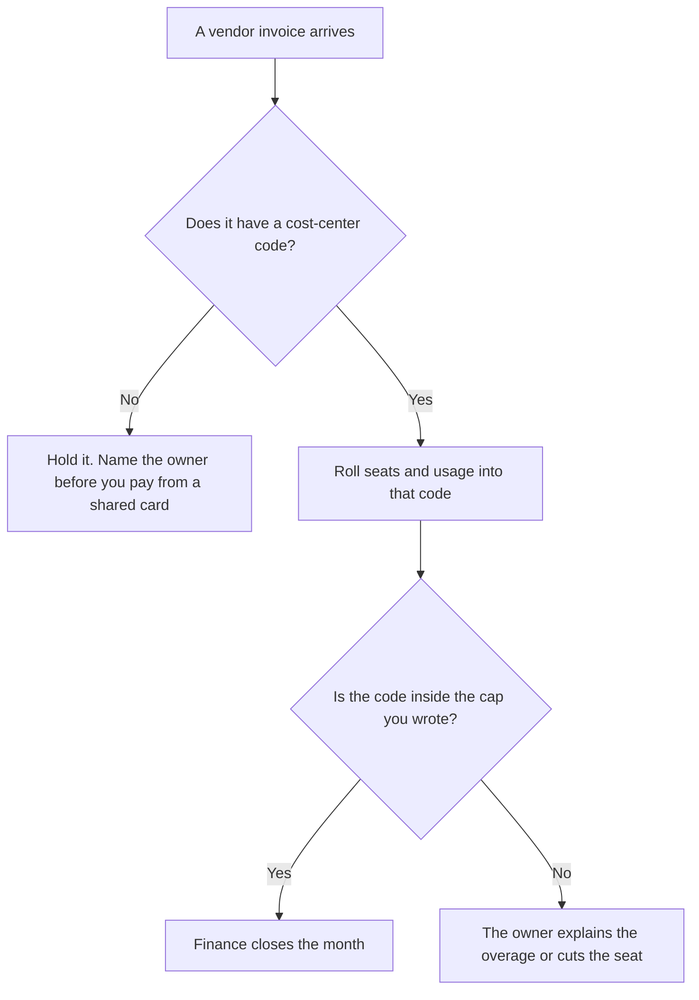

**An AI cost center is the finance code a company assigns AI spend to, so a seat invoice and an API invoice land in a bucket a person already owns.** The code might be a department, a product, or a shared platform. The invoice still arrives from the vendor. The cost center is where your ledger says it belongs.

Tagging each call is [what AI cost attribution is](/blog/what-is-ai-cost-attribution-2026/). A ceiling on the bucket is [what AI budget caps are](/blog/what-is-ai-budget-caps-2026/). A spike against that ceiling is [what AI cost anomaly detection is](/blog/what-is-ai-cost-anomaly-detection-2026/). The fields that make the tag computable are [what AI telemetry is](/blog/what-is-ai-telemetry-2026/).

Prices are US list prices excluding tax from directory pages checked October 16, 2026. Published October 24, 2026. This page does not invent a cost-center software fee. We did not score finance tools.

## What has to be on the code

| Field | A cost center has it | A shared login does not |
|---|---|---|
| The code | A name finance already uses | "AI" as a Slack channel |
| The owner | A person who can stop the spend | A bot that posts the chart |
| The invoices | Seats, credits, and API usage that roll into the code | One receipt nobody mapped |
| The period | The month the ledger closes | A screenshot from launch week |
| The cap | A number the owner agreed | A hope that usage stays flat |
| The exception | Who may open a second code | A new tool bought on a card |

Attribution can split one invoice across several codes. The cost center is the code they split into. If you have tags and no code, you have a spreadsheet. If you have a code and no tags, you have a bucket you cannot explain.

## Invoices that need a code

**Chat seats.** [ChatGPT](/tools/chatgpt/) Business is $20 per user per month billed annually, with a two-user minimum, or $25 monthly. Plus is $20 a month. A Business seat can sit on a department code. A personal Plus seat on a company card is still spend. Put it on a code or stop expensing it. The review is [ChatGPT review](/blog/chatgpt-review-2026/).

**A second assistant seat.** [Claude](/tools/claude/) Pro is $20 a month, or $17 billed annually. Max starts at $100. Team plans cover 2 to 150 people. Two assistants in one team are two lines on the same code unless you meant to split writers from engineering. The review is [Claude review](/blog/claude-review-2026/).

**An API line.** [DeepSeek](/tools/deepseek/) publishes per-token API rates. For `deepseek-flash`, the directory records peak input at $0.30 per 1 million tokens on a cache miss and $0.006 on a cache hit, with output at $1.20. Off-peak is half: $0.15, $0.003, and $0.60. That line belongs on the product code that calls it. The unit is [what AI tokens are](/blog/what-are-ai-tokens-explained-2026/). The counter that records the call is [what AI token metering is](/blog/what-is-ai-token-metering-2026/).

**A workflow bill.** [Zapier](/tools/zapier/) Professional is $19.99 a month billed annually for 750 tasks. Free is 100 tasks. A Zap that calls a model is still a task on a code. Do not leave automation on a founder's card because it is "small."

**An editor seat.** [Cursor](/tools/cursor/) Plus is $8 a month, or $80 a year, on the plans the directory recorded for new subscriptions. Legacy Pro at $20 continues for existing customers. Engineering's code is the right bucket. A designer's trial on the same invoice is a second code or a written exception.

## What a cost center is allowed to hide

The code can roll up many features. It should not hide a vendor you cannot name. A monthly total with no invoice list is a number finance cannot audit. Keep the vendor, the plan, and the owner next to the code.

A customer-facing price is a different document. Internal codes are not a usage invoice unless your pricing page already bills usage. The record of what you promised the customer stays in [what a system of record for AI is](/blog/what-is-a-system-of-record-for-ai-2026/).

## FAQ

### Is a cost center the same as a team?

Often the code matches a team. It can also match a product that several teams share. Write the code finance uses. Do not invent a second vocabulary for AI.

### Can one invoice sit in two cost centers?

Yes, when you split it with a rule you can recompute. A 50/50 guess with no tag is not a split. Attribution is how you defend the percentages.

### Does a free plan need a code?

The dollar can be zero and the tool can still hold company data. Track the tool on the code even when this month's invoice is $0. The next upgrade will not warn you.

### Who closes the code each month?

The owner you named. Finance can refuse a receipt with no code. The owner explains overages. A dashboard without that person is a chart.

## Last verified

October 16, 2026 for ChatGPT, Claude, DeepSeek, Zapier, and Cursor prices named above. A fetch of vendor pricing pages on October 24, 2026 is not what this article relies on. Published October 24, 2026.

**Sources:** [ChatGPT pricing](https://chatgpt.com/pricing/), [Claude pricing](https://claude.com/pricing), [DeepSeek API docs](https://api-docs.deepseek.com/), [Zapier pricing](https://zapier.com/pricing), [Cursor pricing](https://cursor.com/help/account-and-billing/pricing).

*Published by Andrew for [AI Tools Optimizer](https://aitoolsoptimizer.com).*

[DeepSeek](/tools/deepseek/) is in the [chatbots and assistants directory](/tools/category/chatbots-assistants/). Directory pages may use affiliate links. A purchase through them may earn us a commission at no extra cost to you.
