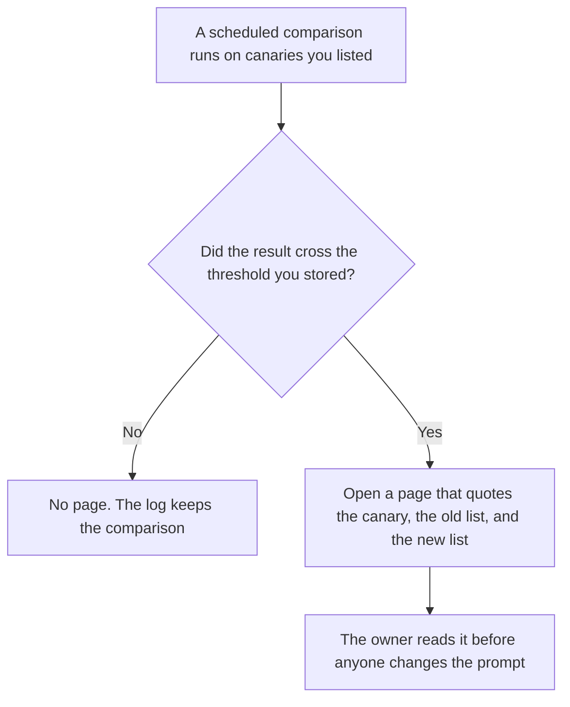

**An AI embedding drift alert is a page, or a ticket, that fires when a retrieval check you already defined moves past a threshold you already wrote.** The check might be "this canary question's top five passages changed" or "overlap with last week's neighbors fell under the number we stored." The alert does not discover that embeddings drifted. It reports the comparison you scheduled. The change itself is [what embedding drift is](/blog/what-is-embedding-drift-2026/). Ordering two retrieval lists is [what AI retrieval hybrid rerank is](/blog/what-is-ai-retrieval-hybrid-rerank-2026/).

Whether the passages you fetched support the answer is a later question. That coverage count is [what AI citation coverage is](/blog/what-is-ai-citation-coverage-2026/). Whether the right pages came back at all is [what retrieval evaluation is](/blog/what-is-retrieval-evaluation-2026/).

Claude's prices are from claude.com/pricing on October 24, 2026. ChatGPT's Plus price is from learn.chatgpt.com/docs/pricing that day. Notion and Cursor prices are from directory pages checked October 16, 2026, except Cursor's Teams seats, which are from the help center recorded October 24. Published October 24, 2026. We did not measure neighbor overlap for any index. The directory does not list an alert fee.

## What the alert is allowed to say

| You already stored | The alert may | The alert may not |
|---|---|---|
| A canary question and the passages that were acceptable | Say those passages are missing, or that new ones appeared | Decide the new passages are better |
| A threshold, such as overlap under a number you wrote | Fire when the comparison crosses it | Pick a new number because last week was noisy |
| An owner | Name that owner | Assign a person who was not on the list |
| The embedding model and index date | Copy them onto the page | Guess which deploy caused the move |

An alert with no canary is a feeling. A feeling does not page anyone. If the threshold is "if retrieval seems worse," you do not have a threshold. Write the comparison, the number, and the owner before the job runs.

## Where you would keep the rule

**The sentence that names the canary.** [Claude](/tools/claude/) Pro is $17 a month billed annually, $200 up front, or $20 monthly. Put the canary questions in a Project so a later edit does not rewrite them. The review is [Claude review](/blog/claude-review-2026/).

**One draft of the page.** [ChatGPT](/tools/chatgpt/) Plus is $20 a month on the October 24 plan page. Use it to format the alert from the two lists you pasted. It does not run the comparison. The ladder is [ChatGPT pricing explained](/blog/chatgpt-pricing-explained-2026/).

**The page the owner opens.** [Notion AI](/tools/notion-ai/) Business is $20 a seat a month. Link the index date. The invoice is [Notion AI pricing explained](/blog/notion-ai-pricing-explained-2026/).

**A change to the job that computes the comparison.** [Cursor](/tools/cursor/) Plus is $8 a month, or $80 a year. You review the diff. The alert text does not merge it. The ladder is [Cursor pricing explained](/blog/cursor-pricing-explained-2026/).

A prompt that holds the line:

"Format the alert from the canary, the old passages, the new passages, and the threshold I pasted. If the threshold is missing, write Threshold not set. Do not say the new list is better. Do not name a cause."

## What not to delegate

Do not let the model choose the canaries. Do not auto-close the alert because a later hour looked closer. Do not retune the prompt on the same day you change the embedding model and then treat the alert as a prompt failure. One change at a time, and the page says which change was in flight.

## FAQ

### How is this different from embedding drift?

Drift is the change in neighbors. The alert is the rule that tells a person the change crossed a line they set. You can have drift with no alert, which means nobody was paged. You can have an alert that never fires, which means the threshold was not crossed. Those are different facts.

### How is this different from citation coverage?

Coverage counts whether claims in an answer point at sources. This alert is about which passages retrieval returned, before anyone writes the answer. A covered answer can still sit on a drifted list. A drifted list can still be cited. Check them separately.

### Does the alert prove the model got worse?

No. It proves the comparison you defined moved past the number you stored. The cause might be the embedding model, the chunking, the index, or a source file that changed. The page lists those as unknown until a person checks.

### Who may change the threshold?

The owner named on the alert. A quiet week is not a reason for the model to raise the bar. Write the new number, the date, and why, in the same place as the old number.

## Last verified

October 24, 2026 for Claude and for ChatGPT's plan page. October 16, 2026 for Notion and Cursor Plus. Cursor's company seats are recorded in the October 24 help-center article linked above. Published October 24, 2026.

**Sources:** [Claude pricing](https://claude.com/pricing), [ChatGPT and Codex pricing](https://learn.chatgpt.com/docs/pricing), [Notion pricing](https://www.notion.com/pricing), [Cursor pricing](https://cursor.com/help/account-and-billing/pricing).

*Published by Andrew for [AI Tools Optimizer](https://aitoolsoptimizer.com).*

[Claude](/tools/claude/) is in the [chatbots and assistants directory](/tools/category/chatbots-assistants/). Directory pages may use affiliate links. A purchase through them may earn us a commission at no extra cost to you.
