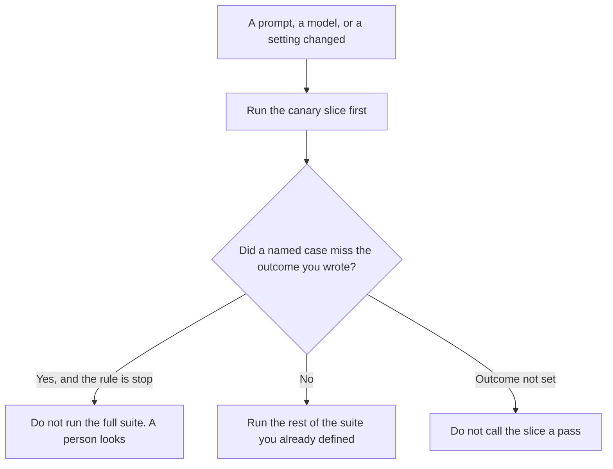

**An AI eval canary slice is a small set of eval cases a person chose, run before the full suite, so a known failure shows up while the run is still cheap.** The cases, the expected outcomes, and the rule for stopping are written down. The slice is not a sample of customers, and it is not a score for the whole model.

The frozen reference you trust as the standard is [what an AI eval golden set is](/blog/what-is-ai-eval-golden-set-2026/). A fixed probe against the live prompt is [what an AI prompt canary is](/blog/what-is-ai-prompt-canary-2026/). The line a metric must meet is [what an AI eval pass threshold is](/blog/what-is-ai-eval-pass-threshold-2026/). The block on a release is [what an AI eval gate is](/blog/what-is-ai-eval-gate-2026/). This page is the small set you run first.

Claude's prices are the October 24, 2026 read of claude.com/pricing recorded in [Claude pricing explained](/blog/claude-pricing-explained-2026/). Cursor's Plus price is the October 24 help-center figure recorded in [Cursor pricing explained](/blog/cursor-pricing-explained-2026/). ChatGPT's Plus price is the October 24 plan-page figure recorded in [ChatGPT pricing explained](/blog/chatgpt-pricing-explained-2026/). Notion is the October 16 directory card. Published October 24, 2026. We did not publish a pass rate. The directory does not list a canary-slice fee.

## What the slice has to include

| Field | Who writes it | A blank means |
|---|---|---|
| Which cases | You, a handful, named | The model picks easy rows |
| The expected outcome | You, or Outcome not set | A fluent answer looks like a pass |
| When it runs | You: before the suite, or on each change | It becomes a report nobody waits for |
| What a miss does | You: stop the suite, or warn | A failure is a footnote |
| Who may add a case | You | The slice grows into the whole suite |

A golden set is the reference you keep stable so later runs mean something. A canary slice can be drawn from that set, or it can be a shorter list you are willing to run on every change. The golden set does not have to be small. The slice does, or you will skip it. A prompt canary is one live probe on a timer. The slice is a batch of cases, usually before you ship, not a drip of production traffic.

A pass on the slice is not a pass on the suite. The threshold still applies to whatever you run. The gate still decides whether a miss blocks a release. The slice only moves the first look earlier.

## Where the cases live

**The outcomes, in words.** [Claude](/tools/claude/) Pro is $17 a month billed annually, $200 up front, or $20 monthly. Keep the expected outcome in a Project so a later edit does not soften a miss into a partial. The review is [Claude review](/blog/claude-review-2026/).

**The diff that should trigger the slice.** [Cursor](/tools/cursor/) Plus is $8 a month, or $80 a year. You review a change to the prompt or the grader. The slice runs before you treat the diff as done. The individual ladder is [Cursor pricing explained](/blog/cursor-pricing-explained-2026/).

**One table from cases you already have.** [ChatGPT](/tools/chatgpt/) Plus is $20 a month. It may format the list. It may not add a case or mark a row passed. The ladder is [ChatGPT pricing explained](/blog/chatgpt-pricing-explained-2026/).

**The page that names the owner.** [Notion AI](/tools/notion-ai/) Business is $20 a seat a month on the October 16 card. The case ids and the stop rule live there. The invoice is [Notion AI pricing explained](/blog/notion-ai-pricing-explained-2026/). The table you fill after a run is [how to create an AI eval scorecard with AI](/blog/how-to-create-an-ai-eval-scorecard-with-ai-2026/).

A prompt that holds the line:

"List the canary cases I pasted, with the outcome I wrote. If an outcome is missing, write Outcome not set. Do not add a case. Do not mark the slice passed."

## What not to delegate

Do not let the model choose "representative" cases. Do not drop a failing case to keep the slice green. Do not skip the full suite because the slice passed. The person who owns the eval names the rows.

## FAQ

### How is this different from a golden set?

The golden set is the frozen reference. The canary slice is a small subset you run first. Every slice case can also be in the golden set. The golden set can be too large to run on every edit. The slice exists so you still run something.

### How is this different from a prompt canary?

A prompt canary is one known probe sent through the live prompt on a schedule. The slice is several eval cases, run before the rest of the suite. One can trip the other. They are not the same artifact.

### How is this different from a pass threshold?

The threshold is the line a metric must meet. The slice is which cases you run before the others. A slice with no threshold can only say that a case ran. A threshold with no slice still applies to the full suite, later.

### Who may add a case?

The owner named on the page. A model that adds an easy case has changed the slice. Outcome not set is not a pass.

## Last verified

October 24, 2026 for Claude, for ChatGPT's plan page, and for Cursor's help page, via the posts cited above. October 16, 2026 for Notion. Published October 24, 2026. No canary-slice fee is recorded in the directory.

**Sources:** [Claude pricing](https://claude.com/pricing), [Cursor pricing](https://cursor.com/help/account-and-billing/pricing), [ChatGPT and Codex pricing](https://learn.chatgpt.com/docs/pricing), [Notion pricing](https://www.notion.com/pricing).

*Published by Andrew for [AI Tools Optimizer](https://aitoolsoptimizer.com).*

[Claude](/tools/claude/) is in the [chatbots and assistants directory](/tools/category/chatbots-assistants/). Directory pages may use affiliate links. A purchase through them may earn us a commission at no extra cost to you.
