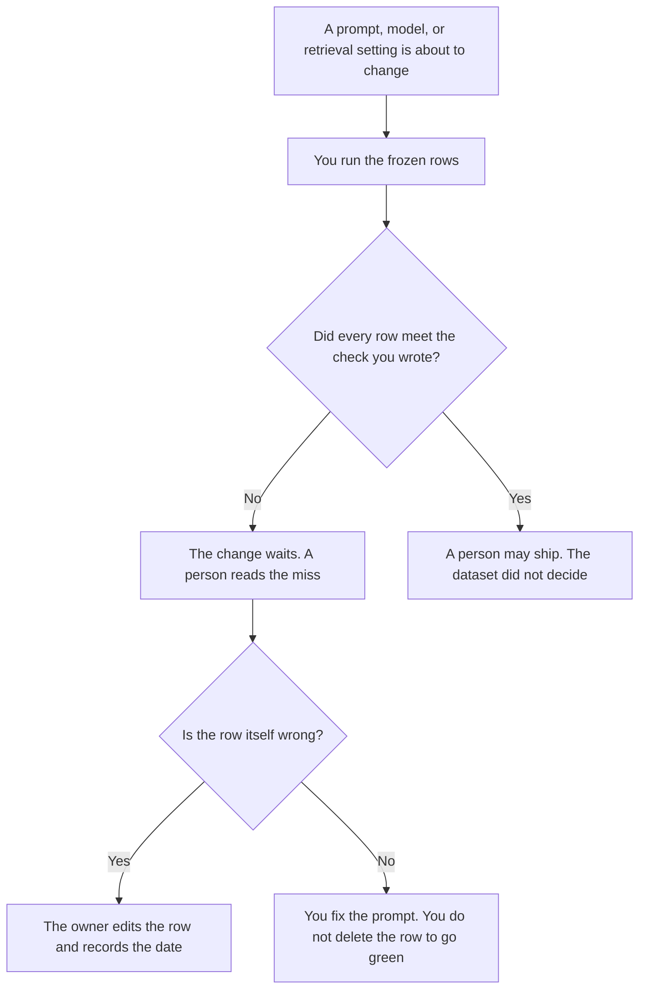

**An AI eval dataset is the frozen set of inputs, and the checks a person already wrote for those inputs, that you re-run when a prompt, a model, or a retrieval setting changes.** The dataset is the rows. The program that runs the rows is [what an AI eval harness is](/blog/what-is-ai-eval-harness-2026/). One input and one check, kept small enough to read, is [what prompt unit testing is](/blog/what-is-prompt-unit-testing-2026/). The practice of keeping a set you can re-run is [what AI eval testing is](/blog/what-is-ai-eval-testing-2026/). This page is the table those three depend on.

A score someone else published for a public benchmark is not your dataset. Fake rows you generated to fill a gap are [what synthetic data is](/blog/what-is-synthetic-data-2026/), and they carry a different risk. Whether a retrieved page supports the sentence is [what AI groundedness is](/blog/what-is-ai-groundedness-2026/).

Prices are US list prices excluding tax from directory pages checked October 16, 2026. Published October 24, 2026. We did not score models. A dataset with no owner is a spreadsheet that will drift.

## What a row has to contain

| Column | Who fills it | The model may |
|---|---|---|
| Input | A real example you are allowed to store, or a fixture you wrote | Copy it. It may not "improve" the example |
| Check | The pass rule you wrote: a phrase that must appear, a field that must match, a source that must be cited | Apply the rule. It may not soften it |
| Owner | A person who can say the row is still valid | Copy the name. It may not write "the team" |
| Source of the row | Production sample, support ticket, or a fixture you authored | Leave the label. A fixture is not a customer |
| Last reviewed | The date someone re-read the row | Copy the date. It may not mark the row current |

Deleting a failing row to make the run pass is how the dataset stops meaning anything. The version of the wording you are testing is [what prompt versioning is](/blog/what-is-prompt-versioning-2026/). A check that the last good answer still passes is [what prompt regression testing is](/blog/what-is-prompt-regression-testing-2026/).

## Where the rows live

**The draft of a new row.** [Claude](/tools/claude/) Pro is $20 a month, or $17 billed annually, when you paste a failing transcript and ask for a check you could apply by hand. Discard any check the model invented that you would not fail a release over. The review is [Claude review](/blog/claude-review-2026/).

**A second formatting.** [ChatGPT](/tools/chatgpt/) Plus at $20 a month can turn a messy thread into the columns above. The input stays the text you pasted. The review is [ChatGPT review](/blog/chatgpt-review-2026/).

**The table.** [Notion AI](/tools/notion-ai/) Business is $20 a seat a month if the dataset is a database the team can open. Free includes a trial of Notion AI. The database is the record. The chat is not.

**The file next to the prompt.** [GitHub Copilot](/tools/github-copilot/) Pro is $10 a user a month if the rows are a file in the repo. Copilot does not know whether a row is still a fair test. The invoice is [GitHub Copilot pricing explained](/blog/github-copilot-pricing-explained-2026/).

A prompt that holds the line:

"Turn this transcript into one eval row. Copy the user text as the input. Propose a check I can apply by looking. If the transcript does not contain a clear pass rule, write Missing. Do not invent a score."

## What to keep out

Keep out secrets, payment data, and anything your retention rule says you may not store for testing. Keep out rows nobody will re-read. A dataset of 2,000 unread rows is a pile. A dataset of 40 rows with owners is a gate. When you generate rows to cover a case you have never seen, label them synthetic and do not treat a pass on them as a pass on customers.

## FAQ

### How many rows do we need?

Enough to catch the failures you already had, plus the cases you refuse to ship. Start with the last ten bugs and the five answers a person said must stay true. Add a row when a real miss happens. A round number is not a quality bar.

### Can the model write the expected answer?

Only when a person checks that answer against a source and signs the row. An expected answer the model wrote, graded by the same model, measures consistency with itself. Label those rows as drafts until someone who knows the domain accepts them.

### Is a public benchmark our eval dataset?

No. A public benchmark measures a general task on someone else's items. Your dataset measures the tasks your product actually does, on inputs you are allowed to keep. You can use both. Shipping because a leaderboard moved is a different decision, and this page does not make it.

### Who updates a row when the product changes?

The owner on the row. If the check describes an old policy, the owner edits the check and dates it. The harness should fail closed on a row with no owner, the same way a release checklist fails closed on a gate with no name.

## Last verified

October 16, 2026 for Claude, ChatGPT, Notion AI, and GitHub Copilot. Published October 24, 2026.

**Sources:** [Claude pricing](https://claude.com/pricing), [ChatGPT pricing](https://chatgpt.com/pricing/), [Notion pricing](https://www.notion.com/pricing), [GitHub Copilot](https://github.com/features/copilot).

*Published by Andrew for [AI Tools Optimizer](https://aitoolsoptimizer.com).*

[Claude](/tools/claude/) is in the [chatbots and assistants directory](/tools/category/chatbots-assistants/). Directory pages may use affiliate links. A purchase through them may earn us a commission at no extra cost to you.
