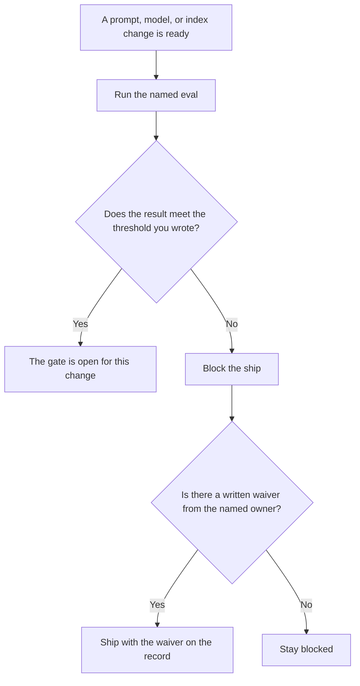

**An AI eval gate is the release rule that blocks a prompt, model, or retrieval change unless a named eval meets a threshold a person already wrote.** The rows you re-run are [what an AI eval dataset is](/blog/what-is-ai-eval-dataset-2026/). The program that runs those rows is [what an AI eval harness is](/blog/what-is-ai-eval-harness-2026/). The check on one live response, after the change has shipped, is [what AI output validation is](/blog/what-is-ai-output-validation-2026/). This page is the block: ship, or do not ship.

Putting one version on a small slice of real traffic is [what an AI canary deployment is](/blog/what-is-ai-canary-deployment-2026/). Re-running the same prompts after an edit, offline, is [what prompt regression testing is](/blog/what-is-prompt-regression-testing-2026/). The wider practice is [what AI eval testing is](/blog/what-is-ai-eval-testing-2026/).

Prices are US list prices excluding tax from directory pages checked October 16, 2026. A live fetch of several vendor pricing pages returned HTTP 401 on October 24, 2026, so this page stays on the directory record. Published October 24, 2026. The directory does not list an eval-gate fee. We did not publish a score for any model.

## What the gate needs before it can block anything

| Piece | You write | A gate that will wave everything through |
|---|---|---|
| Eval name | The dataset and the harness id | "The usual tests" |
| Threshold | The number that fails the release | "Looks fine" |
| Scope | Which change this gate covers | Every edit in the repo, including a typo in a comment |
| Waiver | Who may ship anyway, and where that waiver is written | A chat message that says ship it |
| Record | The result, the threshold, and the commit | A green badge with no row behind it |

A public benchmark score is not your gate. Your gate names your dataset. A gate with no threshold is a report. Reports inform people. Gates stop a merge.

## Where the threshold is kept

**The rubric.** [Claude](/tools/claude/) Pro is $20 a month, or $17 billed annually, when the threshold and the waiver rule are a page a second person will read. The model may format the page. It may not pick the number. The review is [Claude review](/blog/claude-review-2026/).

**The check in the repo.** [Cursor](/tools/cursor/) Plus is $8 a month, or $80 a year, when the gate is a script or a required check. You review the diff. A generated change that turns a failure into a warning has removed the gate. The ladder is [Cursor pricing explained](/blog/cursor-pricing-explained-2026/).

**A short record of the result.** [ChatGPT](/tools/chatgpt/) Plus is $20 a month can format the row you will paste into the release note: eval name, result, threshold, commit. It may not round a miss into a pass.

**Completions beside the diff.** [GitHub Copilot](/tools/github-copilot/) Pro is $10 a user a month when the gate lives in a pull request you already review. The invoice is [GitHub Copilot pricing explained](/blog/github-copilot-pricing-explained-2026/). Copilot does not decide the threshold.

A prompt that holds the line:

"Format an eval-gate card from the eval name, threshold, scope, and waiver owner I pasted. Do not invent a threshold. If the threshold is missing, write Threshold missing and stop."

## What not to delegate

Do not let a model raise the threshold after a bad run so the change can ship. Do not skip the gate because the canary "will catch it." The canary is what you do after a gate has passed, on a slice, with a way back. A waiver is a sentence with a name and a reason, stored with the result.

## FAQ

### How is a gate different from a dataset?

The dataset is the rows. The gate is the rule that those rows can stop a release. You can have a dataset and still ship on a shrug. The gate is the shrug, removed.

### How is it different from output validation?

Output validation checks one response before you show it or let a tool act. The eval gate checks a change before that change becomes the version users hit. You want both. They fail at different times.

### What is a fair threshold?

The one you can explain on the release call. Copying a number from a leaderboard, including any number you wish this page had printed, is how a gate blocks a good fix or passes a bad one. This page does not recommend a universal score.

### Who can waive a failure?

The owner named on the card, in writing, with the result still attached. A waiver that deletes the result is not a waiver. It is a missing record.

## Last verified

October 16, 2026 for Claude, Cursor, ChatGPT, and GitHub Copilot. No eval-gate fee is recorded in the directory. Published October 24, 2026.

**Sources:** [Claude pricing](https://claude.com/pricing), [Cursor pricing](https://cursor.com/help/account-and-billing/pricing), [ChatGPT pricing](https://chatgpt.com/pricing/), [GitHub Copilot](https://github.com/features/copilot).

*Published by Andrew for [AI Tools Optimizer](https://aitoolsoptimizer.com).*

[Cursor](/tools/cursor/) is in the [coding directory](/tools/category/coding/). Directory pages may use affiliate links. A purchase through them may earn us a commission at no extra cost to you.
