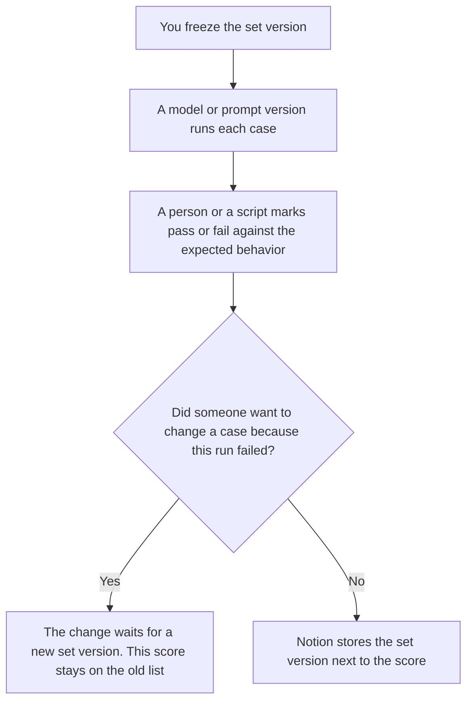

**An AI eval golden set is a frozen list of cases: an input a person saved, and the behavior a person wrote down as the expected result.** You score a model, a prompt version, or a retrieval change against that list. You do not edit the list in the same hour because a run looked bad. A check of the prompt text, before any model runs, is [what an AI prompt unit test is](/blog/what-is-ai-prompt-unit-test-2026/). The sheet that records how a retrieval run did is [how to create a RAG eval scorecard with AI](/blog/how-to-create-a-rag-eval-scorecard-with-ai-2026/).

The share of relevant passages you meant to get back is [what an AI retrieval recall target is](/blog/what-is-ai-retrieval-recall-target-2026/). A golden set can include a recall case. The target is the number. The set is the cases.

Claude's prices are the October 24, 2026 read of claude.com/pricing recorded in [Claude pricing explained](/blog/claude-pricing-explained-2026/). ChatGPT's Plus price is the same-day plan-page figure recorded in [ChatGPT vs Claude for stakeholder updates](/blog/chatgpt-vs-claude-for-stakeholder-updates-2026/). Notion and Cursor prices are from directory pages checked October 16, 2026. Published October 24, 2026. We did not score a model. The directory does not list a golden-set fee.

## What a case is allowed to contain

| Field | Who writes it | A blank means |
|---|---|---|
| Case id | You | Two people can edit different rows and think they are one case |
| Input | You, frozen | The model is graded on a prompt nobody saved |
| Expected behavior | You, in words or a schema you already use | A reviewer invents "good" after seeing the output |
| Owner | A person | Nobody can refuse a quiet edit |
| Set version | You | A score from last month is compared with a list that changed |

A golden set that grows every time a stakeholder dislikes a sentence is a complaint log. Keep the complaint. Ship it as a new version, with a date, after the owner adds the case on purpose. Do not overwrite the input that last month's score used.

The set does not contain a quality rating of the vendor. Pass means the output matched the behavior you wrote. It does not mean the product is better than another product.

## Where the set is kept

**The draft of a new case.** [Claude](/tools/claude/) Pro is $17 a month billed annually, $200 up front, or $20 monthly, on that October 24 read. The Project holds the column names. The review is [Claude review](/blog/claude-review-2026/).

**One case from a short paste.** [ChatGPT](/tools/chatgpt/) Plus is $20 a month on the October 24 plan page. Go is $8 a month on that same page. Plus is the seat for a saved case. The ladder is [ChatGPT pricing explained](/blog/chatgpt-pricing-explained-2026/).

**The register.** [Notion AI](/tools/notion-ai/) Business is $20 a seat a month. One database, one row per case, the set version in the title. Plus at $10 is not the full AI tier. The invoice is [Notion AI pricing explained](/blog/notion-ai-pricing-explained-2026/).

**The diff, if the set lives in a repo.** [Cursor](/tools/cursor/) Plus is $8 a month, or $80 a year, on the October 16 card. You review the diff that adds a case. The ladder is [Cursor pricing explained](/blog/cursor-pricing-explained-2026/).

A prompt that holds the line:

"Draft a golden-set row from the case id, the input, and the expected behavior I pasted. If the expected behavior is missing, write Expected behavior not set. Do not add a case. Do not mark pass."

## What not to delegate

Do not ask the model which cases are "representative." Do not let a failed run rewrite the expected behavior so the score turns green. Do not mix a prompt-text check into this list and call both a golden set. The owner adds a case. A score is computed against the version that was frozen.

## FAQ

### How is this different from a prompt unit test?

The unit test checks the prompt file: a version, an owner, a required clause, a forbidden phrase. It can fail before any model runs. The golden set is inputs and expected behaviors you run. A prompt can pass the unit test and fail the set. Keep both. Do not delete the unit test because the set exists.

### How is this different from a RAG eval scorecard?

The scorecard records a retrieval run: what you asked, what came back, and the marks for that run. The golden set is the cases you promised to keep stable. The scorecard can cite a set version. It is not the set. If the scorecard has no set version, you cannot tell which list it used.

### How is this different from a recall target?

The recall target is the share of relevant passages you said you needed. A golden set can hold the questions you use to measure that share. The target does not list the questions. A set without a target is still a set. A target without cases is a number you cannot rerun.

### Who may change a case?

The owner named on the row, in a new set version. A model suggestion is not a version. Last month's score stays attached to the old version. Do not renumber the old rows to hide the edit.

## Last verified

October 24, 2026 for the Claude and ChatGPT figures, via the posts cited above. October 16, 2026 for Notion and Cursor. Published October 24, 2026.

**Sources:** [Claude pricing](https://claude.com/pricing), [ChatGPT and Codex pricing](https://learn.chatgpt.com/docs/pricing), [Notion pricing](https://www.notion.com/pricing), [Cursor pricing](https://cursor.com/help/account-and-billing/pricing).

*Published by Andrew for [AI Tools Optimizer](https://aitoolsoptimizer.com).*

[Cursor](/tools/cursor/) is in the [coding directory](/tools/category/coding/). Directory pages may use affiliate links. A purchase through them may earn us a commission at no extra cost to you.
