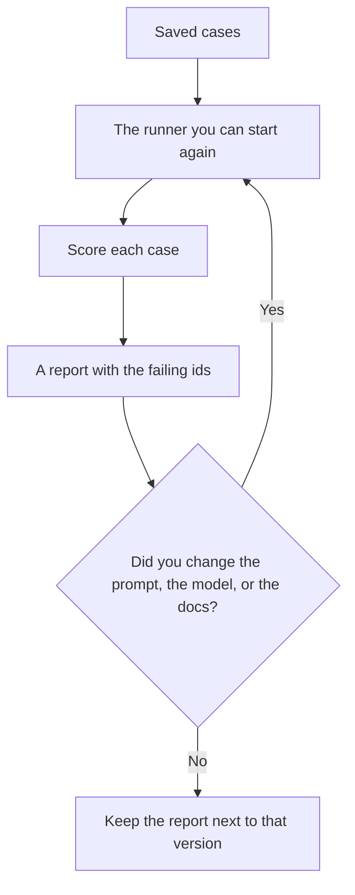

**An AI eval harness is the set of files and the runner that execute your tests the same way every time: the cases, the score rule, and the report.** The habit of deciding which tasks matter is [what AI eval testing is](/blog/what-is-ai-eval-testing-2026/). The harness is how that habit survives a model upgrade without living in someone's memory.

A demo is one chat. A harness is the command, notebook, or script that runs the saved chats and writes pass or fail. If you cannot run it next month, you have notes, not a harness.

Published October 24, 2026. This page does not rank eval vendors. The directory does not list a separate "eval platform" price, so this page does not invent one.

## The pieces you can point at

| Piece | Where it sits | Missing when |
|---|---|---|
| Cases | A file of inputs, with the private data removed | The only copy is a screenshot |
| Expected behavior | The answer, the refusal, or the tool you wanted | The scorer is "looks fine" |
| Runner | A script, a notebook, or a product button you can press again | You retype the prompts by hand |
| Report | A list of failures, with the case id | You get one average and no row |
| Pin | The model name and the prompt version | The report does not say what changed |

An average of 92% can hide a broken refund case. Keep the failing ids. The mistake you are trying to see is [what an AI hallucination is](/blog/what-is-ai-hallucination-2026/).

## What can play the role of a harness

**A file in the repo, plus a person.** Twenty cases in a spreadsheet and a short script are a harness. [Claude](/tools/claude/) Pro is $20 a month, or $17 billed annually, and includes Claude Code. [ChatGPT](/tools/chatgpt/) Plus is $20 and includes expanded Codex usage. Either can help you format the file. The model that wrote the answer should not be the only thing that marks it correct. The coding seat, if the runner is code, is a different choice: [ChatGPT vs Gemini for coding](/blog/chatgpt-vs-gemini-for-coding-2026/).

**A notebook your data team already opens.** [Hex](/tools/hex/) Professional is $36 per editor per month on the directory card checked October 16, 2026. Put the scores there when they are rows you will chart. A twelve-row prompt check does not need a warehouse.

**The product's own test step, if the cases are yours.** [Chatbase](/tools/chatbase/) tells you to test an agent before it goes live. Hobby is $32 a month billed yearly for 700 message credits, on the October 16 directory card. That button is a harness only when the questions and the expected answers came from your articles. A canned demo set is a tour.

**A gate in the workflow.** If a prompt change ships through git, the harness can run in the same pipeline as a test. The people who own that pipeline are the audience of [best AI tools for QA engineers](/blog/best-ai-tools-for-qa-engineers-2026/). The pass-or-block around a live answer is [what AI guardrails are](/blog/what-is-ai-guardrails-2026/). A harness runs before you ship. A guardrail runs while the product is on.

## What a harness will not do

It will not notice a harm you never wrote down as a case. Adding a case is a decision. The scheduled look for failures you defined in policy, described at the product level, is [what AI red teaming is](/blog/what-is-ai-red-teaming-2026/).

It will not make a vague rubric precise. "Be helpful" passes fluent wrong answers. "The date in the reply matches the source, or the reply says the source has no date" can fail. Write the second rule into the scorer.

It will not replace reading. Open the new failures. A green report you did not sample is a number.

When the cases include a tool call, name the tool you expected. That pattern is [what function calling is](/blog/what-is-function-calling-in-ai-2026/). When several steps hand work around, the harness should score the handoff you care about, which is [what AI agent orchestration is](/blog/what-is-ai-agent-orchestration-2026/).

## FAQ

### Is an eval harness the same as a unit test?

It is the same idea: a saved input, a check, a runner. Model outputs vary, so many checks are "contains this fact" or "refuses" rather than "equals this string." You still keep the case in version control.

### How many cases do we need?

Enough to cover the slices that would embarrass you: the refund rule, the citation, the refusal, the empty input. Twenty honest cases beat two hundred generated ones that all look like the happy path. Add a case when production surprises you.

### Can we score with another model?

You can use a second model to flag rows that disagree with the source. A person still opens those rows. The habit is [how to fact-check AI writing](/blog/how-to-fact-check-ai-writing-2026/).

### Do we need to buy an eval product first?

No. Start with a file and a runner you can launch. Buy a product when the file is too awkward to keep, not before you have cases.

## Last verified

October 16, 2026 for Claude, ChatGPT, Chatbase, and Hex prices named above. Published October 24, 2026.

**Sources:** [Claude pricing](https://claude.com/pricing), [ChatGPT pricing](https://chatgpt.com/pricing), [Hex pricing](https://hex.tech/pricing).

*Published by Andrew for [AI Tools Optimizer](https://aitoolsoptimizer.com).*

[Claude](/tools/claude/) is in the [chatbots and assistants directory](/tools/category/chatbots-assistants/). Directory pages may use affiliate links. A purchase through them may earn us a commission at no extra cost to you.
