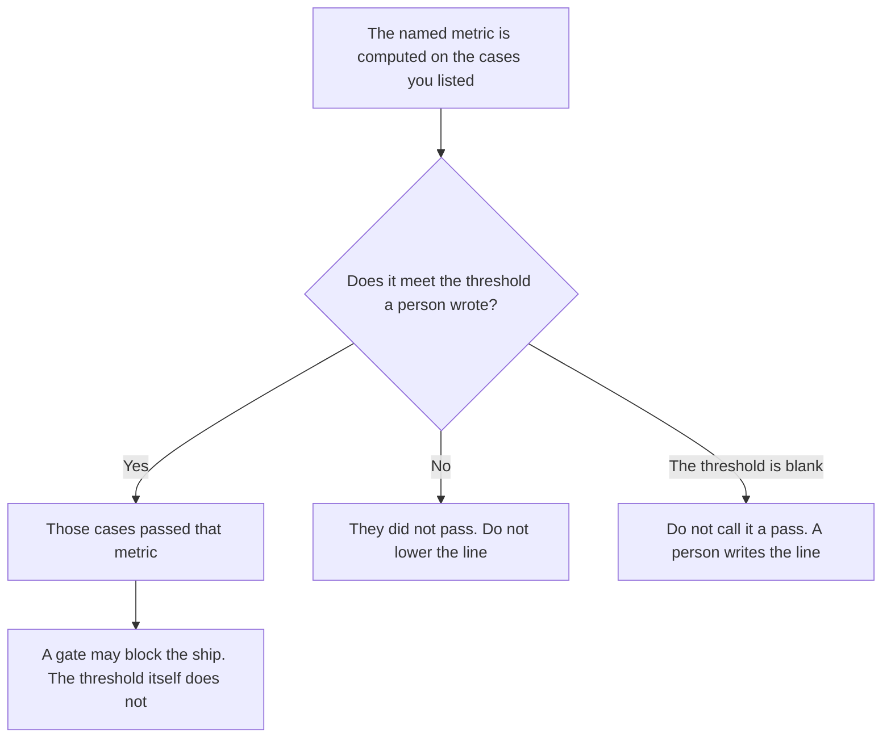

**An AI eval pass threshold is the number, or the named outcome, a person wrote that a named metric must meet to count as a pass.** Below that line, the case did not pass. The rule that blocks a release unless the threshold is met is [what an AI eval gate is](/blog/what-is-ai-eval-gate-2026/). The notice that a named case got worse is [what an AI eval regression alert is](/blog/what-is-ai-eval-regression-alert-2026/). This page is the line. A gate with no threshold is a slogan. A threshold with no gate does not block a ship.

The rows you re-run are [what an AI eval dataset is](/blog/what-is-ai-eval-dataset-2026/). A frozen subset you trust as the reference is [what an AI eval golden set is](/blog/what-is-ai-eval-golden-set-2026/). The threshold does not choose the rows. You do.

Claude's prices are the October 24, 2026 read of claude.com/pricing recorded in [Claude pricing explained](/blog/claude-pricing-explained-2026/). Cursor's Plus price is the October 24 help-center figure recorded in [Cursor Business pricing explained](/blog/cursor-business-pricing-explained-2026/). ChatGPT's Plus price is the October 24 plan-page figure recorded in [ChatGPT pricing explained](/blog/chatgpt-pricing-explained-2026/). Notion is the October 16 directory card. Published October 24, 2026. We did not publish a pass rate. The directory does not list a threshold fee.

## What the threshold has to say

| Line | Who writes it | A blank means |
|---|---|---|
| The metric | You | "Quality" passes when the model says so |
| The line | You: a number, or a named outcome | A higher score is treated as good enough |
| The direction | You: at least, or at most | A lower error rate and a higher score get averaged |
| Which cases | You | One easy case sets the bar for the suite |
| Who may move it | A person, with a date | A failed run lowers the line |

A threshold of "better than last week" is not a threshold until last week's number is written down. A model that reports 0.91 has not passed a line you never set. This article does not supply that 0.91. It is an example of a shape, not a result we measured.

The alert's line for "worse" can differ from the pass line. A case can still pass and still be worse than yesterday. Write both lines if you need both. Do not let a model pick one number that serves as pass, alert, and ship decision.

## Where the line is written

**The sentence.** [Claude](/tools/claude/) Pro is $17 a month billed annually, $200 up front, or $20 monthly. Keep the metric name and the line in a Project so a later edit does not round it. The review is [Claude review](/blog/claude-review-2026/).

**The diff, if the line lives next to the suite.** [Cursor](/tools/cursor/) Plus is $8 a month, or $80 a year, on the October 24 help page. You review a diff that changes the number. The individual ladder is [Cursor pricing explained](/blog/cursor-pricing-explained-2026/).

**One draft of the line from a paste.** [ChatGPT](/tools/chatgpt/) Plus is $20 a month. Discard a version that invents a metric or a number. The ladder is [ChatGPT pricing explained](/blog/chatgpt-pricing-explained-2026/).

**The page that records the current line.** [Notion AI](/tools/notion-ai/) Business is $20 a seat a month. The row is the metric, the line, the date, and the owner. Plus at $10 is not the full AI tier. The invoice is [Notion AI pricing explained](/blog/notion-ai-pricing-explained-2026/).

A prompt that holds the line:

"Write the pass threshold from the metric and the line I pasted. If either is missing, write Threshold not set. Do not invent a number. Do not say the suite passed."

## What not to delegate

Do not let a failed run lower the threshold. Do not treat a single case as the suite. Do not call a ship blocked only because a threshold exists. The gate is a separate rule. The owner writes the line before the run.

## FAQ

### How is a threshold different from an eval gate?

The threshold is the line a metric must meet to count as a pass. The gate is the release rule that blocks a ship unless that line is met. You can record a pass and a fail with no gate at all. You should not block a release on a line nobody wrote. Use the gate page for the block. Use this page for the number or the named outcome.

### How is it different from a regression alert?

The alert fires when a named case got worse past a line you wrote, and it notifies someone. The pass threshold says what counts as a pass. A case can pass and still trigger an alert if it dropped. A case can fail the threshold without anyone being paged, if you never wrote an alert. Write both, or write the one you mean.

### Does a golden set replace the threshold?

The golden set is which cases you trust as the reference. The threshold is the line on a metric over the cases you named. A frozen set with no line still needs a person to say what a pass is. A line with no cases is a number in a vacuum.

### Who may change the threshold?

The owner of the eval. A model that missed the old line does not get a new line. The change has a date. Yesterday's runs stay scored against the line they used.

## Last verified

October 24, 2026 for Claude, for Cursor's help page, and for ChatGPT's plan page, via the posts cited above. October 16, 2026 for Notion. No pass rate is published in this article. Published October 24, 2026.

**Sources:** [Claude pricing](https://claude.com/pricing), [Cursor pricing](https://cursor.com/help/account-and-billing/pricing), [ChatGPT and Codex pricing](https://learn.chatgpt.com/docs/pricing), [Notion pricing](https://www.notion.com/pricing).

*Published by Andrew for [AI Tools Optimizer](https://aitoolsoptimizer.com).*

[Cursor](/tools/cursor/) is in the [coding directory](/tools/category/coding/). Directory pages may use affiliate links. A purchase through them may earn us a commission at no extra cost to you.
