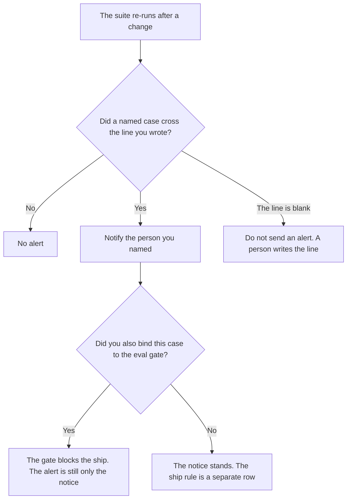

**An AI eval regression alert is a notice that a named case, or a metric a person already defined, got worse after a change, past a line that person wrote.** The notice can page someone. It does not by itself block the ship. The cases you re-run are [what an AI eval regression suite is](/blog/what-is-ai-eval-regression-suite-2026/). The rule that blocks a release is [what an AI eval gate is](/blog/what-is-ai-eval-gate-2026/). This page is the notice. A case that "looks worse" is not an alert until the line and the recipient exist.

Re-running prompts after an edit, offline, is [what prompt regression testing is](/blog/what-is-prompt-regression-testing-2026/). The rows in the suite are [what an AI eval dataset is](/blog/what-is-ai-eval-dataset-2026/). A drift signal on embeddings, which is a different meter, is [what an AI embedding drift alert is](/blog/what-is-ai-embedding-drift-alert-2026/).

Claude's prices are the October 24, 2026 read of claude.com/pricing recorded in [Claude pricing explained](/blog/claude-pricing-explained-2026/). Cursor's Plus price is the October 24 help-center figure recorded in [Cursor Business pricing explained](/blog/cursor-business-pricing-explained-2026/). ChatGPT's Plus price is the October 24 plan-page figure recorded in [ChatGPT pricing explained](/blog/chatgpt-pricing-explained-2026/). Notion is the October 16 directory card. Published October 24, 2026. We did not publish a pass rate. The directory does not list an alert fee.

## What the alert has to say

| Line | Who writes it | A blank means |
|---|---|---|
| Which case, or which metric | You | A vague "quality dropped" page |
| The line that counts as worse | You, as a number or a named outcome | The model decides the drop was serious |
| Who is notified | You | The notice sits in a log |
| Whether the ship is blocked | You: alert only, or also the gate | A page is treated as a block |
| The change that was compared | You: prompt id, model id, or date | The alert cannot name what moved |

An alert without a suite has nothing to compare. A suite without an alert can still be read by a person. A gate without an alert can block a release in silence. If you want both a page and a block, write both rows. Do not describe the page as the block.

The line is yours. If you did not write "this case must still pass" or "this count may fall by at most N," the cell says Line not set. The model does not pick N. A single example that looks better is not a reason to silence the alert. The triage after a failure is [how to create an eval failure triage with AI](/blog/how-to-create-an-eval-failure-triage-with-ai-2026/).

## Where the notice is defined

**The definition of the line.** [Claude](/tools/claude/) Pro is $17 a month billed annually, $200 up front, or $20 monthly. The Project holds the case id, the line, and the recipient so a later edit does not soften them. The review is [Claude review](/blog/claude-review-2026/).

**The diff, if the alert lives next to the suite.** [Cursor](/tools/cursor/) Plus is $8 a month, or $80 a year, on the October 24 help page. You review a diff that deletes a recipient. The ladder is [Cursor pricing explained](/blog/cursor-pricing-explained-2026/).

**One notice, from a paste of the case and the line.** [ChatGPT](/tools/chatgpt/) Plus is $20 a month. Discard a version that adds a severity word you did not write. The ladder is [ChatGPT pricing explained](/blog/chatgpt-pricing-explained-2026/).

**The log the team keeps.** [Notion AI](/tools/notion-ai/) Business is $20 a seat a month. One row per alert: case, line, recipient, date. Plus at $10 is not the full AI tier. The invoice is [Notion AI pricing explained](/blog/notion-ai-pricing-explained-2026/).

A prompt that holds the line:

"Draft the alert row from the case, the line, and the recipient I pasted. If the line is missing, write Line not set. Do not pick a threshold. Do not say the release is blocked unless I said the gate is bound."

## What not to delegate

Do not ask which regressions are "bad enough to page." Do not turn off an alert because the new prompt reads better on one example. Do not treat a page as a ship block. The owner of the suite sets the line. A formatted message is not the alert.

## FAQ

### How is this different from a regression suite?

The suite is the fixed set of cases you re-run. The alert is the notice when a named case crosses a line. You can re-run a suite and read it yourself with no alert. You should not fire an alert for a case the suite does not contain. Use the suite page for the cases. Use this page for the notice.

### How is this different from an eval gate?

The gate blocks a ship unless a threshold you wrote is met. The alert tells a person something got worse. A gate can block with no page. An alert can page with no block. If both exist, say so on two rows. A Slack message is not a release rule.

### How is this different from prompt regression testing?

That page is the habit of re-running prompts after an edit and keeping the diff. An alert is what you send when a diff you already defined counts as worse. Testing can happen with no notice. A notice without a re-run is a guess. Run the test. Then apply the line.

### Who may change the line?

The person named on the row. Moving the line, or removing a recipient, is a new version, with a date. An alert that already fired stays fired under the line that was in force. The model does not relax the line after a noisy week.

## Last verified

October 24, 2026 for Claude, for ChatGPT's plan page, and for Cursor's help page, via the posts cited above. October 16, 2026 for Notion. Published October 24, 2026.

**Sources:** [Claude pricing](https://claude.com/pricing), [ChatGPT and Codex pricing](https://learn.chatgpt.com/docs/pricing), [Cursor pricing](https://cursor.com/help/account-and-billing/pricing), [Notion pricing](https://www.notion.com/pricing).

*Published by Andrew for [AI Tools Optimizer](https://aitoolsoptimizer.com).*

[Cursor](/tools/cursor/) is in the [coding directory](/tools/category/coding/). Directory pages may use affiliate links. A purchase through them may earn us a commission at no extra cost to you.
