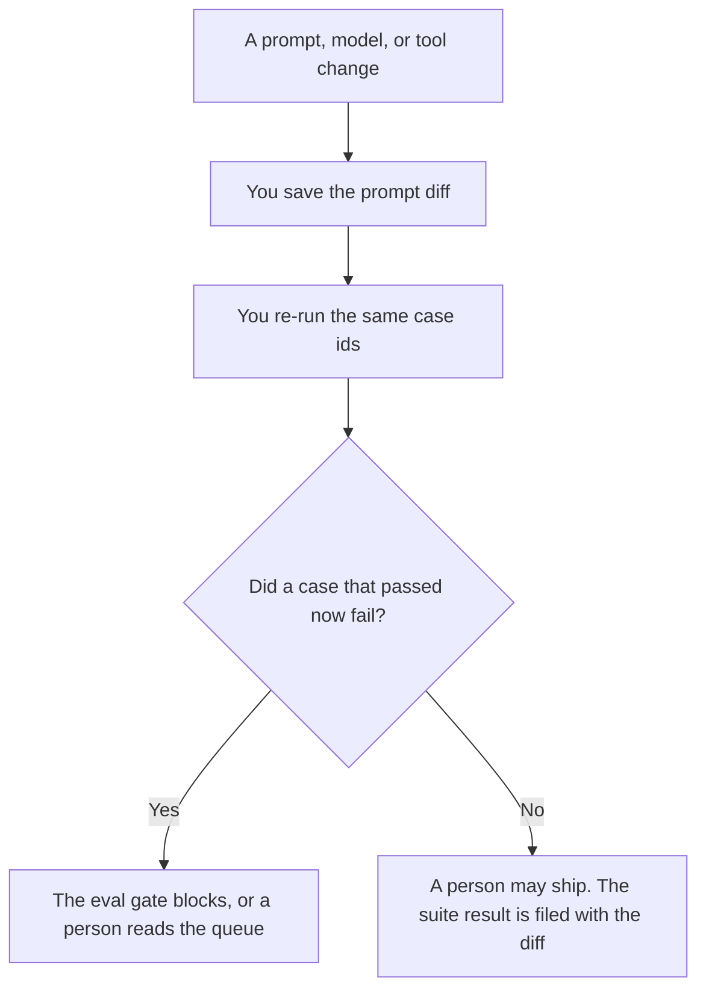

**An AI eval regression suite is a fixed set of cases you re-run when the prompt, the model, the tool, or the retrieved text changes, so you can see which cases got worse.** The rows themselves are [what an AI eval dataset is](/blog/what-is-ai-eval-dataset-2026/). The rule that blocks a release when a case fails is [what an AI eval gate is](/blog/what-is-ai-eval-gate-2026/). The suite is the habit of running the same cases again and keeping the diff. A new prompt that "looks better" on one example is not a suite.

The line-by-line change you are testing is [what an AI prompt diff is](/blog/what-is-ai-prompt-diff-2026/). A person still reads the failures in [what an AI human review queue is](/blog/what-is-ai-human-review-queue-2026/).

Claude's prices are from claude.com/pricing on October 24, 2026. Cursor, ChatGPT, and Notion prices are from directory pages checked October 16, 2026. chatgpt.com/pricing returned HTTP 403 on October 24. Published October 24, 2026. We did not publish a pass rate.

## What belongs in a re-run

| Piece | Who owns it | The model may |
|---|---|---|
| The case id and the input | You, from production failures and the dataset | Format the row. It may not add a case |
| The expected check | You, as a rule a second person can apply | Phrase the check. It may not soften a failure into a pass |
| The before and after outputs | The run you just executed | Place them side by side. It may not "fix" the after |
| The decision to ship | The gate, then a person if the gate says review | Not make that decision |

A suite that changes its cases on the same day as the prompt cannot tell you what regressed. Add cases in a separate change. If a case is wrong, fix the case, then re-run. Do not delete a failing case to make the sheet green.

The dataset can be large. The suite you re-run on every prompt edit can be the slice you named: the ten failures from last quarter, the five policy sentences, the three tool calls that must keep their schema. Name the slice. A "full eval" you never finish is not a regression suite.

## Where the result is kept

**The write-up of a failure.** [Claude](/tools/claude/) Pro is $17 a month billed annually, $200 up front, or $20 monthly, on the October 24 page. Paste the before and after. Ask for a list of case ids that flipped. The review is [Claude review](/blog/claude-review-2026/).

**The run, next to the diff.** [Cursor](/tools/cursor/) Plus is $8 a month, or $80 a year, on the October 16 card. The suite is a command you can re-run. A generated edit that skips a case id is a defect. The ladder is [Cursor pricing explained](/blog/cursor-pricing-explained-2026/).

**One comparison.** [ChatGPT](/tools/chatgpt/) Plus is $20 a month on the October 16 card. Free can format a single before-and-after. Discard a summary that says the new prompt is "more helpful" and does not name a case id.

**The page the team opens.** [Notion AI](/tools/notion-ai/) Business is $20 a seat a month on the October 16 card. Plus at $10 is not the full AI tier. The suite result lives next to the prompt version. The invoice is [Notion AI pricing explained](/blog/notion-ai-pricing-explained-2026/).

A prompt that holds the line:

"List case ids whose check flipped from pass to fail, using only the results I pasted. Do not add a case. Do not call a fail a pass. If a case id has no after result, write Not run."

## What not to delegate

Do not ask which model "won." Do not average the failures into a single score and throw away the ids. Do not let a green run on a smaller slice stand in for the slice you promised. The gate article says what a failure blocks. This article says which cases you owe yourself on the next change.

## FAQ

### How is a regression suite different from an eval dataset?

The dataset is the library of cases. The suite is the set you re-run for this kind of change, and the record of before and after. You can add to the dataset daily and still re-run a named slice on each prompt diff.

### How is it different from an eval gate?

The suite produces the results. The gate reads those results and blocks or allows a release under a rule you wrote. A suite with no gate is a report. A gate with no suite is a threshold with nothing to measure.

### How many cases are enough?

The number you will actually re-run. Start with failures you have already seen in production and the policy lines you cannot break. A thousand cases you do not re-run is a dataset. It is not a regression suite yet.

### Can the model grade the new output?

Only with the check you wrote. A paragraph about tone is not a check, unless tone is the check and you defined the fail. Subjective grades go to the human review queue, with the case id attached.

## Last verified

October 24, 2026 for Claude. October 16, 2026 for Cursor, ChatGPT, and Notion. No eval-suite product fee is recorded in the directory. Published October 24, 2026.

**Sources:** [Claude pricing](https://claude.com/pricing), [Cursor pricing](https://cursor.com/help/account-and-billing/pricing), [ChatGPT pricing](https://chatgpt.com/pricing/), [Notion pricing](https://www.notion.com/pricing).

*Published by Andrew for [AI Tools Optimizer](https://aitoolsoptimizer.com).*

[Cursor](/tools/cursor/) is in the [coding directory](/tools/category/coding/). Directory pages may use affiliate links. A purchase through them may earn us a commission at no extra cost to you.
