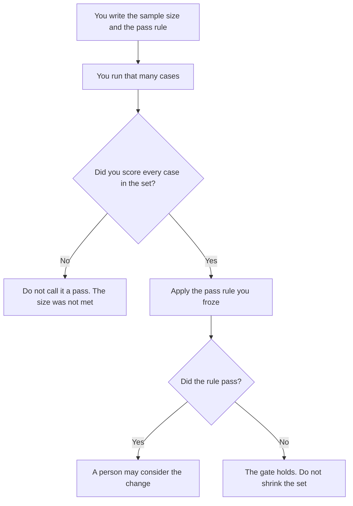

**An AI eval sample size is the number of cases you wrote down, before you looked at the results, as the set that will decide a pass or a fail for one change.** It is not a magic count this page will invent, and it is not a claim that the result is statistically significant. The cases themselves are [what an AI eval dataset is](/blog/what-is-ai-eval-dataset-2026/). The suite you re-run so a change cannot quietly get worse is [what an AI eval regression suite is](/blog/what-is-ai-eval-regression-suite-2026/). The rule that blocks a ship when the suite fails is [what an AI eval gate is](/blog/what-is-ai-eval-gate-2026/).

Claude's prices are from claude.com/pricing on October 24, 2026. Hex, ChatGPT, and Notion prices are from directory pages checked October 16, 2026, except ChatGPT Plus, which is $20 a month on the October 24 Codex plan page. Published October 24, 2026. We did not run a power analysis, and this page is not statistics advice.

## What you freeze before you score

| You write down | A model may | A model may not |
|---|---|---|
| The integer, and which slice it covers | Repeat the integer | Replace it with "a representative sample" |
| What a case is | Format the list | Add cases after it saw the scores |
| The pass rule | Apply the rule you wrote | Say the result is significant |
| What you will do if the set is too small | Say the set is short by the count you named | Drop hard cases to make the rate look better |

One glowing example is not a sample. A hundred cases you chose after you liked the outputs are not the sample you froze. If you need a larger set, change the integer in the plan, then run the new set from the start. Do not add the new cases only where the model already looked good. How you judge a retrieval set, which is a cousin of this problem, is [what retrieval evaluation is](/blog/what-is-retrieval-evaluation-2026/).

## Where the number lives

**The plan.** [Claude](/tools/claude/) Pro is $17 a month billed annually, $200 up front, or $20 monthly. Put the integer in the Project so next month's run uses the same count. The review is [Claude review](/blog/claude-review-2026/).

**The table of cases.** [Hex](/tools/hex/) Professional is $36 an editor a month on the October 16 card. The count is a column you can check. The notebook does not get to drop rows. The invoice is [Hex pricing explained](/blog/hex-pricing-explained-2026/).

**A one-page reminder.** [ChatGPT](/tools/chatgpt/) Plus is $20 a month. Ask it to list the case ids you pasted and to say whether the count matches the integer. Do not ask whether the change "won."

**The page the gate cites.** [Notion AI](/tools/notion-ai/) Business is $20 a seat a month if the eval plan lives in the wiki. Plus at $10 is not the full AI tier. The chat transcript is not the sample.

A prompt that holds the line:

"Count the case ids I pasted. Compare the count to the sample size I wrote. If they differ, write Short by N or Extra by N. Do not judge which outputs are better. Do not drop an id."

## What not to delegate

Do not ask the model for the smallest sample that will "prove" a launch. Do not reuse a sample size from another product because the integer looked familiar. Do not report a pass on a partial run.

## FAQ

### What number should I use?

The number that covers the slices you promised to test, written down before the run. This page will not supply 30, or 100, or any other favorite. A number copied from a blog, including this one, is not your plan.

### How is sample size different from the dataset?

The dataset is the pool of cases you could run. The sample size is how many of them this decision will use, and which ones, frozen first. Running "some of the dataset" without a count is not a sample size. It is a browse.

### Can I stop early if the results look obvious?

Only if the plan you froze says when an early stop is allowed, and what it is allowed to conclude. A streak of failures can be a reason to stop and fix the product. It is not a reason to declare a pass on the cases you have not run.

### Who may change the integer?

The owner of the eval plan, before the next run, with the reason on the page. Changing it after you have seen the scores, so the gate goes green, is a different decision. Record it as a change of plan, not as the original result.

## Last verified

October 24, 2026 for Claude and for ChatGPT Plus. October 16, 2026 for Hex and Notion. No eval-sample-size fee is recorded in the directory. Published October 24, 2026.

**Sources:** [Claude pricing](https://claude.com/pricing), [Hex pricing](https://hex.tech/pricing), [ChatGPT and Codex pricing](https://learn.chatgpt.com/docs/pricing), [Notion pricing](https://www.notion.com/pricing).

*Published by Andrew for [AI Tools Optimizer](https://aitoolsoptimizer.com).*

[Hex](/tools/hex/) is in the [data and analytics directory](/tools/category/data-analytics/). Directory pages may use affiliate links. A purchase through them may earn us a commission at no extra cost to you.
