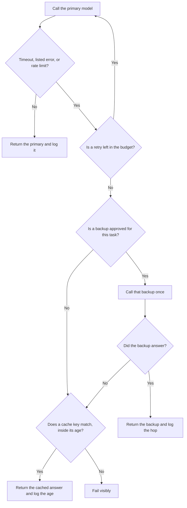

**An AI fallback chain is the ordered list of what happens after a primary model call fails: a retry you already capped, then one named backup, then a cached answer only if the cache key matches, then a visible failure.** Each hop is written down before the incident. A chain that "tries whatever is up" is an invoice with no owner.

The single backup model, which is one hop and not the whole list, is [what AI fallback routing is](/blog/what-is-ai-fallback-routing-2026/). The counter on the first hop is [what an AI retry budget is](/blog/what-is-ai-retry-budget-2026/). A stored answer you may reuse only on a key you defined is [what AI response caching is](/blog/what-is-ai-response-caching-2026/). The clock that ends a hop is [what an AI tool timeout is](/blog/what-is-ai-tool-timeout-2026/).

Prices are US list prices excluding tax from directory pages checked October 16, 2026. A live fetch of several vendor pricing pages returned HTTP 401 on October 24, 2026, so this page stays on the directory record for those seats. Published October 24, 2026. The directory does not list a fallback-chain fee. We did not measure failover time.

## What each hop is allowed to be

| Hop | You write | A chain that will surprise you |
|---|---|---|
| Retry | A count and an error list, from the retry budget | Retry until the answer looks good |
| Backup model | One model id, approved for this task | The next name in a vendor menu |
| Cache | A key you defined, and a maximum age | Any previous answer that sounds related |
| Stop | A visible error, a queue, or a person | A fifth model nobody regression-tested |
| Log | Which hop answered, and the error class | One "model" field that hides the path |

The cache is not a backup model. It is a previous result. If the request must be fresh, the cache hop is "none." A refusal from the primary is not a failure to route around. A refusal is a result. The policy for that case is [what AI policy as code is](/blog/what-is-ai-policy-as-code-2026/).

## Where the list is kept

**The note.** [Claude](/tools/claude/) Pro is $20 a month, or $17 billed annually, when the chain is a short document a second person will read. The review is [Claude review](/blog/claude-review-2026/).

**A paste you reuse.** [ChatGPT](/tools/chatgpt/) Plus is $20 a month when the chain is a dozen lines in a project. The model may format the hops. It may not add a model you did not name. The review is [ChatGPT review](/blog/chatgpt-review-2026/).

**The file in the repo.** [Cursor](/tools/cursor/) Plus is $8 a month, or $80 a year, when the chain is code. You review the diff. A generated hop that calls a model the task never approved is a defect. The ladder is [Cursor pricing explained](/blog/cursor-pricing-explained-2026/).

**The workflow that must not loop.** [Zapier](/tools/zapier/) Professional is $19.99 a month billed annually. A Zap that retries a failing step and also calls a second model can spend both. The chain's stop has to be a path you drew, not a default retry. The invoice is [Zapier pricing explained](/blog/zapier-pricing-explained-2026/).

A prompt that holds the line:

"Format a fallback chain from the retry count, the backup model id, the cache rule, and the stop I pasted. Do not add a hop. If the stop is missing, write Stop missing and do not invent a third model."

## What not to delegate

Do not let the chain pick a model because it is cheaper that hour. Do not count a cache hit as proof the backup still works. The offline check that the backup still does the job is [what prompt regression testing is](/blog/what-is-prompt-regression-testing-2026/). When the chain itself is the incident, the roles for that hour are [what AI incident response is](/blog/what-is-ai-incident-response-2026/).

## FAQ

### How is a chain different from fallback routing?

Fallback routing names the second model after the first call fails for a reason you listed. A chain is the full order: retry, that backup, an optional cache, and a stop. You can have routing and no cache. You can have a cache and no second model. Write the hops you actually run.

### How many models belong in one chain?

One backup, until you can show a reason for a second. Each extra model is another prompt to regression-test and another bill. If the backup fails, stop.

### Can the cache hop run before the backup?

Only if you wrote it that way, and only for requests that may be stale. A support answer from last week is the wrong hop for a balance. Put the cache where the freshness rule allows it, or leave it off.

### Who changes the order?

The owner named on the chain. A deploy that adds a hop without changing the log field will hide which model answered. Update the log in the same change.

## Last verified

October 16, 2026 for Claude, ChatGPT, Cursor, and Zapier. No fallback-chain product fee is recorded in the directory. Published October 24, 2026.

**Sources:** [Claude pricing](https://claude.com/pricing), [ChatGPT pricing](https://chatgpt.com/pricing/), [Cursor pricing](https://cursor.com/help/account-and-billing/pricing), [Zapier pricing](https://zapier.com/blog/zapier-pricing/).

*Published by Andrew for [AI Tools Optimizer](https://aitoolsoptimizer.com).*

[Claude](/tools/claude/) is in the [chatbots and assistants directory](/tools/category/chatbots-assistants/). Directory pages may use affiliate links. A purchase through them may earn us a commission at no extra cost to you.
