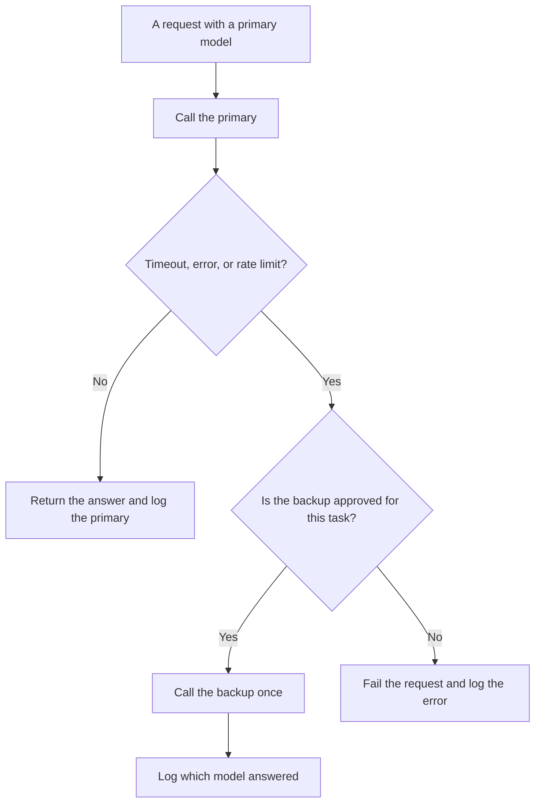

**AI fallback routing is a written order of models: try the primary, and if that call times out, errors, or hits a rate limit, send the same request to a backup you already named.** The backup is a product decision you made before the incident. A silent swap to whatever is cheapest, with no log of which model answered, is an outage with a polite face. The user may get text. You will not know which contract produced it.

Choosing the first model, before anything fails, is [what AI routing is](/blog/what-is-ai-routing-2026/). The door that counts calls so you fail less often is [what AI rate limiting is](/blog/what-is-ai-rate-limiting-2026/). The queue that decides who waits is [what AI traffic shaping is](/blog/what-is-ai-traffic-shaping-2026/). The shared entrance those rules sit behind is [what a model gateway is](/blog/what-is-a-model-gateway-2026/).

Prices are US list prices excluding tax from directory pages checked October 16, 2026. Published October 24, 2026. The directory does not list a fallback-router fee, so this page does not invent one. We did not measure failover time for any vendor.

## What you decide before the first failure

| Choice | Write it down | A fallback that will surprise you |
|---|---|---|
| The trigger | Timeout, HTTP error, or a rate-limit response | Any answer you merely dislike |
| The backup model | A specific id you have tested on this task | "The next model in the list" with no owner |
| The payload | The same instructions, or a shorter prompt you approved for the backup | A different system prompt nobody reviewed |
| The log | Primary, backup, error class, and latency | A single "model" field that hides the swap |
| The stop | After one backup, fail visibly | A chain that tries five models and bills all of them |

Falling back because the prose felt weak is a quality router, and it belongs in the routing rule with a test. Do not disguise it as reliability. The offline check that the backup still does the job is [what prompt regression testing is](/blog/what-is-prompt-regression-testing-2026/).

## Seats you can name, and the gap the directory leaves

**One primary chat you already pay for.** [ChatGPT](/tools/chatgpt/) Plus is $20 a month. Business is $20 a user a month billed annually for two or more users, or $25 billed monthly. A Plus seat is not an API failover policy. If your application calls an API, the fallback is in that application, and the chat plan does not set it. The ladder is [ChatGPT Go vs Plus vs Pro](/blog/chatgpt-go-vs-plus-vs-pro-2026/).

**A backup with a different vendor.** [Claude](/tools/claude/) Pro is $20 a month, or $17 billed annually. Use Pro to write the fallback note: which errors switch, which prompt the backup sees, and who reads the log. Team is per seat for 2 to 150 people, and the directory does not list a public Team dollar. The review is [Claude review](/blog/claude-review-2026/).

**A third name, if the task already lives in Google.** [Gemini](/tools/gemini/) is free with a Google account. Google AI Plus is $4.99 a month. Google AI Pro is $19.99 a month. Naming Gemini as a backup is allowed only after the same cases pass on Gemini. A cheaper sticker is not a test. The review is [Gemini review](/blog/gemini-review-2026/).

**The workflow that must not retry forever.** [Zapier](/tools/zapier/) Professional is $19.99 a month billed annually. A Zap that retries a failing model step on a short loop can spend the backup and the primary. Cap the retries. Zapier's task count is not your model's error budget.

When the fallback itself is sick, you are in an incident. The roles for that hour are [what AI incident response is](/blog/what-is-ai-incident-response-2026/). The steps you wish you had printed are [what an AI runbook is](/blog/what-is-an-ai-runbook-2026/).

## Quality you give up on purpose

Say, in the product note, what the backup is worse at. A backup that is shorter, less cited, or refuses more often can still be the right availability choice. It is the wrong choice if you pretend the answer is the same product. Show a small label in logs and, if the user can tell, in the interface.

Do not fall back from a safety refusal to a model that will comply. A refusal is a result. Routing around it is a policy change, and it belongs in [what AI policy as code is](/blog/what-is-ai-policy-as-code-2026/), not in a timeout handler.

## FAQ

### Is fallback the same as routing?

Routing picks the first model from the task. Fallback picks the next model after the first call fails for a reason you listed. You can route a summary to a cheap model and still have no fallback. Write both or you have only one.

### How many backups should I list?

One, until you can show a reason for a second. Each extra hop adds latency, cost, and a prompt you must regression-test. If the backup fails, stop and tell the caller.

### Should the user see that a backup answered?

Your support team should. Whether the end user sees it depends on the promise you made. If you marketed a specific model, a silent swap breaks that promise. Log it either way.

### Can I fall back only when the answer looks empty?

Only if "empty" is a check you can define without taste, such as a blank body or a missing required field. A vague answer is a quality issue. Put it in the eval, then decide if it is allowed to trigger a second call.

## Last verified

October 16, 2026 for ChatGPT, Claude, Gemini, and Zapier. No fallback-router fee is recorded in the directory. Published October 24, 2026.

**Sources:** [ChatGPT pricing](https://chatgpt.com/pricing/), [Claude pricing](https://claude.com/pricing), [Google AI subscriptions](https://gemini.google/subscriptions/).

*Published by Andrew for [AI Tools Optimizer](https://aitoolsoptimizer.com).*

[Zapier](/tools/zapier/) is in the [automation and agents directory](/tools/category/automation-agents/). Directory pages may use affiliate links. A purchase through them may earn us a commission at no extra cost to you.
