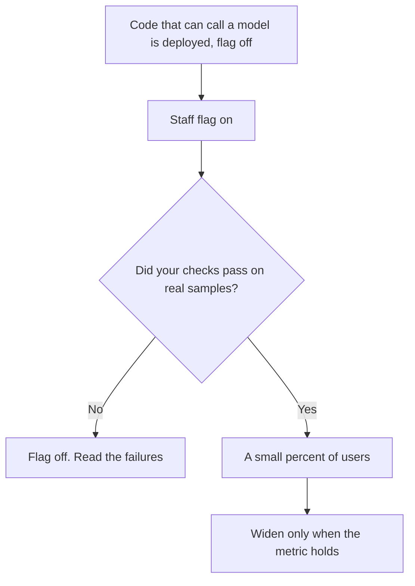

**An AI feature flag is a switch that decides who sees a model-backed feature, separate from the code deploy that added it.** You can show a draft button to staff, then to five percent of customers, then turn it off when the answers go wrong, without shipping a new build. The flag is a product control. It is not a claim that the model is correct.

The check you run before you widen the flag is [what AI eval testing is](/blog/what-is-ai-eval-testing-2026/). A copy of live traffic that users do not see is [what a shadow deployment for AI is](/blog/what-is-a-shadow-deployment-for-ai-2026/). The instruction behind the feature is [what a system prompt is](/blog/what-is-a-system-prompt-2026/), and the file that names which wording is live is [what prompt versioning is](/blog/what-is-prompt-versioning-2026/).

Prices below are US list prices from directory pages checked October 16, 2026. Published October 24, 2026. The directory does not list a feature-flag vendor or a price for one. We did not score flag tools.

## What the switch is allowed to control

| Switch | A safe use | A misuse |
|---|---|---|
| Staff only | The team that wrote the prompt tries it on real tickets they are allowed to see | A personal account with customer data and no log |
| Percent of users | Five percent, with a metric you already collect | Fifty percent because a demo felt good |
| Plan tier | Paying customers get a higher cap you already sell | A secret model described as the same plan |
| Kill | Off, for everyone, in one change | "We will fix it in the next release" while it keeps answering |

A flag without an owner becomes a permanent half-launch. Name the person who can turn it off, and the metric that would make them do it. The habit of reading what the model did is [what AI observability is](/blog/what-is-ai-observability-2026/). A check that blocks a bad action before it lands is [what AI guardrails are](/blog/what-is-ai-guardrails-2026/).

## Where the work sits

**In the product you are building.** The flag lives in your app. The model call sits behind it. [GitHub Copilot](/tools/github-copilot/) can help a developer write that branch. Copilot Pro is $10 a user a month. Business is $19 a user a month and adds governance and IP indemnity. The flag is still your code. Copilot does not host it. The team seat comparison is [Cursor vs GitHub Copilot for teams](/blog/cursor-vs-github-copilot-for-teams-2026/).

**In the editor, as the place you write the switch.** [Cursor](/tools/cursor/) Plus is $8 a month, or $80 a year, for new customers on The X Subscription. Team seats are $30, $100, or $200 a month on the new card. Use the editor you already standardized. Do not buy a second editor to "do feature flags." The individual comparison is [Cursor vs GitHub Copilot](/blog/cursor-vs-github-copilot-2026/).

**As a prompt you version.** Turning a flag on should point at a prompt version you can name. [Claude](/tools/claude/) Pro is $20 a month, or $17 billed annually, and Projects can hold the wording. [ChatGPT](/tools/chatgpt/) Plus is $20 and includes projects. The container comparison is [Claude Projects vs ChatGPT Projects](/blog/claude-projects-vs-chatgpt-projects-2026/). A Project is not a flag. The flag is what percentage of users hit that Project's wording.

**As a manual switch for an internal path.** [Zapier](/tools/zapier/) Professional is $19.99 a month billed annually for 750 tasks. Turning a Zap off is a flag for that one automation. It is a blunt one, and it is honest. The map is [Zapier vs Make vs n8n](/blog/zapier-vs-make-vs-n8n/).

## What to write down when you flip it

Write the flag name, the prompt version, the model name, the audience, and the time. When you turn it off, write why. That note is the seed of a postmortem if the feature reached customers. The write-up habit is [how to write a postmortem with AI](/blog/how-to-write-a-postmortem-with-ai-2026/). The person who approves a wider rollout is [what human-in-the-loop AI is](/blog/what-is-human-in-the-loop-ai-2026/).

Do not use a flag to hide a model change from a plan that promised a specific behavior. Say what changed, in the release note a customer can read. The customer-facing cousin is [how to write release notes with AI](/blog/how-to-write-release-notes-with-ai-2026/).

## FAQ

### Is a feature flag the same as an A/B test?

A flag can split traffic. An A/B test needs a metric and a decision at the end. A flag that stays at fifty percent forever is an unfinished launch, not an experiment.

### Should every prompt have a flag?

Every customer-facing model feature should have a way to turn off. Internal drafts a person always reviews can live without a percent rollout. The review is the control.

### Can the model decide its own flag?

No. A person, or a rule you deployed, sets the audience. The model does not promote itself from staff-only to everyone.

### Where does the prompt text live?

In the versioned prompt, not in an unnamed edit inside a chat. The flag selects a version. It does not replace the version history.

## Last verified

October 16, 2026 for GitHub Copilot, Cursor, Claude, ChatGPT, and Zapier prices named above. No feature-flag vendor price is on the directory cards used here. Published October 24, 2026.

**Sources:** [GitHub Copilot](https://github.com/features/copilot), [Cursor pricing](https://cursor.com/help/account-and-billing/pricing), [Claude pricing](https://claude.com/pricing).

*Published by Andrew for [AI Tools Optimizer](https://aitoolsoptimizer.com).*

[GitHub Copilot](/tools/github-copilot/) is in the [coding directory](/tools/category/coding/). Directory pages may use affiliate links. A purchase through them may earn us a commission at no extra cost to you.
