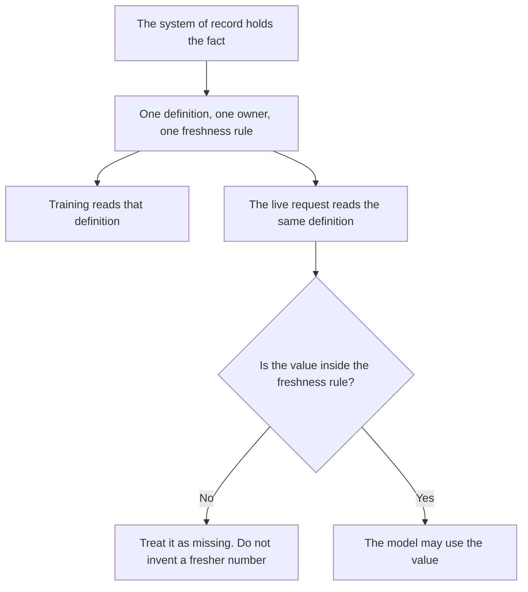

**An AI feature store is a shared catalog of named inputs a model is allowed to read, where each input has an owner, a version, and a freshness rule, and the training path and the live path use that same definition.** "Days since last payment" lives once. If the notebook computes it one way and the live request computes it another way, you do not have a feature store. You have two formulas that happen to share a name.

The home of the business fact the feature points at is [what a system of record for AI is](/blog/what-is-a-system-of-record-for-ai-2026/). The search structure over text chunks is [what an embedding index is](/blog/what-is-embedding-index-2026/). The database that holds those vectors is [what a vector database is](/blog/what-is-a-vector-database-2026/). How old a retrieved page is allowed to be is [what retrieval freshness is](/blog/what-is-retrieval-freshness-2026/).

Prices are US list prices excluding tax from directory pages checked October 16, 2026. Published October 24, 2026. The directory does not list a feature-store product fee, so this page does not invent one. We did not score vendors that sell feature platforms.

## What belongs in the catalog

| Column | What you write | A feature store rejects |
|---|---|---|
| Name | A stable id, such as plan_tier | A column someone renamed in a slide |
| Definition | The formula, in one place | A paragraph in a notebook only |
| Owner | The team that may change the formula | "Analytics" with no person |
| Freshness | How old the value may be at decision time | "As fresh as the warehouse feels" |
| Source | The system of record it is derived from | A CSV on a laptop |
| Consumers | Which models or jobs may read it | Every prompt, by default |

An embedding of a help article is not a feature in this sense. It is a representation for search. A feature is a value with a definition you can audit: plan tier, seats, days since last login, whether the account is past due. The lineage of that value is [what AI data lineage is](/blog/what-is-ai-data-lineage-2026/).

## Where a small team keeps it

**The definitions.** [Notion AI](/tools/notion-ai/) Business is $20 a seat a month when the catalog is a table: name, formula, owner, freshness, source. The model may format a row. It may not add a feature nobody owns. The record rule is the system-of-record article above.

**The query that implements the formula.** [Hex](/tools/hex/) Professional is $36 per editor a month when the warehouse is where the feature is computed. Community is free with an agent trial and small compute. If Hex and the live service disagree, the catalog is wrong or one of them drifted. The invoice is [Hex pricing explained](/blog/hex-pricing-explained-2026/).

**A review of a proposed feature.** [Claude](/tools/claude/) Pro is $20 a month, or $17 billed annually, can restate a formula in plain language so the owner can see what they are signing. It cannot verify the warehouse. The review is [Claude review](/blog/claude-review-2026/).

**A draft row from a messy note.** [ChatGPT](/tools/chatgpt/) Plus at $20 a month can turn a meeting note into a catalog row with Missing where the owner or the freshness was not said. The review is [ChatGPT review](/blog/chatgpt-review-2026/).

A prompt that holds the line:

"Turn this note into a feature-catalog row with name, definition, owner, freshness, and source. If any field was not in the note, write Missing. Do not invent a formula. Do not claim the warehouse matches."

## What to refuse

Do not let a prompt compute a business number that the catalog already defines, using a different sentence in the system prompt. Do not backfill a missing feature with a guess so the model can answer. Missing is a value. A guess is a second formula.

The cold path, when a new account has no history for a feature, is [what AI cold start is](/blog/what-is-ai-cold-start-2026/). Name the default in the catalog. An unnamed default will be invented at request time.

## FAQ

### Is a feature store a vector database?

A vector database stores embeddings for similarity search. A feature store stores named values with definitions, owners, and freshness, shared by training and by the live path. You might use both. They answer different questions.

### Do we need a vendor product?

Not to start. A table with the six columns, and one query the live path and the training job both call, is the store. A product is justified when many models read the same features and the hand-kept table is drifting. This page does not price those products, because they are not in the directory we used.

### Who changes a definition?

The owner on the row, with a version note. A silent edit to "days since last payment" changes every model that reads it. That is a release. Treat it like one.

### What if the live value is stale?

Follow the freshness rule. If the rule says the decision may not use a value older than a day, the request sees missing, or it waits, or it uses the fallback you wrote. It does not get a fresher number from the model.

## Last verified

October 16, 2026 for Hex, Notion AI, Claude, and ChatGPT. Published October 24, 2026.

**Sources:** [Hex pricing](https://hex.tech/pricing/), [Notion pricing](https://www.notion.com/pricing), [Claude pricing](https://claude.com/pricing), [ChatGPT pricing](https://chatgpt.com/pricing/).

*Published by Andrew for [AI Tools Optimizer](https://aitoolsoptimizer.com).*

[Hex](/tools/hex/) is in the [data and analytics directory](/tools/category/data-analytics/). Directory pages may use affiliate links. A purchase through them may earn us a commission at no extra cost to you.
