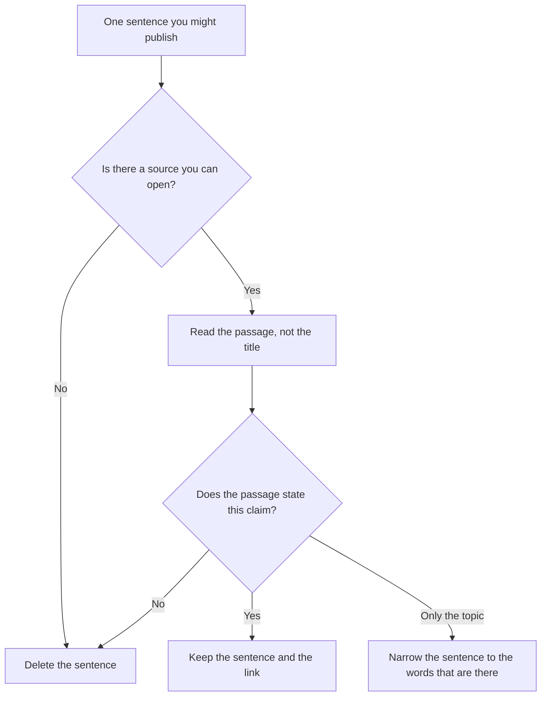

**AI groundedness is whether a specific claim is supported by a source you can open.** Grounding is the product step that attaches a source. Groundedness is the check on that attachment. A citation can be present and still fail: the page exists, and the sentence is not in it.

Attaching the source is [what AI grounding is](/blog/what-is-ai-grounding-2026/). The retrieval step that often feeds it is [what RAG is](/blog/what-is-rag-explained-2026/). A claim with no support in the source is [what an AI hallucination is](/blog/what-is-ai-hallucination-2026/). Scoring a sample of claims against sources is [what AI eval testing is](/blog/what-is-ai-eval-testing-2026/). One named check in that family is [what RAGAS evaluation is](/blog/what-is-ragas-evaluation-2026/).

Prices are US list prices excluding tax from directory pages checked October 16, 2026. Published October 24, 2026. We did not score citation accuracy for any product. A green "grounded" badge in a UI is the vendor's label. Your check is the passage.

## Three outcomes for one sentence

| Outcome | What you found | What you may do with the sentence |
|---|---|---|
| Supported | The passage states the claim, including the number and the date | Reuse it, with the link |
| Partial | The passage is about the topic, and it does not state this claim | Cut the claim, or narrow it to the words that are there |
| Unsupported | No passage, a dead link, or a passage that says something else | Delete the sentence. Do not keep the citation as decoration |
| Silent source | The source set does not mention the question | The honest answer is that the sources do not say. A guess is a new claim |

A title that matches your question is not support. Support is the sentence, the table cell, or the quote. If the number in your draft is not the number in the source, the draft fails even when the topic is right.

## Where people run the check

**A web question with links.** [Perplexity](/tools/perplexity/) Pro is $17 a month billed annually on the directory card. Free includes top models with limited weekly usage. Open the citation before you paste the sentence into a memo. The invoice is [Perplexity pricing explained](/blog/perplexity-pricing-explained-2026/).

**A question about papers.** [Consensus](/tools/consensus/) Pro is $12 a month billed annually ($144 a year), or $20 monthly. The free plan includes unlimited paper searches, with tight limits on Pro messages and Deep reviews. A cited paper still has to contain the claim. The invoice is [Consensus pricing explained](/blog/consensus-pricing-explained-2026/).

**A table across papers.** [Elicit](/tools/elicit/) Plus is $11 per user per month billed annually. A cell in an extraction table is a claim. Open the quote. The invoice is [Elicit pricing explained](/blog/elicit-pricing-explained-2026/).

**Files you already have.** [Gemini Notebook](/tools/gemini-notebook/) is free with a Google account on the directory card. Higher limits sit on Google AI plans. The notebook answers from uploads. Groundedness is still "is this sentence in this file?"

**A draft you will edit.** [Claude](/tools/claude/) Pro is $20 a month, or $17 billed annually. Ask it to list claims that are not in the paste. You still open the source. The model can mark its own sentence as supported. That mark is not the check.

## What to write down before you sample

Pick the unit. A paragraph can mix a supported date with an invented cause. The unit that fails cleanly is one claim.

Pick the source set. "The internet" is not a set. Name the file, the help article, or the paper. If the source set is silent, the grounded result is silence, which is [the grounding rule](/blog/what-is-ai-grounding-2026/) applied as a pass/fail.

Pick who reads the sample. A person who owns the fact should read the failures. A model-only label of its own output is a hint. The person is [what human-in-the-loop AI is](/blog/what-is-human-in-the-loop-ai-2026/).

## FAQ

### Is groundedness the same as grounding?

Grounding attaches a source. Groundedness asks whether that source supports the claim. You can turn grounding on and still publish an unsupported sentence with a link beside it.

### Does a citation count as a pass?

A citation counts as a pointer. The pass is the passage. If you cannot find the claim in the passage, the citation failed its job.

### Should every sentence in a chat be scored?

Score the sentences you will reuse: a price, a date, a limit, a medical or legal claim, a customer-facing answer. A brainstorm you will not publish does not need a score. It also should not be pasted into the doc that will ship.

### Can I use a model's "faithfulness" score as the decision?

Use it to choose what a person reads first. The decision to publish is the passage. We do not publish a vendor ranking of those scores.

## Last verified

October 16, 2026 for the prices named above. Published October 24, 2026. The definition does not depend on a price change.

**Sources:** [Perplexity pricing](https://www.perplexity.ai/hub/pricing), [Consensus pricing](https://consensus.app/pricing/), [Elicit pricing](https://elicit.com/pricing), [Claude pricing](https://claude.com/pricing).

*Published by Andrew for [AI Tools Optimizer](https://aitoolsoptimizer.com).*

[Perplexity](/tools/perplexity/) is in the [research and search directory](/tools/category/research-search/). Directory pages may use affiliate links. A purchase through them may earn us a commission at no extra cost to you.
