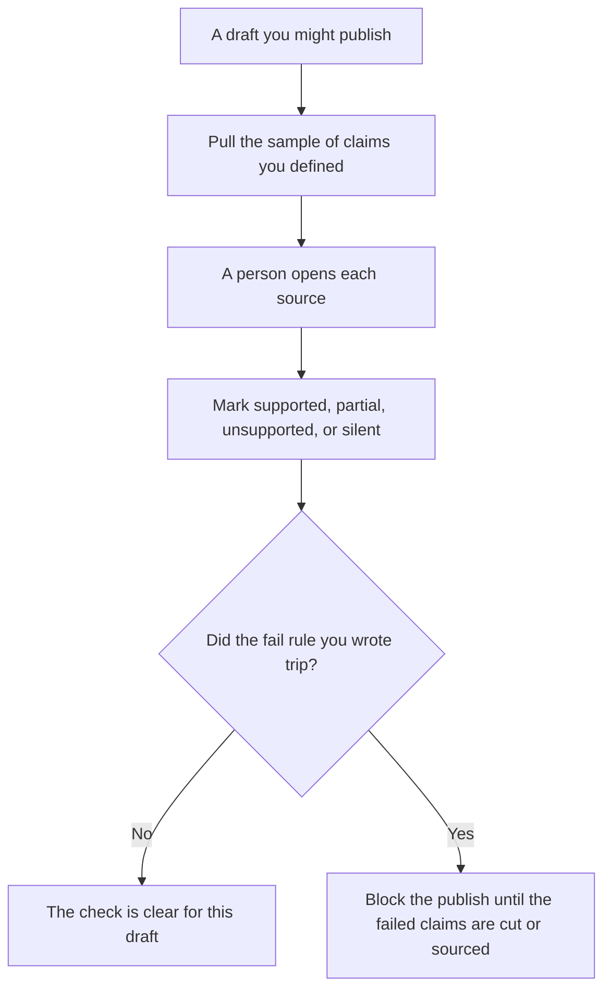

**An AI groundedness check is a sample of claims you might publish, read against sources a person can open, with a fail rule that can block the publish.** Whether one sentence is supported is [what AI groundedness is](/blog/what-is-ai-groundedness-2026/). Attaching a source at all is [what AI grounding is](/blog/what-is-ai-grounding-2026/). This page is the operational check: how many claims, who reads the failures, and what happens when the fail rule hits.

A sentence with nothing behind it is [what an AI hallucination is](/blog/what-is-ai-hallucination-2026/). Scoring a set of tasks on purpose is [what AI eval testing is](/blog/what-is-ai-eval-testing-2026/). The habit of opening the page before you reuse a line is [how to fact-check AI writing](/blog/how-to-fact-check-ai-writing-2026/).

Prices are US list prices excluding tax from directory pages checked October 16, 2026. A live fetch of several vendor pricing pages returned HTTP 401 on October 24, 2026, so this page stays on the directory record. Published October 24, 2026. We did not score citation accuracy for any product.

## The card for one publish

| Line | You write | A check that cannot block anything |
|---|---|---|
| Unit | One claim, not a whole paragraph | "The post" |
| Sample | How many claims, and how you picked them | The first sentence only |
| Fail rule | How many unsupported claims stop the publish | "Use judgment" |
| Reader | The person who owns the fact | The same model that wrote the sentence |
| Record | Claim, source, outcome, date | A green badge with no passage |

The four outcomes live on the groundedness page. This check only works if the reader uses those outcomes and writes them down. A model that labels its own sentence "supported" can choose what a person reads first. It cannot be the only reader. That split is [what human-in-the-loop AI is](/blog/what-is-human-in-the-loop-ai-2026/).

## Where the sample is read

**A web claim with a link.** [Perplexity](/tools/perplexity/) Pro is $17 a month billed annually on the directory card. Free includes top models with limited weekly usage. Open the citation. The invoice is [Perplexity pricing explained](/blog/perplexity-pricing-explained-2026/).

**The list of claims.** [Claude](/tools/claude/) Pro is $20 a month, or $17 billed annually, when you ask for a list of factual sentences in a draft you pasted. You still open the source. The review is [Claude review](/blog/claude-review-2026/).

**A shorter list.** [ChatGPT](/tools/chatgpt/) Plus is $20 a month can number the claims. Discard any claim it adds that was not in the draft. The review is [ChatGPT review](/blog/chatgpt-review-2026/).

**The record.** [Notion AI](/tools/notion-ai/) Business is $20 a seat a month if the check log lives in the wiki. The page is the record. The chat is not.

A prompt that holds the line:

"List factual claims in the draft I pasted, one per line. Do not mark them supported. Do not add a claim. I will open the sources."

## What not to delegate

Do not lower the fail rule after the sample looks bad so the publish can go out. Do not count a link that loads as a pass. The pass is the passage, which is the groundedness definition. Do not sample only the sentences you already trust.

## FAQ

### How is this different from groundedness?

Groundedness is the judgment on one claim: supported, partial, unsupported, or a source set that never mentions the question. The check is the sample, the reader, and the fail rule wrapped around that judgment. You can believe in the definition and still publish because nobody sampled.

### How big should the sample be?

Large enough that a miss matters, and small enough that the named reader will finish it before the publish time. This page does not recommend a universal percentage. Write the number on the card for that kind of page: a price page is a different sample from a brainstorm you will not ship.

### What if the source set is silent?

Mark it silent and cut the claim, or say the sources do not cover it. Silence is a result. A fluent sentence in the gap is a new claim.

### Can a badge in the product replace the check?

A badge is the vendor's label. Your check is the passage and the fail rule. We do not rank badges.

## Last verified

October 16, 2026 for Perplexity, Claude, ChatGPT, and Notion AI. Published October 24, 2026. The definition of a single claim does not depend on a price change.

**Sources:** [Perplexity pricing](https://www.perplexity.ai/hub/pricing), [Claude pricing](https://claude.com/pricing), [ChatGPT pricing](https://chatgpt.com/pricing/), [Notion pricing](https://www.notion.com/pricing).

*Published by Andrew for [AI Tools Optimizer](https://aitoolsoptimizer.com).*

[Perplexity](/tools/perplexity/) is in the [research and search directory](/tools/category/research-search/). Directory pages may use affiliate links. A purchase through them may earn us a commission at no extra cost to you.
