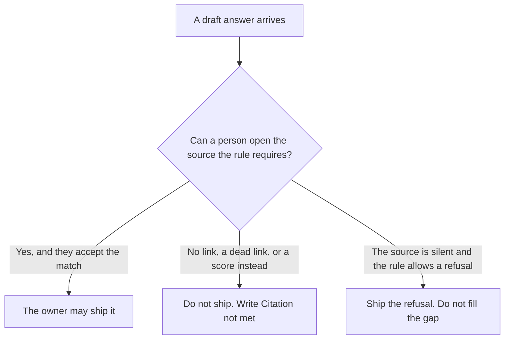

**AI grounding citation-required is a rule a person wrote: an answer may ship only if it includes a source that person can open, and a missing source means the answer does not ship.** The product may or may not enforce it. The rule is yours. A footnote the model typed, that leads nowhere, does not meet the rule.

The product setting that refuses when it cannot attach a source is [what AI citation-required mode is](/blog/what-is-ai-citation-required-mode-2026/). Tying an answer to sources you can open, as a property of the answer, is [what AI grounding is](/blog/what-is-ai-grounding-2026/). A number someone computes for how grounded a run was is [what an AI grounding score is](/blog/what-is-ai-grounding-score-2026/). This page is the requirement you put on your own workflow.

Perplexity's prices are the October 24, 2026 pricing-page read recorded in [Perplexity pricing explained](/blog/perplexity-pricing-explained-2026/). Claude's prices are the October 24 read of claude.com/pricing recorded in [Claude pricing explained](/blog/claude-pricing-explained-2026/). ChatGPT's Plus price is the October 24 plan-page figure recorded in [ChatGPT pricing explained](/blog/chatgpt-pricing-explained-2026/). Notion is the October 16 directory card. Published October 24, 2026. We did not score citation accuracy. The directory does not list a citation-required fee.

## What the rule accepts

| The draft offers | The rule says |
|---|---|
| A link or passage a person can open, and the claim matches it | The answer may ship, after that person checks it |
| A link that 404s, or a title with no location | Citation not met. Do not ship |
| A claim with no source | Citation not met. Do not ship |
| A refusal that says the source was silent | Allowed, if you wrote that silence is an acceptable result |
| A score in place of a source | Citation not met |

Grounding is the property: the answer is tied to something you can open. Citation-required mode is a product that tries to enforce a version of that property. The rule on this page can sit on a product that has no such mode. You still refuse to publish the paragraph. You can also turn a mode on and still fail the rule, if nobody opens the source.

A grounding score is a metric. It can be high while the one claim you care about has no source. The rule does not average. One required claim without a source holds the answer.

## Where the rule is applied

**A public-web answer.** [Perplexity](/tools/perplexity/) Pro is $17 a month billed annually on the October 24 read. The product attaches sources. Your rule still says a person opens them before the sentence goes into an RFP or a handbook. The invoice is [Perplexity pricing explained](/blog/perplexity-pricing-explained-2026/).

**A closed corpus you pasted.** [Claude](/tools/claude/) Pro is $17 a month billed annually, $200 up front, or $20 monthly. If the paste has no passage for the claim, the line says Citation not met. The model does not fetch a substitute. The review is [Claude review](/blog/claude-review-2026/).

**One draft you will check by hand.** [ChatGPT](/tools/chatgpt/) Plus is $20 a month. A confident paragraph is not a citation. The ladder is [ChatGPT pricing explained](/blog/chatgpt-pricing-explained-2026/).

**The page that will hold the shipped sentence.** [Notion AI](/tools/notion-ai/) Business is $20 a seat a month on the October 16 card. Link the source next to the claim. Plus at $10 is not the full AI tier. The invoice is [Notion AI pricing explained](/blog/notion-ai-pricing-explained-2026/).

A prompt that holds the line:

"Answer only from the sources I pasted. After each claim, put the source a person can open. If a claim has no source in the paste, write Citation not met and stop that claim. Do not add a source you were not given."

## What not to delegate

Do not let the model decide that a claim is "common knowledge" and skip the source. Do not accept a bibliography that was not in the paste. Do not publish because a mode was turned on. The person who owns the page opens the source.

## FAQ

### How is this different from citation-required mode?

The mode is a product behavior: attach a source or refuse. The rule is yours, and it applies even when the product will happily return an unsourced paragraph. You can use a mode and still keep the rule, because someone still has to open the link.

### How is this different from grounding?

Grounding is the property of the answer. The rule is the requirement that you will not ship without that property on the claims you listed. An answer can be grounded on three sentences and still fail the rule on the fourth.

### How is this different from a grounding score?

A score compresses a run into a number. The rule is pass or hold on the claims you named. This page does not publish a score, and it does not tell you which number to treat as enough.

### Who may waive the rule?

The owner of the page, in writing, for a claim they mark as not requiring a source. A model sentence that says the source was unnecessary is not a waiver. Citation not met stays unshipped.

## Last verified

October 24, 2026 for Perplexity, Claude, and ChatGPT's plan page, via the posts cited above. October 16, 2026 for Notion. Published October 24, 2026. No citation-required fee is recorded in the directory.

**Sources:** [Perplexity pricing](https://www.perplexity.ai/pro), [Claude pricing](https://claude.com/pricing), [ChatGPT and Codex pricing](https://learn.chatgpt.com/docs/pricing), [Notion pricing](https://www.notion.com/pricing).

*Published by Andrew for [AI Tools Optimizer](https://aitoolsoptimizer.com).*

[Perplexity](/tools/perplexity/) is in the [research and search directory](/tools/category/research-search/). Directory pages may use affiliate links. A purchase through them may earn us a commission at no extra cost to you.
