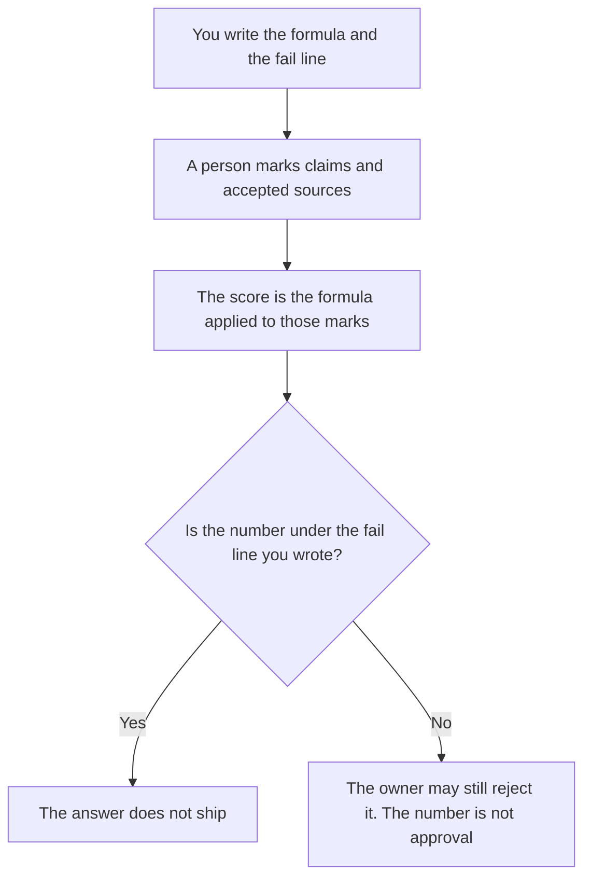

**An AI grounding score is a number produced by a formula you already wrote, applied to an answer and to sources a person already accepted.** The formula might be "supported claims divided by total claims," with the claim list you marked. The score is not a property the model possesses. The property, separate from any number, is [what AI groundedness is](/blog/what-is-ai-groundedness-2026/). A pass or fail against a rule is [what an AI groundedness check is](/blog/what-is-ai-groundedness-check-2026/).

How many claims carry a citation at all is [what AI citation coverage is](/blog/what-is-ai-citation-coverage-2026/). Attaching the model to sources in the first place is [what AI grounding is](/blog/what-is-ai-grounding-2026/). This page is the formula and the number it emits. We do not publish a score for any product.

Claude's prices are from claude.com/pricing on October 24, 2026. Perplexity, ChatGPT, and Notion prices below that are not from a fresh Perplexity fetch: Perplexity's Pro price is the October 16 directory card. ChatGPT's Plus price is from learn.chatgpt.com/docs/pricing on October 24. Notion is the October 16 card. Published October 24, 2026. We did not score answers.

## What has to exist before a number does

| Piece | Who owns it | If it is missing |
|---|---|---|
| The formula, in one sentence | You | There is no score. There is a vibe |
| The claim list a person marked on this answer | You | The model must not invent claims to divide |
| The sources you accepted for this answer | You | A link the model found is not yet accepted |
| The scale, such as 0 to 1, and what a fail is | You | A "high" score with no cutoff |

A score the model reports about its own answer is not this score. It did not use your formula, and it marked its own claims. Put that self-report in a separate column labeled Model's own figure, or leave it out.

## Where the formula is applied

**The formula text.** [Claude](/tools/claude/) Pro is $17 a month billed annually, $200 up front, or $20 monthly. Keep the sentence in a Project so a later draft does not soften the fail line. The review is [Claude review](/blog/claude-review-2026/).

**A cited first pass, which is not the score.** [Perplexity](/tools/perplexity/) Pro is $17 a month billed annually on the October 16 card. Open the citation. The score still uses sources you accepted, not every link in the answer. The review is [Perplexity review](/blog/perplexity-review-2026/).

**One table from marks you paste.** [ChatGPT](/tools/chatgpt/) Plus is $20 a month. It may divide the counts you typed. It may not mark a claim supported. The ladder is [ChatGPT pricing explained](/blog/chatgpt-pricing-explained-2026/).

**The sheet the team keeps.** [Notion AI](/tools/notion-ai/) Business is $20 a seat a month. Store the formula version next to the number. The invoice is [Notion AI pricing explained](/blog/notion-ai-pricing-explained-2026/).

A prompt that holds the line:

"Compute the grounding score from the formula, the claim counts, and the fail line I pasted. If a count is missing, write Count not set. Do not mark a claim supported. Do not change the formula."

## What not to delegate

Do not ask which answer is "more grounded" without the formula. Do not average this score with a preference rating and call the blend quality. Do not ship because the number cleared the line if the owner has not looked at the unsupported claim. The line is a gate. It is not a grade of the product.

## FAQ

### How is this different from groundedness?

Groundedness is whether the answer stays within the sources. The score is a number from your formula. An answer can be poorly grounded and still receive a number, including a failing one. An answer can look careful and have no score, because nobody wrote a formula.

### How is this different from a groundedness check?

The check is pass or fail against a rule. The score is a number on a scale you defined. You can fail the check and still record the score, or the reverse, if the rule and the formula are not the same. Say which one blocked the ship.

### How is this different from citation coverage?

Coverage asks whether claims have citations. The score asks whether the sources you accepted support the claims, using your formula. A claim can carry a citation to a page that does not support it. Coverage would count the citation. Your formula might not count it as supported. That is why both exist.

### Who may change the formula?

The owner of the eval. A changed formula is a new version, with a date. Old numbers stay attached to the old formula. Do not recompute history in silence and then compare weeks.

## Last verified

October 24, 2026 for Claude and for ChatGPT's plan page. October 16, 2026 for Perplexity and Notion. Published October 24, 2026.

**Sources:** [Claude pricing](https://claude.com/pricing), [Perplexity](https://www.perplexity.ai/), [ChatGPT and Codex pricing](https://learn.chatgpt.com/docs/pricing), [Notion pricing](https://www.notion.com/pricing).

*Published by Andrew for [AI Tools Optimizer](https://aitoolsoptimizer.com).*

[Perplexity](/tools/perplexity/) is in the [research and search directory](/tools/category/research-search/). Directory pages may use affiliate links. A purchase through them may earn us a commission at no extra cost to you.
