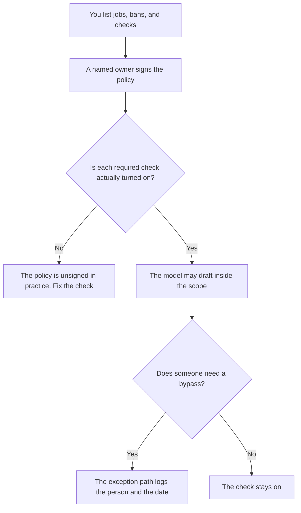

**An AI guardrail policy is a document a person signs that names which model actions are allowed, which checks must pass, and who approves an exception.** The filter that blocks a reply is the guardrail. The policy is why that filter exists, and what happens when someone wants it turned off.

The checks themselves are [what AI guardrails are](/blog/what-is-ai-guardrails-2026/). A rule the pipeline can execute is [what AI policy as code is](/blog/what-is-ai-policy-as-code-2026/). Text that tries to override your instructions is [what prompt injection is](/blog/what-is-prompt-injection-2026/). A person who still sends the email is [what human-in-the-loop AI is](/blog/what-is-human-in-the-loop-ai-2026/).

Prices are US list prices excluding tax from directory pages checked October 16, 2026, except Lindy's approval line, which the guardrails article read on October 24, 2026. Published October 24, 2026. This page does not rate any vendor's safety, and it is not legal advice.

## What the signed page contains

| Section | What you write | What fails the page |
|---|---|---|
| Scope | The product and the users it covers | "All AI" with no system named |
| Allowed jobs | The tasks the model may draft | A demo prompt pasted as policy |
| Banned actions | Money movement, customer email, record changes, or whatever you forbid without approval | A slogan about being helpful |
| Required checks | Input filter, output filter, tool permission, human approval | "We use guardrails" with no check named |
| Exception | Who may bypass a check, for how long, and where it is logged | A Slack yes with no date |
| Review date | When the owner rereads the page | A doc from last year nobody owns |

A slide that says "be safe" is a wish. A policy names the action and the check. Policy as code is one way to store a check the build can fail. You can sign a policy before any of it is code. You should not claim the code exists until someone can point at the control.

## Products where the policy has to be filled in

[Lindy](/tools/lindy/) states that anything with outside impact waits for approval: sending an email, updating a ticket, posting to a channel, publishing a doc. That sentence was read on the pricing page October 24, 2026. Paid use on that page starts at $49.99 per user per month for 5,000 credits. Your policy should say which of those actions are in scope for your workspace. The invoice is [Lindy pricing explained](/blog/lindy-pricing-explained-2026/).

[Chatbase](/tools/chatbase/) lets you set guardrails and test before going live, on the directory card checked October 16, 2026. Hobby is $32 a month billed yearly, with 700 message credits. The empty field is not a policy. Write the topics the agent may answer and the topics it must hand off. The handoff table is [how to create a support escalation matrix with AI](/blog/how-to-create-a-support-escalation-matrix-with-ai-2026/).

[Intercom Fin](/tools/intercom-fin/) bills $0.99 per outcome, with a $49 a month base that includes 50 resolutions, on the October 16 card. A procedure is inside your policy only if a person wrote the steps. The meter is [Intercom Fin pricing explained](/blog/intercom-fin-pricing-explained-2026/).

[n8n](/tools/n8n/) can place an AI step in a workflow you draw. Starter cloud is €20 a month billed annually for 2,500 executions, on the October 16 card. This page does not convert euros. A human node before a send is a check your policy can require. The drawing is the evidence.

[Claude](/tools/claude/) will refuse some requests from its own training. Your refund rule is not that training. The policy says which project files hold the rule, and which replies a person must read. Pro is $20 a month, or $17 billed annually.

## What the policy should refuse to be

It should refuse to be a prompt. A system prompt can quote the policy. It cannot replace the signature, the exception log, or the tool permission. The wording you hide in the prompt is [what a system prompt is](/blog/what-is-a-system-prompt-2026/).

It should also refuse to list attack steps. The policy names the checks you run. How to break those checks belongs in a private security review, not in this document and not in a customer-facing bot.

## FAQ

### Is the policy the same as the filter?

The filter is the control. The policy is the signed list of controls and the person who owns them. You can have a filter nobody approved. You can have a policy nobody implemented. You want both, and a date that says you checked.

### Can a small team skip the document?

You can keep it to one page. You still name the banned actions and the owner. A team of three can break a customer promise as easily as a team of three hundred if the model sends the email.

### Does buying a tool with "guardrails" satisfy the policy?

It satisfies the policy only for the checks you turned on and listed. A feature you did not configure is a menu item. Write the settings you actually use.

### How often should the owner reread it?

Put a date on the page. Reread it when you add a tool, a new action, or a new kind of customer data. A yearly review with no trigger in between will miss the Zap someone added in March.

## Last verified

October 24, 2026 for Lindy's approval language and the $49.99 line, from the guardrails article's read of lindy.ai/pricing. October 16, 2026 for Chatbase, Intercom Fin, n8n, and Claude. Published October 24, 2026.

**Sources:** [Lindy pricing](https://www.lindy.ai/pricing), [Chatbase pricing](https://www.chatbase.co/pricing), [Intercom Fin](https://fin.ai).

*Published by Andrew for [AI Tools Optimizer](https://aitoolsoptimizer.com).*

[Chatbase](/tools/chatbase/) is in the [customer support directory](/tools/category/customer-support/). Directory pages may use affiliate links. A purchase through them may earn us a commission at no extra cost to you.
