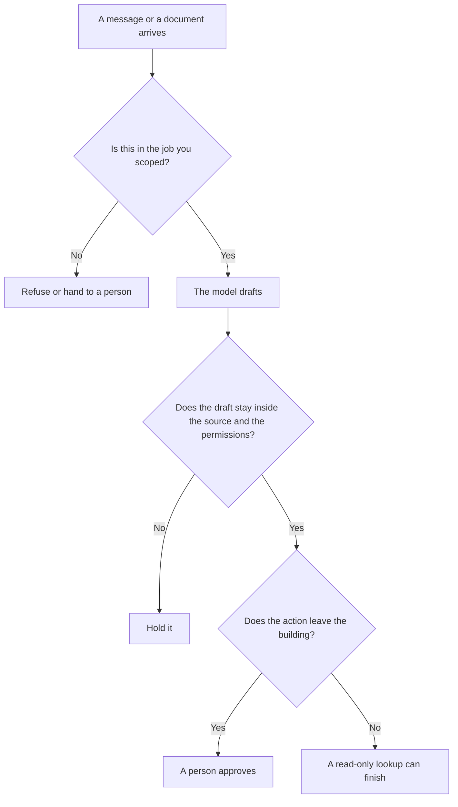

**AI guardrails are checks around a model that block, rewrite, or escalate an input or an output before it reaches a customer, a teammate, or another tool.** The model can still draft. The guardrail decides whether that draft is allowed to move.

Training a model to refuse harmful requests is [what AI safety and alignment are](/blog/what-is-ai-safety-alignment-2026/). A guardrail is the product layer on top of that training: a filter, a permission, a human click. Instructions you hide in the prompt are [what a system prompt is](/blog/what-is-a-system-prompt-2026/). A system prompt is not a guardrail. The model can be talked out of it by text in a document, which is [what prompt injection is](/blog/what-is-prompt-injection-2026/).

Published October 24, 2026. This page does not rate any vendor's safety.

## Where the check sits

| Check | What it watches | A failure you can describe |
|---|---|---|
| Input filter | The user's message, or a file they uploaded | A request to reveal another customer's data gets refused before the model answers |
| Output filter | The draft | A reply that adds a refund rule your policy does not contain is held |
| Tool permission | Which systems the model may call | The model can read the help center and cannot issue a refund |
| Human approval | The action, after the draft | An email waits until a person sends it |
| Topic boundary | The job you scoped | The bot says it only answers billing questions and routes the rest |

The pattern of handing steps to tools is [what function calling is](/blog/what-is-function-calling-in-ai-2026/). The pattern of several agents handing work around is [what AI agent orchestration is](/blog/what-is-ai-agent-orchestration-2026/). Guardrails are the permissions on those handoffs. Orchestration without permissions is a demo.

## What you can buy, and what you still configure

[Chatbase](/tools/chatbase/) is a support agent you train on your content. The directory, checked October 16, 2026, says you set guardrails and test before going live. Hobby is $32 a month billed yearly, with 700 message credits. The setting is yours to fill in. An empty guardrail field is a chat widget with your logo.

[Lindy](/tools/lindy/) states, on the pricing page read October 24, 2026, that anything with outside impact waits for approval: sending an email, updating a ticket, posting to a channel, publishing a doc. Read-only lookups from approved sources do not. That sentence is a guardrail you can hold the vendor to. Paid use on that page starts at $49.99 per user per month for 5,000 credits. The approval rule matters more than the credit pack. The invoice is [Lindy pricing explained](/blog/lindy-pricing-explained-2026/).

[Intercom Fin](/tools/intercom-fin/) resolves conversations and runs procedures. The directory lists $0.99 per outcome and a $49 a month base that includes 50 outcomes, checked October 16, 2026. A procedure is a guardrail only if a person wrote the steps. A model that "resolves" by inventing a policy is an outcome you paid for and should not have.

[n8n](/tools/n8n/) can put an AI step inside a workflow you can draw. Starter cloud is €20 a month billed annually for 2,500 executions, on the October 16 card. This page does not convert euros. A drawn workflow with a human node before the send is a guardrail. An agent with no diagram is [what an AI agent is](/blog/what-is-an-ai-agent-2026/), and it still needs the approval.

[Claude](/tools/claude/) will refuse some requests because of training. That is the alignment layer. Your refund policy is not in that training. Put the policy in the project files and fail the reply when it adds a rule. The repeatable version of that fail is [what AI eval testing is](/blog/what-is-ai-eval-testing-2026/).

## FAQ

### Are guardrails the same as the model's refusal training?

Refusal training is inside the model. Guardrails are checks you can point at: a blocked tool, a held email, a filter on a phrase, a person. You want both when the model can act. You want the checks you can see when you have to explain a miss.

### Does a content filter make a support bot safe?

It blocks some inputs and some outputs. It does not know your warranty. Pair the filter with articles the bot must quote, and with a person on anything that moves money.

### Should every internal tool have an approval?

Any action that emails a customer, changes a record, or spends money should wait. A summary shown to the person who asked can go through. Lindy's own split, read October 24, 2026, is that shape.

### Can a system prompt be the only guardrail?

It can state the rule. It cannot enforce the rule once untrusted text is in the context. Use a permission on the tool, and a person on the send.

## Last verified

October 24, 2026 for Lindy's approval language and the $49.99 starting line, from lindy.ai/pricing. October 16, 2026 for Chatbase, Intercom Fin, n8n, and Claude plan structure in the directory. Published October 24, 2026.

**Sources:** [Lindy pricing](https://www.lindy.ai/pricing), [Chatbase pricing](https://www.chatbase.co/pricing), [Intercom Fin](https://fin.ai).

*Published by Andrew for [AI Tools Optimizer](https://aitoolsoptimizer.com).*

[Chatbase](/tools/chatbase/) and [Intercom Fin](/tools/intercom-fin/) are in the [customer support directory](/tools/category/customer-support/). Directory pages may use affiliate links. A purchase through them may earn us a commission at no extra cost to you.
