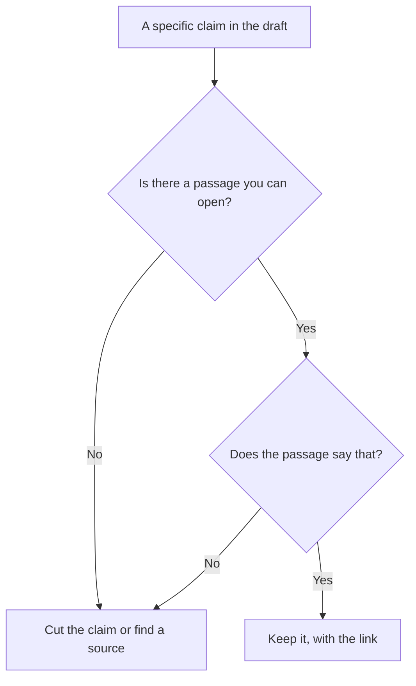

**An AI hallucination is a fluent claim that the source does not support.** The model states a price, a quote, a citation, or a policy as if it were in the document. Sometimes the document never said it. Sometimes the model named a paper that does not exist. The sentence can be grammatical and still be wrong. Fluency is not evidence.

You reduce the damage by attaching a source and checking the sentence against it. You do not remove the failure by asking the model to "never hallucinate." That instruction is a wish. The check is yours.

This page does not publish a hallucination rate. Vendors' percentages are their studies, on their prompts. Prices are US list prices excluding tax from directory pages checked October 16, 2026, except Perplexity's plan detail, which a later article read on October 24, 2026.

## Where the invented claim shows up

| What you asked | What a hallucination looks like | What to do instead |
|---|---|---|
| "What is our refund window?" with no policy attached | A plausible 30-day policy | Paste the policy, or refuse to publish a number that is not in it |
| "Cite a study" | An author, year, and title that do not resolve | Search papers in [Consensus](/tools/consensus/) or [Elicit](/tools/elicit/) and open the paper |
| "Summarize this PDF" | A finding from a different section, or from a similar paper | Require a quote, then find the quote in the file |
| A market figure | A dollar total with no page | [Perplexity](/tools/perplexity/), then open the link. The steps are [how to use Perplexity for market research](/blog/how-to-use-perplexity-for-market-research-2026/) |

The pattern of "retrieve, then write" is [what RAG is](/blog/what-is-rag-explained-2026/). RAG gives you a passage. It does not guarantee the summary matches the passage. You still do the match step.

## Tools that make the check cheaper

| Need | Start here | Price to know |
|---|---|---|
| A public-web claim with a link | [Perplexity](/tools/perplexity/) | Free includes limited Pro Searches. The October 24, 2026 help-center read lists 3 Pro Searches a day. Pro is $17/month billed annually |
| A peer-reviewed paper | [Consensus](/tools/consensus/) | Pro is $12/month on a $144 year, or $20 monthly |
| A table of fields pulled from papers | [Elicit](/tools/elicit/) | Plus is $11/user/month billed annually on the non-Industry card |
| Files you uploaded | [Gemini Notebook](/tools/gemini-notebook/) | Free with a Google account. Google AI Plus is $4.99/month |
| A draft from notes you paste, which you will line-edit | [Claude](/tools/claude/) or [ChatGPT](/tools/chatgpt/) | Claude Pro $20/month or $17 annual. ChatGPT Plus $20 |

The bill for Perplexity's ladder is [Perplexity pricing explained](/blog/perplexity-pricing-explained-2026/). The paper workflow is [how to research with Elicit and Consensus](/blog/how-to-research-with-elicit-and-consensus-2026/). A general chat is the wrong tool for "cite a real paper" unless you paste the paper.

## Habits that catch the failure before a client does

**Ask for the quote, then search the file for it.** If the quote is not in the file, the summary invented a finding. Delete the finding.

**Refuse numbers that have no page.** Revenue, headcount, and "studies show" are the usual inventions. A model will supply a round number because round numbers are common in training text.

**Split research from drafting.** Collect claims with links first. Then ask [Claude](/tools/claude/) to draft only from that list. The writing workflow is [how to write a blog post with Claude](/blog/how-to-write-a-blog-post-with-claude-2026/). A single prompt that says "research and write" hides the moment where a source should have been opened.

**Treat a missing source as an answer.** "Not in the notes" is a successful output. A completed paragraph with a made-up policy is the expensive one, because someone might follow it.

Temperature changes how varied the wording is. It does not add a citation. That setting is [what temperature means](/blog/what-is-temperature-in-ai-models-2026/). The underlying system is [what an LLM is](/blog/what-is-an-llm-2026/).

## FAQ

### Are hallucinations the same as bias?

No. Bias is a skew in what the model tends to say. A hallucination is a specific claim that is not supported. A sentence can be biased and sourced, or invented and neutral in tone. Check the claim either way.

### Does a bigger model stop this?

A different model can be wrong less often on a test the vendor chose. Your contract, your price, and yesterday's news are not that test. Attach the source. Open it.

### Is a citation proof?

A citation is a pointer. If the page 404s, or the page says something else, the citation failed. Perplexity and Consensus are useful because they give you the pointer. They do not replace the click.

### Should I tell the model it will be penalized for mistakes?

You can require quotes and abstention. A threat in the prompt is not a control. The control is the source check in the diagram above.

## Last verified

October 16, 2026 for most plan prices. October 24, 2026 for Perplexity's free-tier Pro Search note, via [Perplexity pricing explained](/blog/perplexity-pricing-explained-2026/). Published October 24, 2026.

**Sources:** [Perplexity pricing](https://www.perplexity.ai/pro), [Consensus pricing](https://consensus.app/pricing/), [Elicit pricing](https://elicit.com/pricing).

*Published by Andrew for [AI Tools Optimizer](https://aitoolsoptimizer.com).*

[Perplexity](/tools/perplexity/), [Consensus](/tools/consensus/), and [Elicit](/tools/elicit/) are in the [research directory](/tools/category/research-search/). Directory pages may use affiliate links. A purchase through them may earn us a commission at no extra cost to you.
