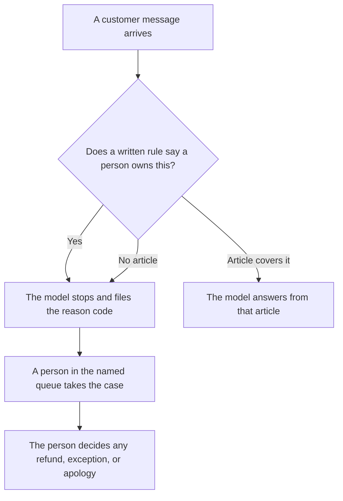

**AI human escalation is the moment a case leaves the model and a person owns it, with a reason code, a queue, and a stop so the model does not keep answering.** The customer asked for a person, the policy says a person must decide, or the model has no article that covers the ask. Escalation is that handoff. A polite paragraph that still guesses the refund is the model staying on the case.

A person who approves an action before it counts is [what human-in-the-loop AI is](/blog/what-is-human-in-the-loop-ai-2026/). The grid of who gets which severity is [how to create a support escalation matrix with AI](/blog/how-to-create-a-support-escalation-matrix-with-ai-2026/). The checks that should fire before a tool call is [what AI guardrails are](/blog/what-is-ai-guardrails-2026/). The note you send after a person has decided the remedy is [how to write a customer apology email with AI](/blog/how-to-write-a-customer-apology-email-with-ai-2026/).

Prices are US list prices excluding tax from directory pages checked October 16, 2026. Published October 24, 2026. We did not score how fast any vendor hands a chat to a person. This page is not a promise about wait times.

## What the handoff has to carry

| Field | Who fills it | The model may |
|---|---|---|
| Reason code | The list you published: asked for a person, no article, billing exception, safety, policy | Pick from that list. It may not invent a code |
| What the customer asked | The thread | Quote it. It may not restate the ask as a promise |
| What was already tried | The article ids, or "none" | List them. It may not claim an article was used |
| Who owns the queue | The role you named | Copy the role. It may not pick a teammate |
| What the model must stop doing | Reply, refund, account change | Stop. A second draft after the handoff is a second answer |

The reason code is a closed list. "The customer seems upset" is not a code until you define it and staff it. A code with no owner is a parking lot. The matrix article is where the severities and the roles are written. This page is the handoff those rows trigger.

## Where you meet this as a buyer

**A bot on your articles.** [Chatbase](/tools/chatbase/) Hobby is $32 a month billed yearly, or $40 monthly, with 700 message credits, on the October 16 card. The handoff is useful only if the bot stops when the article is silent. A bot that apologizes and invents a credit has skipped escalation. The corpus comes first: [how to build a knowledge-base chatbot](/blog/how-to-build-a-knowledge-base-chatbot-2026/).

**The draft of the reason list.** [Claude](/tools/claude/) Pro is $20 a month, or $17 billed annually, when the handbook of codes sits in a Project. The model can format the list you already use. It cannot add a severity you do not staff. The review is [Claude review](/blog/claude-review-2026/).

**The queue record.** [Notion AI](/tools/notion-ai/) Business is $20 a seat a month if the codes and the owners live in the wiki. The chat transcript is not the queue. The page with the owner is.

**The wording after a person decides.** [Grammarly](/tools/grammarly/) Pro is $12 a member a month billed annually, or $30 monthly, for a tone pass on a note whose facts are already frozen. Grammarly does not choose the remedy. The invoice is [Grammarly pricing explained](/blog/grammarly-pricing-explained-2026/).

## What to write down

Name the codes. Name the queue for each code. Name the actions the model loses the moment the code is set: no further reply, no refund tool, no account change. A retry of the same customer message must not open a second case. That property is [what AI idempotency is](/blog/what-is-ai-idempotency-2026/).

Do not accept "we escalate when confidence is low" as the design until someone shows the threshold and the queue it lands in. A number with no person behind it is a delay, then a wrong answer.

## FAQ

### Is escalation the same as a human in the loop?

A human in the loop approves an action before it counts. Escalation takes the case away from the model because a person has to own the outcome. You can require both: a person approves routine refunds, and a different queue takes the cases the policy excludes from the model entirely.

### Can the model write the apology while it escalates?

It can draft from facts a person already confirmed, and a person sends it. It should not send, and it should not invent the cause or the credit. The apology workflow is the linked article. The handoff is this one.

### What if the customer only wants a faster answer?

Wanting speed is not a reason to skip the code. If the article covers the question, answer from the article. If it does not, the fast wrong answer is the defect. Staff the queue, or narrow what the bot is allowed to touch.

### Does a help center remove the need to escalate?

A current help center shrinks the pile. It does not remove billing exceptions, safety cases, or a customer who asked for a person. Those rows stay on the matrix even when the articles are good.

## Last verified

October 16, 2026 for Chatbase, Claude, Notion AI, and Grammarly. Published October 24, 2026.

**Sources:** [Chatbase pricing](https://www.chatbase.co/pricing), [Claude pricing](https://claude.com/pricing), [Notion pricing](https://www.notion.com/pricing), [Grammarly Pro cost](https://support.grammarly.com/hc/en-us/articles/115000090011-How-much-does-Grammarly-Pro-cost).

*Published by Andrew for [AI Tools Optimizer](https://aitoolsoptimizer.com).*

[Chatbase](/tools/chatbase/) is in the [customer support directory](/tools/category/customer-support/). Directory pages may use affiliate links. A purchase through them may earn us a commission at no extra cost to you.
