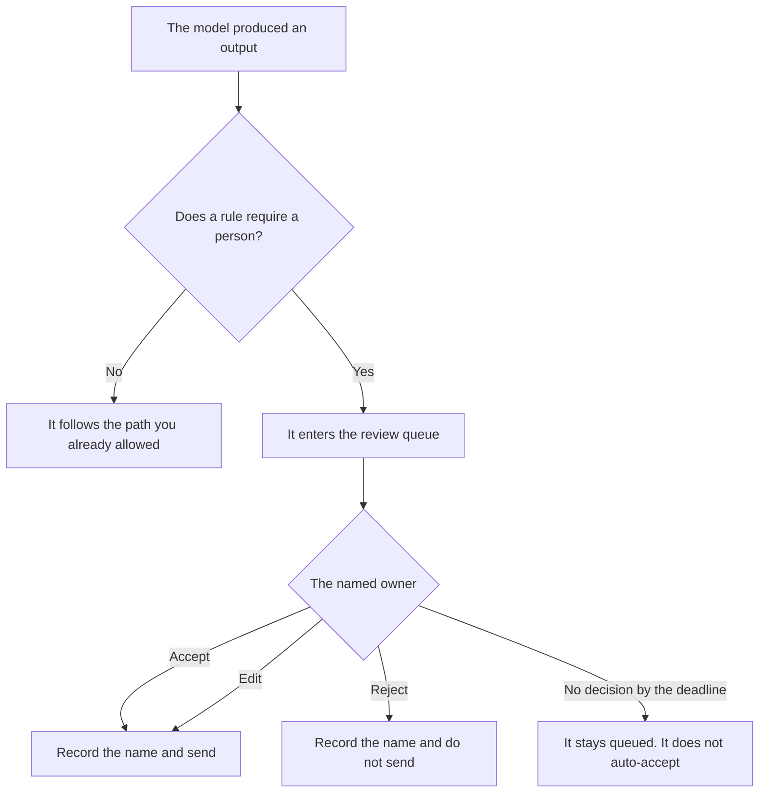

**An AI human review queue is a list of model outputs that stay incomplete until a named person accepts, edits, or rejects each one.** The output can sit in the product. It does not count as sent, published, or booked until that action is recorded. A dashboard that shows the text is not the queue. The queue is the decision.

The automatic check that can block a release is [what an AI eval gate is](/blog/what-is-ai-eval-gate-2026/). Logging an action without taking it is [what AI shadow mode is](/blog/what-is-ai-shadow-mode-2026/). A machine check on the shape of a response is [what AI output validation is](/blog/what-is-ai-output-validation-2026/). The support version of a path that never should have reached a person is [how to create a support deflection tree with AI](/blog/how-to-create-a-support-deflection-tree-with-ai-2026/).

Prices are US list prices excluding tax from directory pages checked October 16, 2026. A live fetch of vendor pricing pages on October 24, 2026 returned HTTP 401, so this page stays on the directory record. Published October 24, 2026. The directory does not list a human-review-queue fee. We did not measure review time.

## What the queue stores

| Field | Why it is there | Empty means |
|---|---|---|
| The output | The text or the action under review | There is nothing to decide |
| The reason it was queued | The rule that required a person | You cannot tell a policy sample from a random sample |
| The owner | The person who may accept it | Anyone's click is not an acceptance |
| The deadline | The clock you wrote | The item waits. It does not auto-send |
| The decision | Accept, edit, or reject, with the editor's name | The output is still a draft |

Shadow mode is for an action you are not ready to take at all. You log what the system would have done. A review queue is for an output you might take, after a person looks. Output validation can reject a malformed payload before it reaches the queue. It cannot accept a refund, a public page, or a customer email. That acceptance is a name.

If every output is queued, you have a bottleneck and you have not written a rule. If nothing is queued, you have decided that no class of output needs a person. Write the class down: money movement, a public claim, a policy exception, a message to a named customer.

## Where the queue is kept

**The page the reviewers already open.** [Notion AI](/tools/notion-ai/) Business is $20 a seat a month when the queue is a database with an owner and a status. The chat is not the queue. The invoice is [Notion AI pricing explained](/blog/notion-ai-pricing-explained-2026/).

**The rubric the reviewer reads.** [Claude](/tools/claude/) Pro is $20 a month, or $17 billed annually, when the accept and reject examples are long. The model may format examples you paste. It may not accept an item. The review is [Claude review](/blog/claude-review-2026/).

**The desk, when the output is a customer reply.** [Zendesk AI](/tools/zendesk-ai/) Suite Team is $55 per agent per month paid yearly, which is the directory's line for AI agents. Support Team at $19 does not include them, on that card. A macro can still require a person to send it. The lead's view of that change is [best AI tools for support ops leads](/blog/best-ai-tools-for-support-ops-leads-2026/).

**A short rubric.** [ChatGPT](/tools/chatgpt/) Plus is $20 a month. Discard a rubric that says the model may accept its own draft when the queue is busy.

A prompt that holds the line:

"Format a review-queue row from the output, the rule, the owner, and the deadline I pasted. Do not set the decision. If the owner is missing, write Owner missing and stop."

## What not to delegate

Do not auto-accept when the deadline passes. A missed review is a late review, or a reject, according to the rule you wrote in advance. Do not let the same model that drafted the output be the only reviewer. Do not put the raw customer record in a queue the whole company can browse. Redact first.

## FAQ

### How is this different from an eval gate?

The eval gate is an automatic check that can block a ship. The review queue is a person. You can require both: the gate must pass, and a named owner must still accept. A green gate is not an acceptance.

### How is this different from shadow mode?

Shadow mode records an action and does not take it. The review queue holds an output that a person may take. If you are not willing for a person to send it this week, it belongs in shadow mode, not in a queue that looks like work.

### What if the reviewer edits the output?

The edit is the version that sends, and the record keeps the original and the editor's name. An edit that adds a fact the source did not contain is a new draft. It goes back through the same rule.

### Can the queue live in a spreadsheet?

Yes, if that spreadsheet is the system the owner actually opens, and the status cannot be changed by a script you have not reviewed. A chat transcript is not a queue. You cannot tell who accepted the item.

## Last verified

October 16, 2026 for Notion, Claude, Zendesk, and ChatGPT. No human-review-queue product fee is recorded in the directory. Published October 24, 2026.

**Sources:** [Notion pricing](https://www.notion.com/pricing), [Claude pricing](https://claude.com/pricing), [Zendesk](https://www.zendesk.com), [ChatGPT pricing](https://chatgpt.com/pricing/).

*Published by Andrew for [AI Tools Optimizer](https://aitoolsoptimizer.com).*

[Notion AI](/tools/notion-ai/) is in the [productivity and notes directory](/tools/category/productivity-notes/). Directory pages may use affiliate links. A purchase through them may earn us a commission at no extra cost to you.
