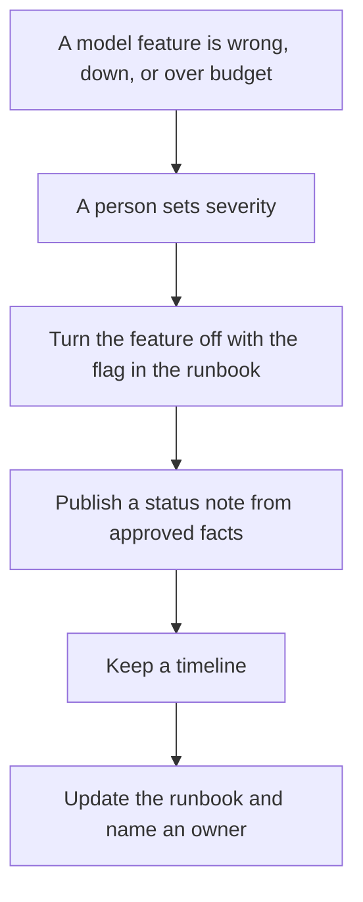

**AI incident response is the written path a team follows when a model-backed feature is wrong, down, or spending in a way you did not approve: a severity, an owner, a way to turn the feature off, a customer note, and a short record afterward.** This page is that path as operations and documentation. It does not describe attack techniques, payloads, or how to probe a system.

The file the on-call opens is [what an AI runbook is](/blog/what-is-an-ai-runbook-2026/). The switch that turns a model off without a redeploy is [what AI feature flags are](/blog/what-is-ai-feature-flags-2026/). The promise you can check is [what AI SLA monitoring is](/blog/what-is-ai-sla-monitoring-2026/). Traces and cost you can open are [what AI observability is](/blog/what-is-ai-observability-2026/).

Prices are US list prices excluding tax from directory pages checked October 16, 2026. Published October 24, 2026. We did not score incident tools. No incident-response product fee is on the cards below.

## The path, in the order a reader needs it

| Moment | The document says | A model may |
|---|---|---|
| Declare | Severity, product, start time, and the on-call name | Draft the sentence from fields you paste. It may not pick the severity |
| Contain | Which feature flag or key to turn off, and who is allowed to turn it off | Remind you of the flag name that is already in the runbook |
| Tell customers | What failed, what still works, and the next update time | Draft from the facts you approved. It may not invent a cause |
| Keep notes | A timeline with times and names | Format the notes. It may not add events that were not logged |
| Close | What changed in the runbook, and the date | Propose an edit. A person merges it |

Untrusted text in a document is a product risk to write down in the runbook, not a technique to practice here. The boundary, at the level of roles and checks, is [what a prompt injection defense is](/blog/what-is-a-prompt-injection-defense-2026/). The person who approves the customer sentence is [what human-in-the-loop AI is](/blog/what-is-human-in-the-loop-ai-2026/).

## Where the words live

**The runbook and the timeline.** [Notion AI](/tools/notion-ai/) on Notion Business is $20 a seat a month. That is the seat if the on-call page lives in Notion. Plus at $10 is not the full AI tier on the directory card. The invoice is [Notion AI pricing explained](/blog/notion-ai-pricing-explained-2026/).

**A first draft of the customer note.** [Claude](/tools/claude/) Pro is $20 a month, or $17 billed annually. Paste the approved facts. Delete any cause the timeline does not contain. The review is [Claude review](/blog/claude-review-2026/).

**The team seat, when the notes are confidential.** [ChatGPT](/tools/chatgpt/) Business is $20 a user a month billed annually for two or more users, or $25 monthly. Plus at $20 is a personal seat and a poor system of record for an incident. The ladder is [ChatGPT Go vs Plus vs Pro](/blog/chatgpt-go-vs-plus-vs-pro-2026/).

**The line edit on the public sentence.** [Grammarly](/tools/grammarly/) Pro is $12 a member a month billed annually. It will not know the severity rules.

The customer wording, as a habit, is [how to write a status update with AI](/blog/how-to-write-a-status-update-with-ai-2026/). The broader ops shelf for the people who carry the pager is [best AI tools for SRE teams](/blog/best-ai-tools-for-sre-teams-2026/). The docs shelf on this site is [best AI tools for security ops docs](/blog/best-ai-tools-for-security-ops-docs-2026/).

## What to leave out of the channel

Leave exploit steps, credentials, and customer payloads out of the status note and out of the prompt. Say what customers can do now. Say when you will update. A guessed root cause is [a hallucination](/blog/what-is-ai-hallucination-2026/) with a timestamp.

If spend is the incident, the ceiling you wish you had set is [what an AI budget cap is](/blog/what-is-ai-budget-caps-2026/). The spike itself is [what AI cost anomaly detection is](/blog/what-is-ai-cost-anomaly-detection-2026/).

## FAQ

### Is a chatbot outage an AI incident?

Treat it as one when the failure is the model, the tool it called, the retrieval it used, or the bill it ran up. A vendor status page can still be the cause. Your note should match what you know, including "we are waiting on the vendor."

### Who is allowed to turn the feature off?

The people named in the runbook. A well-written flag is useless if the on-call does not have access. Write the access next to the flag name.

### Can AI write the postmortem?

It can turn a timeline you paste into a draft. It cannot attend the incident. Every time, name, and customer impact in the draft has to match the log. The check is [how to fact-check AI writing](/blog/how-to-fact-check-ai-writing-2026/).

### Do we need a separate process from the rest of production?

Use the same severity names and the same status page if you already have them. Add the model-specific lines: which flag, which key, which prompt version, and who approves turning it back on.

## Last verified

October 16, 2026 for Notion, Claude, ChatGPT, and Grammarly prices named above. Published October 24, 2026.

**Sources:** [Notion pricing](https://www.notion.com/pricing), [Claude pricing](https://claude.com/pricing), [Grammarly Pro](https://support.grammarly.com/hc/en-us/articles/115000090011-How-much-does-Grammarly-Pro-cost).

*Published by Andrew for [AI Tools Optimizer](https://aitoolsoptimizer.com).*

[Notion AI](/tools/notion-ai/) is in the [productivity and notes directory](/tools/category/productivity-notes/). Directory pages may use affiliate links. A purchase through them may earn us a commission at no extra cost to you.
