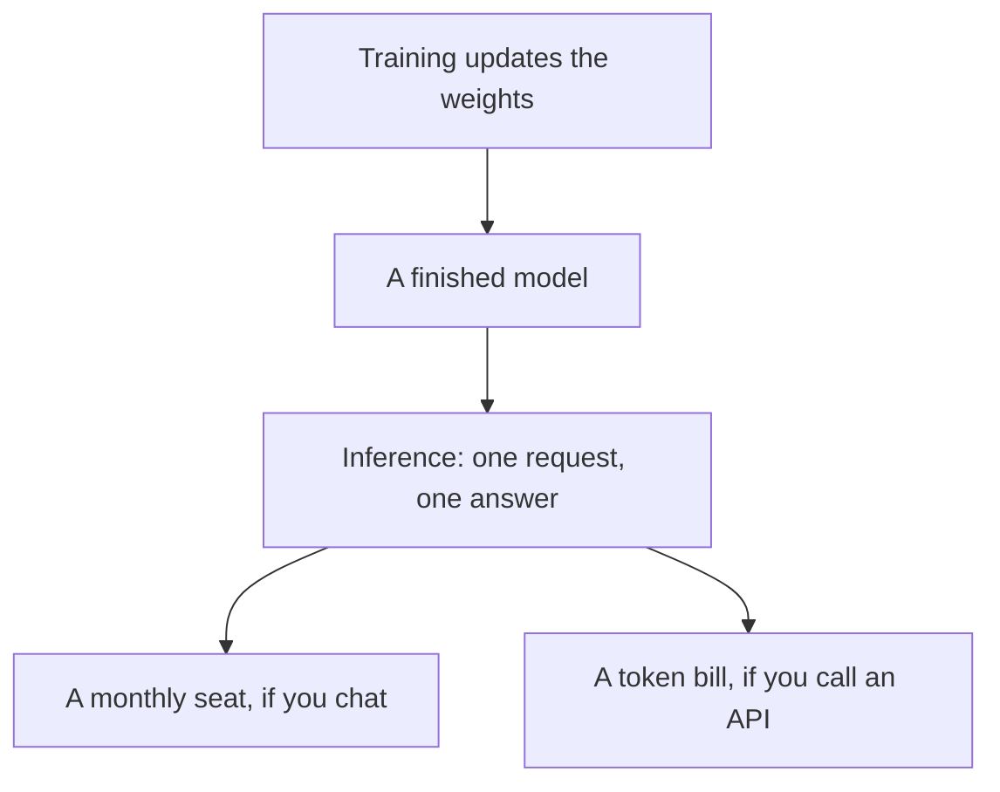

**Training is the work that produces a model. Inference is every time that model answers you.** A chat subscription pays for inference. An API bill pays for inference by the token. Training is a lab cost, or a separate fine-tuning project, and it is the wrong word for "I asked ChatGPT a question."

Prices below are US list prices excluding tax from directory pages checked October 16, 2026, published here on October 24, 2026. The unit those APIs count is [what AI tokens are](/blog/what-are-ai-tokens-explained-2026/). The model class is [what an LLM is](/blog/what-is-an-llm-2026/).

## The two jobs

| | Training | Inference |
|---|---|---|
| What happens | Weights are updated from examples | A finished model produces the next tokens |
| Who pays, for most readers | The lab that shipped the model | You, through a seat or an API |
| When it runs | Before the product exists, or during a fine-tune | Every prompt, every image, every meeting summary |
| What a failure looks like | A model that never learned the pattern | A wrong answer, a slow answer, or a bill that grew with volume |
| The lever you control | Whether to fine-tune at all | The prompt, the model, and how often you call it |

A prompt does not train the model. Writing a better instruction is [what prompt engineering is](/blog/what-is-prompt-engineering-2026/). Changing the weights on your own examples is [what fine-tuning is](/blog/what-is-fine-tuning-ai-2026/). Most teams never need that second project.

## What you are buying in a product

| Way you use a model | What the invoice is | A published price |
|---|---|---|
| Chat in an app | Inference, capped by the plan | [Claude](/tools/claude/) Pro is $20/month, or $17 billed annually. [ChatGPT](/tools/chatgpt/) Plus is $20. Go is $8 |
| A developer API | Inference, metered in tokens | [DeepSeek](/tools/deepseek/) chat is free. API input is from $0.15 per 1 million tokens off-peak on a cache miss. Output is $0.60 off-peak |
| A coding agent in a repo | Inference against your code, plus the editor seat | [OpenAI Codex](/tools/openai-codex/) sits on the coding side of the same split. The editor comparison is [Cursor vs Claude Code vs Codex](/blog/cursor-vs-claude-code-vs-codex-2026/) |
| "Train it on our wiki" | Usually retrieval, sometimes fine-tuning | Retrieval is [what RAG is](/blog/what-is-rag-explained-2026/). It does not update the weights |

DeepSeek's peak hours, recorded on the directory page, are 01:00–04:00 and 06:00–10:00 UTC on weekdays. Peak input on a cache miss is $0.30 per 1 million tokens, and peak output is $1.20. That gap is an inference schedule. It is a training decision only for the lab.

ChatGPT Pro, from $100 a month, raises inference limits inside the product. It does not hand you the weights. Claude Max, from $100 a month, is the same kind of purchase: more inference on the model Anthropic already trained.

## How to talk about it at work

**Say "inference" when the question is cost per answer.** A support bot that replies 15,000 times a month is an inference forecast. [Chatbase](/tools/chatbase/) prices that shape as message credits, from Hobby at $32 a month billed yearly for 700 credits. The credit is the product's name for inference plus the wrapper around it.

**Say "training" when someone proposes to change the model.** That proposal needs examples, an evaluation set, and a reason a prompt plus your documents failed. The site's model table, updated October 19, 2026, lists per-million-token inference prices for hosted models. Those numbers are answers, not the cost of the original training run.

**Say "fine-tuning" only for the middle case.** You start from a trained model and continue training on your set. You still pay inference afterward, every time you call the result.

## FAQ

### Does chatting train the model on my company data?

A vendor policy can say customer chats are excluded from later training. That policy is a contract term. The chat you just sent is still inference. Read the plan you are on before you paste a client file. This article does not score those policies.

### Why is the API cheap and the chat seat $20?

The seat bundles the app, the limits, and the support around inference. The API bill is closer to raw inference, and it grows when you send more tokens. A light chat user can spend less on Plus than a script that calls the API all day.

### Is generating an image inference?

Yes. The model that draws the picture is already trained. Each image is an inference call, whether the product hides it inside ChatGPT Plus or bills tokens on the image API. ChatGPT's image API rate recorded for GPT-Image-2.5 Sunburst is $8 per 1 million image input tokens and $30 per 1 million image output tokens.

### When should a team train its own model?

When a measured task stays wrong after a clearer prompt and a retrieved source, and you have examples you are allowed to train on. That is a project with an owner. A new chatbot seat is the ordinary next step.

## Last verified

October 16, 2026 for plan and API prices. Published October 24, 2026. The training-versus-inference split does not depend on a price change.

**Sources:** [Claude pricing](https://claude.com/pricing), [DeepSeek API pricing](https://api-docs.deepseek.com/quick_start/pricing/), [OpenAI ChatGPT pricing](https://openai.com/chatgpt/pricing/).

*Published by Andrew for [AI Tools Optimizer](https://aitoolsoptimizer.com).*

[Claude](/tools/claude/) and [ChatGPT](/tools/chatgpt/) are in the [chatbots directory](/tools/category/chatbots-assistants/). Directory pages may use affiliate links. A purchase through them may earn us a commission at no extra cost to you.
