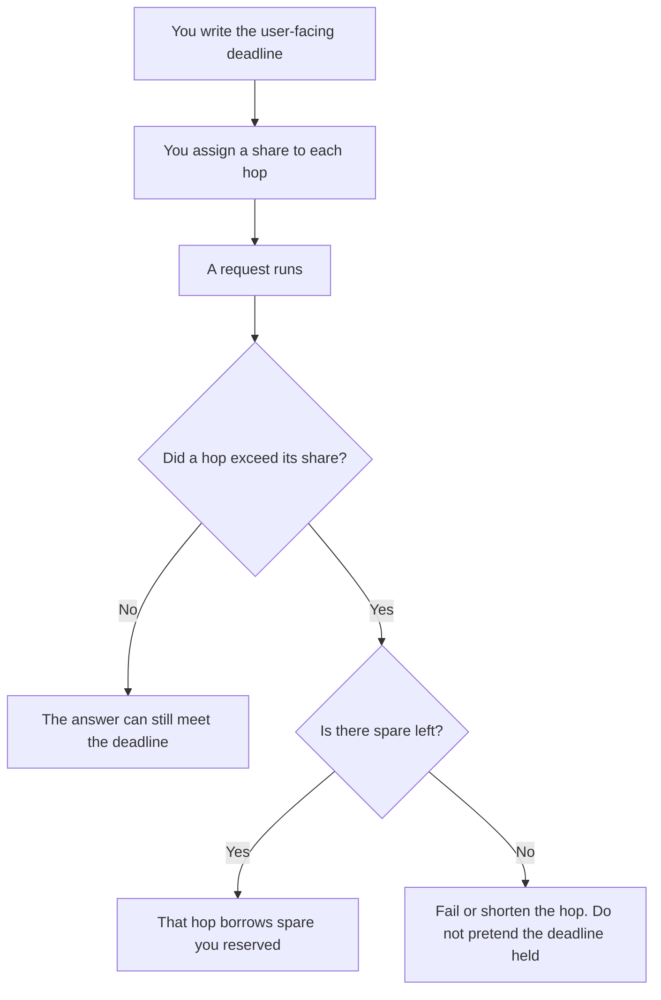

**An AI latency budget is the way you split one deadline you already chose across the hops that make an answer: retrieval, the model, tool calls, and the page that draws the result.** Latency is the wait. The budget is the allowance for each hop so the sum still fits the deadline. A hop with no allowance will spend whatever it wants.

The two clocks, one wait and the work finished in that minute, are [latency versus throughput](/blog/what-is-ai-latency-vs-throughput-2026/). The deadline you show a user is [what an AI SLO is](/blog/what-is-ai-slo-2026/). Watching a contractual target is [what AI SLA monitoring is](/blog/what-is-ai-sla-monitoring-2026/). Dropping work on purpose when the budget is gone is [what AI load shedding is](/blog/what-is-ai-load-shedding-2026/).

Prices are US list prices excluding tax from directory pages checked October 16, 2026. Published October 24, 2026. This page does not publish a speed score, and it does not recommend a millisecond target. The numbers in the example are placeholders you replace with measurements from your own system.

## The lines on the budget

| Hop | What it spends | What you write down |
|---|---|---|
| Network and auth | Time before your server sees the prompt | A share of the deadline |
| Retrieval | Time to fetch passages, if you fetch | A share, or zero if you do not retrieve |
| Model | Time to first token and time to finish | Two shares, because the user may see the first token sooner |
| Tools | Each external call the model makes | A share per call, with a max number of calls |
| Render | Time to show the answer | A share |
| Spare | Time you did not assign | The only place a hop may borrow |

An example you must replace: a team writes "8 seconds to a complete answer" as their own product rule. They might assign 1 second to retrieval, 5 seconds to the model, 1 second to a single tool, and 1 second to render. Those figures are an illustration of a split. They are not a benchmark, and they are not a vendor promise. Measure your hops and write your own shares.

## Where the deadline is yours, and where it is theirs

**A chat product.** [ChatGPT](/tools/chatgpt/) Plus is $20 a month. [Claude](/tools/claude/) Pro is $20 a month, or $17 billed annually. You do not get a hop diagram. Your budget, if the chat is the product, is the wait you will tolerate before you tell the user something failed. Their serving is [what model serving is](/blog/what-is-model-serving-2026/). A cold start, if you run your own instances, is a hop of its own: [what an AI warm pool is](/blog/what-is-ai-warm-pool-2026/).

**An API inside your feature.** [DeepSeek](/tools/deepseek/) records token prices, not a latency SLO, on the October 16 card. Put the model hop in your budget with a timeout you chose. The token price does not tell you the wait. Log the wait next to the usage so the cost center and the budget can be read together. The counter is [what AI token metering is](/blog/what-is-ai-token-metering-2026/).

**A bot on your site.** [Chatbase](/tools/chatbase/) Hobby is $32 a month billed yearly, with 700 message credits. The directory does not list a latency commitment. If the bot must answer inside a deadline you promise customers, that deadline is your SLO. The vendor's generation time is one hop. Your page and your handoff are the others.

## What the budget is for

Use it in an incident. "The model was slow" is not a line. "Retrieval took the model's share" is a line you can act on. Shorten the fetch, cut a tool, or change the deadline. Do not add the times after the fact and call it a budget.

A throughput win can hurt the budget. Serving more requests at once can make one request miss its share. Read both clocks. The budget is about the one request a person is waiting on.

## FAQ

### Is the latency budget the SLO?

The SLO is the promise, usually to a user or to another team. The budget is how you intend to keep that promise inside the system. You can miss the budget and still meet the SLO if spare covered it. You cannot meet the SLO for long if every hop is unbounded.

### Should time to first token and time to finish share one number?

Give them two shares when the interface streams. A user can see a start and still abandon a long completion. If you only show a finished message, one share for the model is enough, and you should say so.

### Can the model spend the retrieval budget?

Only if you reserved spare and the policy says borrowing is allowed. Silent borrowing is how every hop looks fine in isolation and the user still waits too long.

### Do we need a budget for an internal demo?

Write one number for the wait you will accept. A full hop table matters when the feature is in front of customers or on call. A demo can use a single timeout.

## Last verified

October 16, 2026 for ChatGPT, Claude, DeepSeek, and Chatbase prices. No latency figures on those cards are repeated here as scores. Published October 24, 2026.

**Sources:** [ChatGPT pricing](https://chatgpt.com/pricing/), [Claude pricing](https://claude.com/pricing), [DeepSeek API docs](https://api-docs.deepseek.com/), [Chatbase pricing](https://www.chatbase.co/pricing).

*Published by Andrew for [AI Tools Optimizer](https://aitoolsoptimizer.com).*

[Chatbase](/tools/chatbase/) is in the [customer support directory](/tools/category/customer-support/). Directory pages may use affiliate links. A purchase through them may earn us a commission at no extra cost to you.
