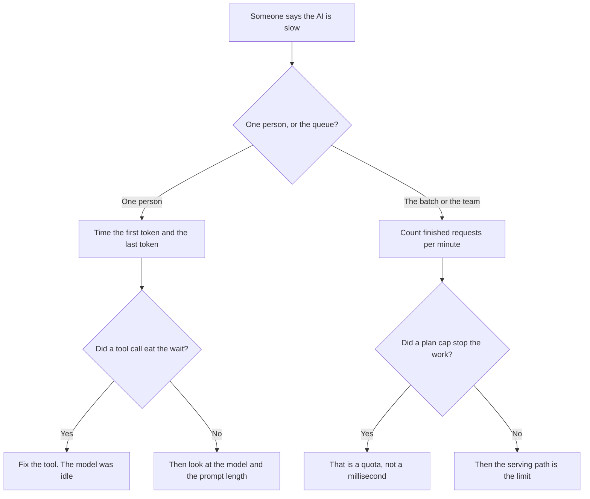

**Latency is how long one person waits for an answer. Throughput is how much work the system finishes in that same stretch of time.** A demo can feel instant and still fall behind when fifty people send prompts at once. You track both, because a change that shortens one wait can shrink the number of waits you can serve.

The bill for each answer is [what AI inference is](/blog/what-is-ai-inference-vs-training-2026/). The unit on that bill is [what AI tokens are](/blog/what-are-ai-tokens-explained-2026/). A record of one slow request is [what AI observability is](/blog/what-is-ai-observability-2026/).

Prices below are US list prices excluding tax from directory pages checked October 16, 2026, with DeepSeek's cache rows as confirmed in the October 24 review. Published October 24, 2026. This page does not publish a speed score.

## Two clocks, two complaints

| The complaint | The clock that answers it | What will not answer it |
|---|---|---|
| "This chat feels slow" | Time to the first token, then time until the answer stops | The monthly invoice |
| "The overnight job did not finish" | Requests or tokens completed per minute | One person's stopwatch from yesterday's demo |
| "We hit the plan limit at 2 p.m." | How many answers the seat allows | A faster model name with the same cap |
| "The tool call sat there" | Time inside your search, your database, or your ticket system | The model's token rate alone |
| "It got slower when the team joined" | Queue depth, then latency at that depth | A single-user test |

A slow tool is a latency incident. A full queue is a throughput incident. Logging only an average for the week hides both. The trace that separates them is the same one observability asks you to keep: prompt, tools, tokens, and the two times.

## Where a plan pretends to be a speed promise

A chat subscription sells a cap, not a latency SLA. [ChatGPT](/tools/chatgpt/) Plus is $20 a month. Go is $8. Pro starts at $100. Hitting Plus in the middle of the day is a throughput limit on that seat. It does not tell you how many milliseconds the next token took before the cap. The ladder is [ChatGPT Go vs Plus vs Pro](/blog/chatgpt-go-vs-plus-vs-pro-2026/).

[Claude](/tools/claude/) Pro is $20 a month, or $17 billed annually. Max from $100 is a usage multiple of Pro, recorded as 5× or 20×. Buy Max when Pro stops a workday. Do not buy it because one PDF felt slow. A long file and a short file pasted fifty times spend the cap differently. The split is [Claude Pro vs Max](/blog/claude-pro-vs-max-2026/).

[DeepSeek](/tools/deepseek/) chat is free. The API posts a token price, not a latency number. Flash input on a cache miss is $0.15 per million tokens off-peak and $0.30 at peak. Output is $0.60 off-peak and $1.20 at peak. Peak hours on the directory page are 01:00–04:00 and 06:00–10:00 UTC on weekdays. That window changes the bill. It is not a published response-time guarantee. The card is [DeepSeek review](/blog/deepseek-review-2026/).

[v0](/tools/v0/) is the other recorded meter in this set: dollars of tokens against a credit grant, including a cache-read column. A large project resent on every turn spends the grant. That is cost throughput, the rate at which credits disappear. The table is [v0 pricing explained](/blog/v0-pricing-explained-2026/).

## What you can change without inventing a benchmark

**Shorten the prompt that repeats.** A stable prefix is the job of [a context cache](/blog/what-is-a-context-cache-2026/). A cache hit can cut the input bill. It does not, by itself, publish a faster time-to-first-token.

**Ask for less output when the user is waiting.** Throughput of a live chat is often limited by how many tokens you generate, not by how clever the question was. A one-line answer finishes sooner than a memo. That is a product choice.

**Separate the live path from the pile.** A person at a keyboard cares about latency. A folder of documents that can wait cares about throughput and price. Mixing them on one endpoint is how the interactive user inherits the batch's queue. Speculative decoding, when a vendor uses it, is a latency technique. The definition is [what speculative decoding is](/blog/what-is-speculative-decoding-2026/). Quantization is a memory technique that can change both clocks. The definition is [what quantization is](/blog/what-is-quantization-in-ai-2026/).

**Time your prompt, on your plan.** This directory does not keep a leaderboard of milliseconds. A number from someone else's hardware will not match your tool calls.

## FAQ

### Is a higher token-per-second number the same as throughput?

It is one way to describe throughput for a single stream. Account throughput is how many of those streams finish before the plan, the queue, or the GPU runs out. Quote the unit. "Fast" is not a unit.

### Does a bigger context window lower latency?

A larger window lets you send more. More input usually takes more work before the first token. The ceiling this site has recorded, and the practical limit, is [what a context window is](/blog/what-is-a-context-window-2026/).

### Should I optimize latency or throughput first?

Optimize the complaint you can reproduce. One slow ticket is latency. A job that misses a morning deadline is throughput. Fix the one your users actually hit.

### Will a more expensive chat plan make tokens arrive faster?

It raises how much you may use. Treat a speed change as unproven until you time the same prompt on both plans. The receipt and the stopwatch answer different questions.

## Last verified

October 16, 2026 for ChatGPT, Claude, and the DeepSeek directory rates. October 24, 2026 for the DeepSeek review's confirmation of those Flash rates and for v0's cache columns. Published October 24, 2026. The definitions do not depend on a price change.

**Sources:** [DeepSeek API docs](https://api-docs.deepseek.com/), [Claude pricing](https://claude.com/pricing), [ChatGPT pricing](https://chatgpt.com/pricing).

*Published by Andrew for [AI Tools Optimizer](https://aitoolsoptimizer.com).*

[DeepSeek](/tools/deepseek/) is in the [chatbots and assistants directory](/tools/category/chatbots-assistants/). Directory pages may use affiliate links. A purchase through them may earn us a commission at no extra cost to you.
