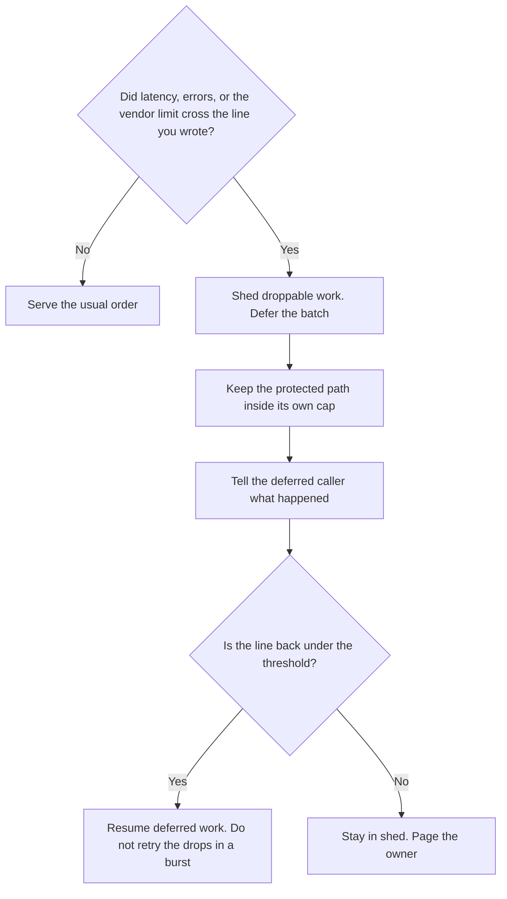

**AI load shedding is a written rule for overload: when latency, errors, or a vendor limit cross a line you set, you drop or delay the work you marked as deferrable so the path you promised stays up.** The model is not "smarter" under shed. It is simply not being asked to do the optional job. A queue that grows forever is not shedding. Shedding is a decision to refuse something on purpose.

The standing cap, before you are in trouble, is [what AI rate limiting is](/blog/what-is-ai-rate-limiting-2026/). Who waits, among calls you still intend to serve, is [what AI traffic shaping is](/blog/what-is-ai-traffic-shaping-2026/). The promise you publish for the path that must survive is [what AI SLA monitoring is](/blog/what-is-ai-sla-monitoring-2026/). Stopping calls to a dependency that is already failing is [what an AI circuit breaker is](/blog/what-is-ai-circuit-breaker-2026/).

Prices are US list prices excluding tax from directory pages checked October 16, 2026. Published October 24, 2026. The directory does not list a load-shedder fee, so this page does not invent one. We did not measure any vendor's overload behavior.

## What you classify before the spike

| Class | Example you might write | Under overload |
|---|---|---|
| Protected | The customer reply you advertised a response time for | Keep serving. Shed other classes first |
| Deferrable | A nightly summary, a backfill, a "regenerate the draft" button | Delay, then run when the line clears |
| Droppable | A duplicate click, a preview, a suggestion nobody is waiting on | Refuse immediately and say so |
| Never automatic | A payment, a send, a delete | A person already had to confirm. Do not shed by guessing. Do not proceed by guessing either |

A retry of every dropped call, the moment you recover, is a second spike. Dropped means dropped. Deferred means a schedule, not a thundering herd.

The record of which class you shed belongs in [structured logging for AI](/blog/what-is-structured-logging-for-ai-2026/). If the log says only "error," you cannot prove you protected the path you named.

## Seats and paths that meet a real cap

Shedding is your rule. These are the plans where a cap already exists, so you know what "full" can look like.

| Path | What the directory recorded | What you still decide |
|---|---|---|
| A personal chat | [ChatGPT](/tools/chatgpt/) Plus is $20 a month. [Claude](/tools/claude/) Pro is $20, or $17 billed annually | Which of your own tasks you stop when the plan slows you down. The vendor's cap is not your shed list |
| A help desk that bills outcomes | [Zendesk AI](/tools/zendesk-ai/) Suite Team is $55 per agent per month paid yearly | Which tickets may wait. Automated resolutions can bill on top. A shed that hides tickets is an outage |
| A workflow you can pause | [Zapier](/tools/zapier/) Professional is $19.99 a month billed annually. Free is 100 tasks a month | Which Zap stays on when tasks run out |
| A second workflow tool | [Make](/tools/make/) Core is $9 a month billed annually for 10,000 credits | Which scenario is droppable. Credits are the meter |

Zendesk's card is not a license to invent a resolution price beyond what the directory already says. The support stack is [best AI tools for support teams](/blog/best-ai-tools-for-support-teams-2026/). The public sentence, if customers can see the shed, is [how to write a status page update with AI](/blog/how-to-write-a-status-page-update-with-ai-2026/).

## What not to shed by accident

Do not shed the path that takes payment, sends a customer message, or deletes data, unless a person has a separate confirmation and the shed only stops the suggestion. Do not mark everything "protected," or you have no shed list. Do not shed by closing the whole product when one batch job was the spike. Remove the batch first.

A fallback to a cheaper model can be part of the protected path's plan. It is not shedding. Shedding removes work. Fallback still does the work, on a model you named. That swap is [what AI fallback routing is](/blog/what-is-ai-fallback-routing-2026/).

## FAQ

### Is load shedding the same as a rate limit?

A rate limit is always on. Shedding starts when you cross an overload line. You can be under the rate limit and still need to shed, if the vendor is slow or a dependency is failing. You can be over a generous rate limit and still have no overload. Write both numbers.

### What should the user see?

A sentence you wrote in advance: this action is paused, try again later, or it was not run. A spinner is not a shed. A fake success is worse.

### Can the model decide what to drop?

No. The classes are a product decision. The model is the work being dropped or kept. Letting the model choose which customer to ignore is an unreviewed policy.

### When do we resume?

When the line you wrote is back in range for a period you wrote, and a person or a job you trust turns deferred work back on. Resume in a trickle if the deferred pile is large.

## Last verified

October 16, 2026 for the prices named above. Published October 24, 2026. The definition does not depend on a price change.

**Sources:** [ChatGPT pricing](https://chatgpt.com/pricing/), [Claude pricing](https://claude.com/pricing), [Zendesk pricing](https://www.zendesk.com/pricing/).

*Published by Andrew for [AI Tools Optimizer](https://aitoolsoptimizer.com).*

[Zendesk AI](/tools/zendesk-ai/) is in the [customer support directory](/tools/category/customer-support/). Directory pages may use affiliate links. A purchase through them may earn us a commission at no extra cost to you.
