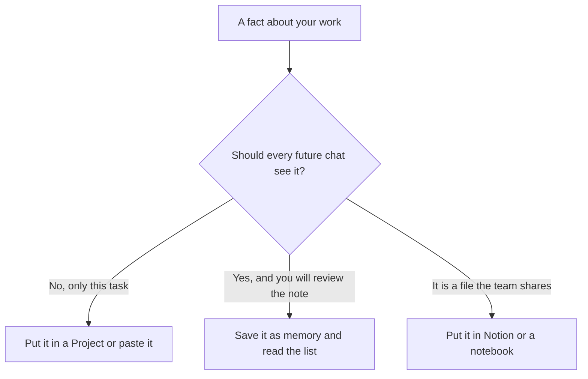

**AI memory is a saved note the product can attach to a later chat, so you do not retype a preference or a fact about your work.** It is not the chat you have open. It is not the file you uploaded this morning. If you cannot open the note and delete it, you do not have memory. You have a long transcript.

People mix up three stores. The [context window](/blog/what-is-a-context-window-2026/) is what this request can see. A Project or a notebook is a folder you curate. Memory is the product's own list of notes about you. They fail in different ways, and they are billed on different plans.

Prices are US list prices excluding tax from directory pages and the plan matrix recorded for October 16 and October 24, 2026. Published October 24, 2026. We did not score how well any product remembers.

## Three stores people call memory

| Store | Who writes it | What a new chat can see | How you turn it off |
|---|---|---|---|
| This chat's window | You, plus the reply so far | Only this thread, until the window or the app drops earlier turns | Start a new chat |
| A Project, custom GPT, or notebook | You, on purpose | The instructions and files you put there | Remove the file or leave the project |
| Product memory | The product, sometimes after you agree | A note it saved, injected later | The memory setting, if the product shows the note |

A preference such as "write in short paragraphs" is a memory candidate. A client contract is not. The contract belongs in a Project you open for that client, or in the wiki. Memory that swallows the contract will leak it into the next unrelated chat.

## What the plan cards actually say

| Product | What the recorded card says about memory | Price to know |
|---|---|---|
| [Claude](/tools/claude/) | Free lists memory, along with files, connectors, and Artifacts. Pro adds usage, Projects, and Claude Code | Free is $0. Pro is $20/month, or $17 billed annually |
| [ChatGPT](/tools/chatgpt/) | Free includes limited memory. Go, at $8, lists more memory than Free. Plus, at $20, is where advanced reasoning and projects sit. Pro is described as maximum memory | Go may include ads. Plus is $20. Pro starts at $100 |
| [Gemini](/tools/gemini/) | The directory prices Google AI plans. It does not record a separate "memory add-on" | Pro is $19.99/month and is the card that lists Gemini in Gmail and Docs |
| [Gemini Notebook](/tools/gemini-notebook/) | The notebook stays on sources you add. That is a corpus, not a hidden profile | Free with a Google account. Higher limits from Google AI Plus at $4.99 |
| [Notion AI](/tools/notion-ai/) | The page is the memory. Business is where Agent and meeting notes sit | Business is $20 per seat per month |

The ChatGPT ladder, including which tier lists more memory, is [ChatGPT Go vs Plus vs Pro](/blog/chatgpt-go-vs-plus-vs-pro-2026/). The writing split, which cares about Projects more than about a profile, is [ChatGPT vs Claude for writing](/blog/chatgpt-vs-claude-for-writing-2026/). A Project versus a custom GPT is [ChatGPT Projects vs custom GPTs](/blog/chatgpt-projects-vs-custom-gpts-2026/). Claude's container versus ChatGPT's is [Claude Projects vs ChatGPT Projects](/blog/claude-projects-vs-chatgpt-projects-2026/).

Gemini Notebook is the clean case of "only these files." The study version is [how to study with Gemini Notebook](/blog/gemini-notebook-study-workflows/). Do not call that memory. A new notebook does not know the previous notebook unless you put the source there.

## What to save, and what to refuse

**Save a stable preference you are willing to see repeated.** Tone, format, the name of the team. Review the list once a month. Delete the note that is no longer true. A stale title in memory becomes a wrong signature.

**Refuse secrets, health details, and anything a colleague should not see if they open your laptop.** Memory is a convenience feature. It is a poor vault. The enterprise card, where it exists, is the place to read training and retention. ChatGPT Business is $20 per user per month billed annually, for two or more users, on the October 16 card. That is admin and data controls, not a promise that memory behaves like a records system.

**Prefer a Project when the fact has a scope.** "This client's brand" belongs to that client. "I like tables" can be memory. Mixing them is how a pitch for Client A mentions Client B.

**Do not use memory as a database.** If the fact changes weekly, put it in Notion or in the file you attach. A remembered price will outlive the price list. That stale sentence is [a hallucination](/blog/what-is-ai-hallucination-2026/) you helped write.

ChatGPT's own directory note says to turn memory on carefully and review what it remembers. That sentence is the product advice. A larger context window does not retire it. The window forgets when the chat ends. Memory is the part that does not.

## FAQ

### Is memory the same as a long context window?

No. The window is this request. Memory is a note reused later. Claude's recorded context can reach 1 million tokens depending on the model. That figure is not a memory quota. The window article is the place for the limit. This article is the place for the note.

### Does ChatGPT Free have memory?

The plan matrix recorded for this site says Free includes limited memory, and Go lists more memory than Free. Plus is not the first plan that mentions memory. Plus is the plan for reasoning, projects, and expanded Codex. If a setting is missing on your account, the product UI wins over this sentence.

### Should a team share one person's memory?

No. Shared facts belong in a wiki the team can edit. [Notion AI](/tools/notion-ai/) at the Business seat is that wiki. One employee's memory is a personal scratchpad. The notes comparison is [Notion AI vs ChatGPT for notes](/blog/notion-ai-vs-chatgpt-for-notes-2026/).

### Can I export it?

If the product shows the list, you can at least read and delete it. If it does not show the list, do not put anything there you would need to produce later. A memory you cannot audit is a setting to leave off.

## Last verified

October 16, 2026 for Claude, Notion, and Gemini prices. October 24, 2026 for the ChatGPT memory split as recorded in the Go, Plus, and Pro comparison. Published October 24, 2026.

**Sources:** [ChatGPT pricing](https://chatgpt.com/pricing/), [Claude pricing](https://claude.com/pricing), [Notion AI](https://www.notion.com/product/ai).

*Published by Andrew for [AI Tools Optimizer](https://aitoolsoptimizer.com).*

[Claude](/tools/claude/) and [ChatGPT](/tools/chatgpt/) are in the [chatbots directory](/tools/category/chatbots-assistants/). Directory pages may use affiliate links. A purchase through them may earn us a commission at no extra cost to you.
