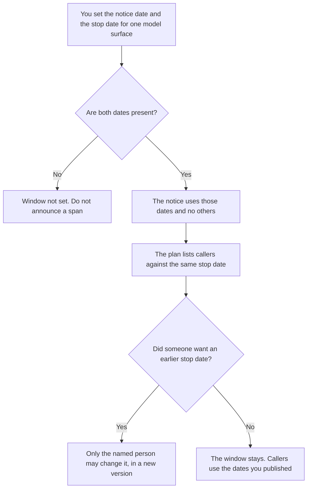

**An AI model deprecation window is the span a person set between the date a notice goes out and the date a named model surface stops accepting calls.** The customer or developer message is [how to write a model deprecation notice with AI](/blog/how-to-write-a-model-deprecation-notice-with-ai-2026/). The caller list and the fallback are [how to write a model deprecation plan with AI](/blog/how-to-write-a-model-deprecation-plan-with-ai-2026/). This page is the span. If either date is missing, the window is not set.

A feature you are retiring in your own product, rather than a model surface, is [how to write a feature deprecation note with AI](/blog/how-to-write-a-feature-deprecation-note-with-ai-2026/). Do not reuse a model window for a button you are removing unless you meant that date.

Claude's prices are the October 24, 2026 read of claude.com/pricing recorded in [Claude pricing explained](/blog/claude-pricing-explained-2026/). Cursor, Notion, and ChatGPT prices are from the posts cited below, with Cursor and Notion on the October 16 directory cards and ChatGPT on the October 24 plan page. Published October 24, 2026. We did not score migration speed. The directory does not list a deprecation-window fee.

## What the window has to name

| Line | Who writes it | A blank means |
|---|---|---|
| Model surface | You | Callers guess which name will stop |
| Notice date | You | The stop date has no start |
| Stop date | You | The notice has no end |
| What still works during the window | You | A caller assumes the old model is fully supported |
| Who may move the stop date | A person | A draft notice shortens the window |

The window is not a grace period the model may invent. It is two dates. Work that must finish before the stop date belongs in the plan, with an owner. The window does not assign that owner.

A vendor's published retirement date is an input you paste. This page does not keep a live table of vendor dates. If the vendor moves the date, a person updates the window. The old notice stays attached to the old dates so you can see what callers were told.

## Where the dates are kept

**The definition of the window.** [Claude](/tools/claude/) Pro is $17 a month billed annually, $200 up front, or $20 monthly. The Project holds the surface name and both dates. The review is [Claude review](/blog/claude-review-2026/).

**The diff, if callers live in a repo.** [Cursor](/tools/cursor/) Plus is $8 a month, or $80 a year. You review the diff that points a caller at the replacement. The model does not merge it. The ladder is [Cursor pricing explained](/blog/cursor-pricing-explained-2026/).

**The register.** [Notion AI](/tools/notion-ai/) Business is $20 a seat a month. One row per surface: notice date, stop date, and the person who may move them. The invoice is [Notion AI pricing explained](/blog/notion-ai-pricing-explained-2026/).

**The notice draft from a short paste.** [ChatGPT](/tools/chatgpt/) Plus is $20 a month. Go is $8 a month. Plus is the seat for a saved notice. Discard a draft that moves a date. The ladder is [ChatGPT pricing explained](/blog/chatgpt-pricing-explained-2026/).

A prompt that holds the line:

"Draft the deprecation-window row from the model surface, the notice date, and the stop date I pasted. If either date is missing, write Window not set. Do not move a date. Do not name a replacement I did not paste."

## What not to delegate

Do not ask the model how long teams "usually" need. Do not shorten the window because a migration draft looks finished. Do not announce a stop date that is not on the row. The owner of the surface sets both dates. A formatted notice is not a new window.

## FAQ

### How is this different from a deprecation notice?

The notice is the message: which surface, which date, what the reader must do. The window is the span that message is allowed to quote. Write the window first. The notice copies it. If the notice and the window disagree, the window row wins until a person changes the row, and you correct the notice.

### How is this different from a deprecation plan?

The plan is the caller list, the fallback, and who does the work before the stop date. The window is only the two dates. A plan without a stop date is a wish. A window without a caller list still tells you when the surface stops. Do not hide the caller list inside the window row.

### How is this different from a feature deprecation note?

A feature note is about a behavior in your product: a button, an endpoint you own, a replacement you named. A model window is about a model surface that will stop accepting calls. The same week can contain both. Keep the dates on the row that matches the thing that is ending.

### Who may move the stop date?

The person named on the window. A vendor email is a reason for that person to edit the row. It is not an automatic edit. Callers who already received the old notice need the new dates in a new notice. The old dates stay in the record.

## Last verified

October 24, 2026 for Claude and for ChatGPT's plan page, via the posts cited above. October 16, 2026 for Cursor and Notion. Published October 24, 2026.

**Sources:** [Claude pricing](https://claude.com/pricing), [Cursor pricing](https://cursor.com/help/account-and-billing/pricing), [Notion pricing](https://www.notion.com/pricing), [ChatGPT and Codex pricing](https://learn.chatgpt.com/docs/pricing).

*Published by Andrew for [AI Tools Optimizer](https://aitoolsoptimizer.com).*

[Cursor](/tools/cursor/) is in the [coding directory](/tools/category/coding/). Directory pages may use affiliate links. A purchase through them may earn us a commission at no extra cost to you.
