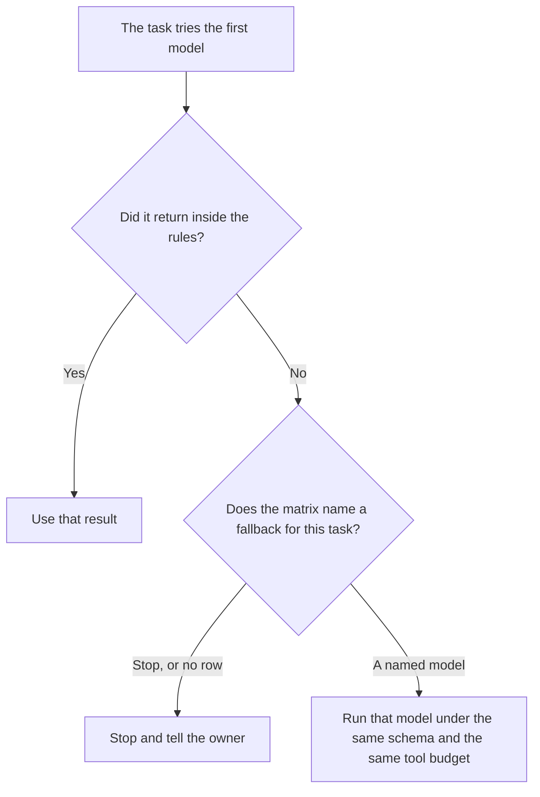

**An AI model fallback matrix is a table a person writes before the outage. Each row names the task, the first model, the model that may run if the first one cannot, and the rules that stay the same.** An empty cell means that task stops. A cheaper model is allowed only on a row where a person already wrote it. A vote among models that are all healthy is [what an AI multi-model vote is](/blog/what-is-ai-multi-model-vote-2026/). The count of tool calls that still applies on the fallback row is [what an AI tool call budget is](/blog/what-is-ai-tool-call-budget-2026/).

Claude's prices are from claude.com/pricing on October 24, 2026. ChatGPT Plus is $20 a month on learn.chatgpt.com/docs/pricing that day. GitHub Copilot and Cursor prices are from directory pages checked October 16, 2026. Published October 24, 2026. We did not score models. The directory does not sell a fallback-matrix product.

## What a row must contain

| Column | Who fills it | A blank means |
|---|---|---|
| Task name | The owner | That task is not covered. It stops |
| First model | The owner | There is no default to invent |
| Fallback model | The owner, or the word Stop | Stop is a complete answer |
| What must stay identical | The owner: schema, tools, pinned policy | The fallback may not widen the job |
| Who is told | The owner | A silent swap is a failed row |

A matrix that says "use whatever is up" is a wish. The row has a name. If gpt-6-luna is the fallback for summaries and nothing is named for refunds, refunds wait. Price is a reason to pick a row in advance. It is not a reason for the agent to hop during the incident. A spend spike after the hop is [what an AI cost anomaly alert is](/blog/what-is-ai-cost-anomaly-alert-2026/).

## Where the matrix is used

**The policy in a project.** [Claude](/tools/claude/) Pro is $17 a month billed annually, $200 up front, or $20 monthly. Store the matrix in the Project so the on-call note and the agent read the same table. The review is [Claude review](/blog/claude-review-2026/).

**One workflow in a chat seat.** [ChatGPT](/tools/chatgpt/) Plus is $20 a month. Business is $20 a user a month billed annually for two or more users, or $25 monthly, on that October 24 page, when the matrix is company data. The seat ladder is [ChatGPT pricing explained](/blog/chatgpt-pricing-explained-2026/).

**The IDE, if the fallback is a coding model.** [GitHub Copilot](/tools/github-copilot/) Business is $19 a user a month on the October 16 card. A personal Pro seat at $10 does not set the company's fallback row. The invoice is [GitHub Copilot pricing explained](/blog/github-copilot-pricing-explained-2026/).

**The diff, if the fallback edits a repo.** [Cursor](/tools/cursor/) Plus is $8 a month, or $80 a year, on that card. The fallback model still owes you a diff you can read. The ladder is [Cursor pricing explained](/blog/cursor-pricing-explained-2026/).

A prompt that holds the line:

"If the first model fails, use only the fallback named on the row for this task. If the cell says Stop, stop. Do not pick a model because it is cheaper or because it answered once before."

## What not to delegate

Do not let the agent add a row during the outage. Do not treat a successful fallback as permission to make it the new first model. Do not copy a vendor status page into the matrix and call the outage over. The owner updates the row.

## FAQ

### How is this different from a multi-model vote?

A vote asks more than one healthy model and compares them. A fallback runs when the first model cannot. You can have both. The vote does not fill a blank fallback cell.

### Does the tool budget reset on the fallback?

Only if the matrix says so. The default on this page is that the same tool-call budget still applies. A second model is not a new task unless a person opens one.

### Can every task share one fallback?

Only if you write that. A summary and a payment decision do not inherit the same row because they share a product. Copy the row if you mean it, and leave Stop where you mean Stop.

### Who may change the matrix?

The owner named on the document. An incident channel can request a change. The request is not the change until that owner writes it.

## Last verified

October 24, 2026 for Claude and for ChatGPT Plus and Business. October 16, 2026 for GitHub Copilot and Cursor. No fallback-matrix fee is recorded in the directory. Published October 24, 2026.

**Sources:** [Claude pricing](https://claude.com/pricing), [ChatGPT and Codex pricing](https://learn.chatgpt.com/docs/pricing), [GitHub Copilot](https://github.com/features/copilot), [Cursor pricing](https://cursor.com/help/account-and-billing/pricing).

*Published by Andrew for [AI Tools Optimizer](https://aitoolsoptimizer.com).*

[Claude](/tools/claude/) is in the [chatbots and assistants directory](/tools/category/chatbots-assistants/). Directory pages may use affiliate links. A purchase through them may earn us a commission at no extra cost to you.
