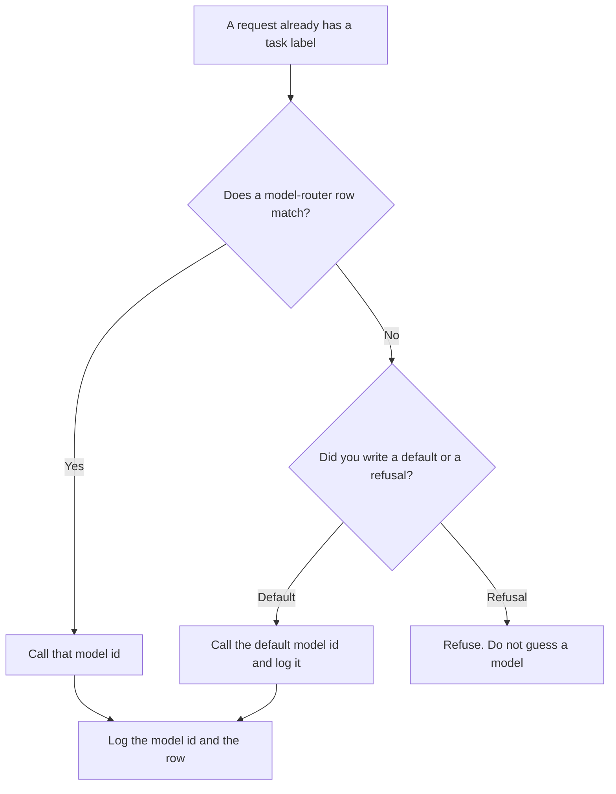

**An AI model router picks the model id for a request from a rule you already wrote: the task label, the context size, or the budget still left.** It does not invent the task. The table that sends a labeled request to a prompt template is [what an AI prompt router is](/blog/what-is-ai-prompt-router-2026/). The match by meaning, when there is no label, is [what an AI semantic router is](/blog/what-is-ai-semantic-router-2026/). The broader choice of model, queue, or batch before work starts is [what AI routing is](/blog/what-is-ai-routing-2026/). This page is the column that holds a model id.

The single door in front of many models is [what a model gateway is](/blog/what-is-a-model-gateway-2026/). The cap on how much this request may spend is [what an AI request budget is](/blog/what-is-ai-request-budget-2026/). The ordered stops after the chosen model fails are [what an AI fallback chain is](/blog/what-is-ai-fallback-chain-2026/).

Prices are US list prices excluding tax from directory pages checked October 16, 2026. A live fetch of several vendor pricing pages returned HTTP 401 on October 24, 2026, so this page stays on the directory record. Published October 24, 2026. The directory does not list a model-router fee. We did not measure routing accuracy.

## What the rule may look at

| Signal you already have | A model id the rule may name | A rule that will surprise you |
|---|---|---|
| Task label from the prompt router | The model you approved for that label | "The best model" |
| Context size over a line you set | The model whose window you already checked | A silent truncation |
| Budget remaining under the cap | The cheaper model id you named for that case | Whichever vendor is discounting this hour |
| No row matches | A default you wrote, or a refusal | The most expensive model, because it was first in the client |

The prompt router can run first and hand this router a label. The semantic router can run when the label is missing, and it should land on an unknown bucket rather than a model you did not name. If both fire and they disagree, you wrote two owners. Pick one order and log it.

## Where the model id is kept

**The row.** [Claude](/tools/claude/) Pro is $20 a month, or $17 billed annually, when the table is short enough to review in a Project. The model may format rows you already filled. It may not add a model id. The review is [Claude review](/blog/claude-review-2026/).

**A paste you reuse.** [ChatGPT](/tools/chatgpt/) Plus is $20 a month when you have a dozen rows. The review is [ChatGPT review](/blog/chatgpt-review-2026/).

**The file.** [Cursor](/tools/cursor/) Plus is $8 a month, or $80 a year, when the router is code. You review the diff. A generated change that deletes the refusal row is a defect. The ladder is [Cursor pricing explained](/blog/cursor-pricing-explained-2026/).

**A cheaper model you might name on a row.** [DeepSeek](/tools/deepseek/) API input starts at $0.15 per 1 million tokens off-peak on a cache miss, with output at $0.60 off-peak, on the directory card. Naming it on a row is a routing decision. The price is not a reason to send every task there.

A prompt that holds the line:

"Format model-router rows from the task labels and model ids I pasted. Do not add a model. If a label has no model id, write Model missing and stop."

## What not to delegate

Do not let the router change model because a vendor status page looks calm. Do not hide the model id from the log. When an answer is wrong, you need the id that produced it. A second model after a failure is the fallback chain, and it is a different row from the one that chose the first id.

## FAQ

### How is a model router different from a prompt router?

The prompt router picks the template. The model router picks the model id. A billing template can stay the same while the model id changes because the context crossed a size you wrote down. Keep the columns separate so a template edit does not silently change the model.

### How is it different from a semantic router?

A semantic router compares the sentence to examples. A model router runs on a label or a number you can check. Use the semantic router only for requests that arrive without a label, and send the misses to a refusal or a human queue.

### Can the router pick a model to save money?

Only by a rule you wrote: this label, under this budget, uses this cheaper id. A rule that says "cheapest available" will move production traffic the hour a price changes. Write the id.

### Who changes a row?

The owner named on the table. A deploy that changes the id without changing the log field will hide which model answered. Update the log in the same change.

## Last verified

October 16, 2026 for Claude, ChatGPT, Cursor, and DeepSeek. No model-router fee is recorded in the directory. Published October 24, 2026.

**Sources:** [Claude pricing](https://claude.com/pricing), [ChatGPT pricing](https://chatgpt.com/pricing/), [Cursor pricing](https://cursor.com/help/account-and-billing/pricing), [DeepSeek API docs](https://api-docs.deepseek.com/).

*Published by Andrew for [AI Tools Optimizer](https://aitoolsoptimizer.com).*

[Claude](/tools/claude/) is in the [chatbots and assistants directory](/tools/category/chatbots-assistants/). Directory pages may use affiliate links. A purchase through them may earn us a commission at no extra cost to you.
