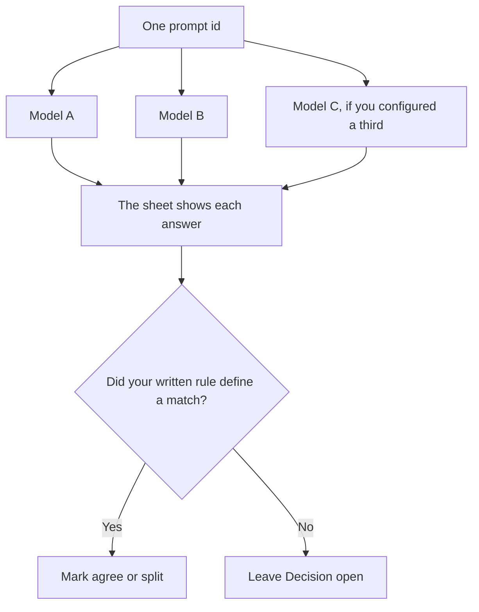

**An AI multi-model vote sends the same prompt to more than one model and records the answers side by side, including where they disagree.** Agreement is a fact about those answers. It is not proof the agreed answer is true. A rule that picks the longest reply, or the reply with the most citations, is a rule you wrote. Call it a rule. Do not call it a vote of experts.

The cases you trust more than a single disagreement are [what an AI eval regression suite is](/blog/what-is-ai-eval-regression-suite-2026/). A cited page you can open is [what RAG is](/blog/what-is-rag-explained-2026/). The line you compare when the prompt itself changed is [what an AI prompt diff is](/blog/what-is-ai-prompt-diff-2026/).

Perplexity, ChatGPT, and Gemini prices are from directory pages checked October 16, 2026. Claude's prices are from claude.com/pricing on October 24. chatgpt.com/pricing returned HTTP 403 that day. Published October 24, 2026. We did not score which model is right. The October 16 Perplexity card lists Model Council on Pro and Max. This page does not invent a separate price for a vote.

## What the record contains

| Field | Who fills it | A model may |
|---|---|---|
| The prompt id | You | Copy it. A vote on two different prompts is not a vote |
| Each model's answer | The call | Paste it. Do not blend them into one paragraph first |
| Agreement | A person, or a rule you wrote | Mark lines that match. It may not declare a winner |
| A source | Only if the answer cited one you can open | Not treat another model's agreement as a source |
| The decision | A person | Leave it blank when you did not decide |

Three models can share a wrong date if they were trained on the same page. The vote catches some contradictions. It does not replace the source. For a vendor question, open the page. The comparison that starts from citations is [Perplexity vs Gemini for vendor diligence](/blog/perplexity-vs-gemini-for-vendor-diligence-2026/).

If you need one answer for a draft, pick the seat that matches the job and say a person will check it. Running three models and merging the prose is how a number survives in one paragraph and disappears in another.

## Where a comparison is available

**A product feature that compares models.** [Perplexity](/tools/perplexity/) Pro is $17 a month billed annually on the October 16 card. That card says Pro and Max include Model Council, which compares answers across models. Max is $167 a month billed annually on the same card. The invoice is [Perplexity pricing explained](/blog/perplexity-pricing-explained-2026/).

**A second reading you paste.** [Claude](/tools/claude/) Pro is $17 a month billed annually, $200 up front, or $20 monthly. Paste two answers. Ask for sentences that contradict. The review is [Claude review](/blog/claude-review-2026/).

**One prompt, one seat.** [ChatGPT](/tools/chatgpt/) Plus is $20 a month on the October 16 card. Plus is not a multi-model vote. If you only have one answer, say so. The review is [ChatGPT review](/blog/chatgpt-review-2026/).

**Another single seat.** [Gemini](/tools/gemini/) Google AI Plus is $4.99 a month on the October 16 card. Pro is $19.99. A second product is a second answer only if you sent the same prompt and kept both. The invoice is [Gemini pricing explained](/blog/gemini-pricing-explained-2026/).

A prompt that holds the line:

"Here are two answers to the same prompt. List claims that match and claims that conflict. Do not pick a winner. Do not add a claim that is in neither answer."

## What not to delegate

Do not average numbers the models invented. Do not hide a split by asking for "the consensus view." Do not skip the source because two models agreed. The regression suite is how a disagreement becomes a case you keep, instead of a chat you close.

## FAQ

### Does agreement mean the answer is right?

No. It means those models produced the same claim on this prompt. Check the claim against a source a person can open. If there is no source, write Unverified.

### Is Model Council a vote?

The October 16 Perplexity card says Model Council compares answers across models on Pro and Max. This page does not describe how it breaks a tie. Use the product's current page if you need that rule. Keep the prompt id with the comparison.

### How many models do I need?

At least two, on the same prompt, or you do not have a vote. A third model adds cost and another column. It does not add truth. Stop when you can see the split you care about.

### Who accepts the result?

The person named on the decision line. A rule can mark agreement. It should not close a decision you marked as open.

## Last verified

October 24, 2026 for Claude. October 16, 2026 for Perplexity, ChatGPT, and Gemini. Published October 24, 2026.

**Sources:** [Perplexity pricing](https://www.perplexity.ai/pro), [Claude pricing](https://claude.com/pricing), [ChatGPT pricing](https://chatgpt.com/pricing/), [Gemini subscriptions](https://gemini.google/subscriptions).

*Published by Andrew for [AI Tools Optimizer](https://aitoolsoptimizer.com).*

[Perplexity](/tools/perplexity/) is in the [research and search directory](/tools/category/research-search/). Directory pages may use affiliate links. A purchase through them may earn us a commission at no extra cost to you.
