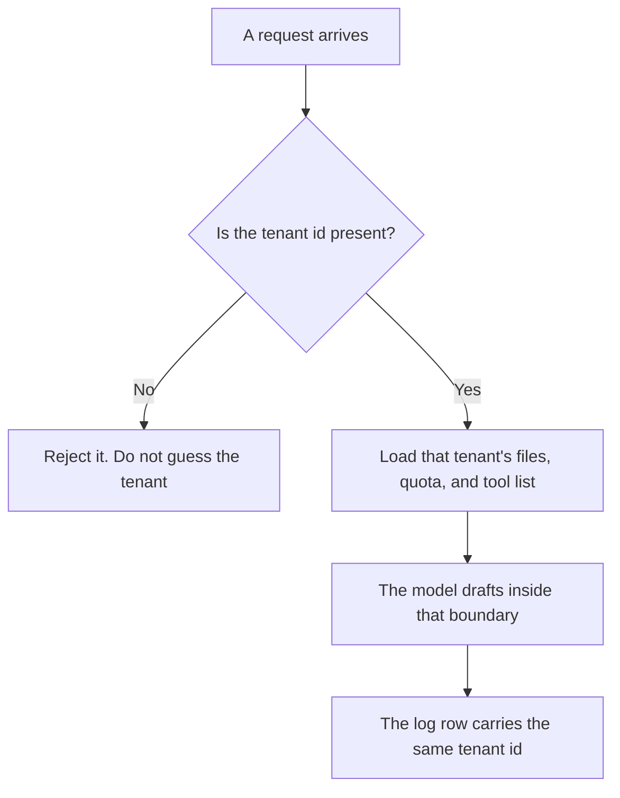

**AI multi-tenancy means one product serves many customers, and a boundary keeps one customer's prompts, files, quota, and keys from becoming another's.** The model weights are often shared. The tenant's data is not, unless a contract says that customer opted into sharing. A login screen is not that boundary. The boundary is the identifier on every row, every tool call, and every log line.

The bill you assign to a team is [what an AI cost center is](/blog/what-is-ai-cost-center-2026/). The counter on usage is [what AI token metering is](/blog/what-is-ai-token-metering-2026/). The signed list of allowed actions is [what an AI guardrail policy is](/blog/what-is-ai-guardrail-policy-2026/). The place a fact is allowed to live is [what a system of record for AI is](/blog/what-is-a-system-of-record-for-ai-2026/).

Prices below are US list prices excluding tax. ChatGPT, Claude, and Chatbase figures are from directory pages checked October 16, 2026. Lindy's seat price is the figure the guardrail article read on October 24, 2026. Published October 24, 2026. This page does not score how well any vendor isolates tenants.

## What is shared, and what is not

| Piece | Often shared | Must stay on the tenant |
|---|---|---|
| Model weights | Yes, unless that customer paid for a private copy | A fine-tune or a file they uploaded |
| Prompts and outputs | No | Stored and retrieved only with that tenant id |
| Quotas and keys | A pool you split | One tenant cannot spend another's allowance or call another's tools |
| Retrieved documents | No | A search for tenant A returns tenant A's corpus |
| Admin logs | Your operators may see a cross-tenant view | A tenant admin sees only their tenant |

A shared model is normal. A shared prompt log is a breach of the promise you made, even when the text looks harmless. The same rule applies to embeddings: the index that holds one customer's chunks is [what an embedding index is](/blog/what-is-embedding-index-2026/). If two customers share an index, the filter is the tenant id, and a missing filter is a data leak.

## Where you meet this as a buyer

**A company workspace.** [ChatGPT](/tools/chatgpt/) Business is $20 per user per month billed annually, with a two-user minimum, or $25 monthly, on the October 16 card. The card says Business does not train on your business data by default. That sentence is about training. It is not a diagram of how workspaces are separated. Your policy still names which workspace is the tenant. Plus at $20 a month is a personal seat. Do not put two customers' files in one personal account and call it multi-tenant.

**A writing seat.** [Claude](/tools/claude/) Pro is $20 a month, or $17 billed annually. The directory says Team plans serve 2 to 150 people. This page does not print a Team dollar price, because the card we are using does not. A Project is a folder. It becomes a tenant boundary only if people outside that customer cannot open it.

**A bot per customer.** [Chatbase](/tools/chatbase/) Hobby is $32 a month billed yearly, with 700 message credits, on the October 16 card. If you run one bot for many customers, the retrieval set has to be filtered by customer. A single help center for your own company is one tenant. Two clients' private docs in one bot, with no filter, is the failure mode.

**An agent that can act.** [Lindy](/tools/lindy/) paid use starts at $49.99 per user per month for 5,000 credits, on the pricing page read October 24, 2026. Anything with outside impact waits for approval, on that same read. Approval is per action. It does not replace a tenant id on the record the agent is allowed to touch.

## What to write down

Name the tenant key. Name who can read another tenant's logs, and why. Name the quota so a noisy customer cannot drain the pool. A retry that must not double-charge that tenant is [what AI idempotency is](/blog/what-is-ai-idempotency-2026/).

Do not accept "we use enterprise security" as the design. Ask which field is the tenant id, and what a request does when that field is missing. The correct behavior is to reject it.

## FAQ

### Is a shared model a multi-tenant violation?

No. Sharing weights is how a hosted model works. The violation is sharing or mixing customer content, credentials, or spend without a rule the customer accepted.

### Does a separate workspace guarantee isolation?

It is the vendor's control, plus the settings you turned on. Confirm what an admin in workspace A can export from workspace B. If the answer is "it depends who is an org owner," write that owner down. Hope is not a boundary.

### Can a small team skip this?

If you have one customer, you have one tenant, and the page can be one paragraph. The moment a second customer's private text enters the same bot, index, or agent, you need the id. Adding it later means re-labeling every row.

### Is this the same as a cost center?

A cost center says who pays. Multi-tenancy says who can see and spend. You can bill two teams correctly and still leak one's documents into the other's answers. Track both.

## Last verified

October 16, 2026 for ChatGPT, Claude, and Chatbase. October 24, 2026 for Lindy's $49.99 line, from the guardrail article's read of lindy.ai/pricing. No isolation rating is claimed. Published October 24, 2026.

**Sources:** [ChatGPT pricing](https://chatgpt.com/pricing/), [Claude pricing](https://claude.com/pricing), [Chatbase pricing](https://www.chatbase.co/pricing), [Lindy pricing](https://www.lindy.ai/pricing).

*Published by Andrew for [AI Tools Optimizer](https://aitoolsoptimizer.com).*

[Chatbase](/tools/chatbase/) is in the [customer support directory](/tools/category/customer-support/). Directory pages may use affiliate links. A purchase through them may earn us a commission at no extra cost to you.
