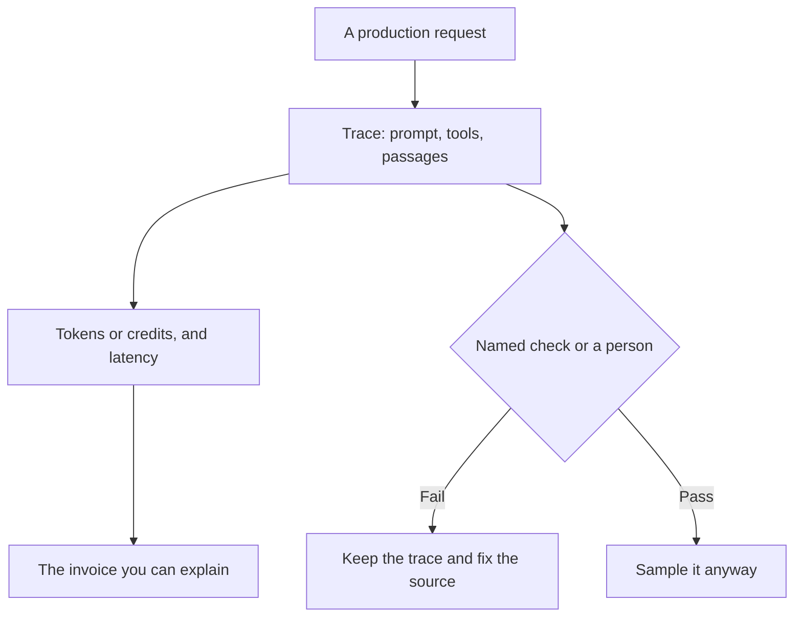

**AI observability is the record of what a model did on a real request: the prompt, the tools it called, the passages it used, the latency, the token cost, and whether a check you defined passed.** A dashboard of vibes is not observability. If you cannot open one bad answer and see why it was produced, you are looking at a chart, not the system.

You need it when the model faces a customer, spends money, or writes into another system. You do not need a second product to watch a personal chat you already reread. The check itself is [what AI eval testing is](/blog/what-is-ai-eval-testing-2026/). The fence around what the model may do is [what AI guardrails are](/blog/what-is-ai-guardrails-2026/).

Prices below are US list prices excluding tax from directory pages checked October 16, 2026. Published October 24, 2026. This page does not rank trace vendors, and it does not publish a quality score.

## What you should be able to open

| Question after a bad answer | The record that answers it | What is not enough |
|---|---|---|
| What did we send? | The prompt, the system instructions, and the files attached | "The user asked about refunds" |
| What did it look up? | The passages or tool results, with ids | A citation title with no passage |
| What did it do? | Each tool call and whether your system allowed it | The final paragraph only |
| What did it cost? | Tokens or credits on that request | The monthly invoice, with no per-request split |
| Was it slow? | Time to first token and time to done | A single average for the week |
| Did it pass a check? | A named eval or a human label on that trace | A green "AI quality" tile |

A trace you cannot export is a vendor screenshot. Write down, before you buy, who can open a trace and how long it is kept. A support lead who cannot see the prompt will escalate to engineering for every complaint.

## Where this directory already shows a meter

Most chat seats are not observability platforms. They show a usage cap. That cap is still the number finance will ask about, so start there before you add a tool whose only job is traces.

| What you run | The meter this directory recorded | Price to know |
|---|---|---|
| A help bot on your articles | [Chatbase](/tools/chatbase/) message credits | Hobby is $32/month billed yearly for 700 credits. Extra credits are $40 per 1,000 |
| An API you call yourself | [DeepSeek](/tools/deepseek/) token rates | Chat is free. API input from $0.15 per 1 million tokens off-peak on a cache miss, output $0.60 off-peak |
| A chat seat with a cap | [Claude](/tools/claude/) or [ChatGPT](/tools/chatgpt/) | Claude Pro is $20/month, or $17 billed annually. ChatGPT Plus is $20. The cap is the observability |
| A path you drew | [n8n](/tools/n8n/) executions | Cloud Starter was shown in euros, from €20/month billed annually. This page does not convert that |
| A help desk that bills outcomes | [Zendesk AI](/tools/zendesk-ai/) | Suite Team is $55 per agent per month paid yearly. Automated resolutions can bill on top |

Chatbase's credit card is [Chatbase pricing explained](/blog/chatbase-pricing-explained-2026/). The support stack around the bot is [best AI tools for support teams](/blog/best-ai-tools-for-support-teams-2026/). A document that tries to rewrite the bot's instructions is [what prompt injection is](/blog/what-is-prompt-injection-2026/). Log that attempt. The model's polite reply is not the incident record.

If you are building the call yourself, the trace has to include the tool request. That mechanism is [what function calling is](/blog/what-is-function-calling-in-ai-2026/). An agent that takes several of those calls is [what an AI agent is](/blog/what-is-an-ai-agent-2026/). Several agents handing work around is [what AI agent orchestration is](/blog/what-is-ai-agent-orchestration-2026/). Orchestration without a trace is how a refund gets sent twice and nobody can say which step did it.

## What to collect, and what to skip

**Collect the failure and a sample of the ordinary.** One angry ticket and fifty random traces from the same day. The random set is how you learn the failure is rare. The ticket is how you learn it is expensive.

**Collect cost next to the feature, not next to the vendor.** "DeepSeek output tokens on the refund flow" is a sentence finance can use. "AI spend" is not.

**Do not collect a score you cannot define.** A 0.8 "helpfulness" number with no rubric will be managed. The rubric is the eval. The trace is the evidence the rubric ran.

**Do not buy a trace product to watch a plan you could read in settings.** Claude and ChatGPT publish usage limits. Hit the limit, then decide you need per-request traces. A personal Plus seat does not need a tracing warehouse.

Latency belongs in the same trace as the tokens. A slow tool call is a different incident from a slow model. This glossary does not invent a latency budget. Time the request you care about, on the plan you pay for.

## FAQ

### Is observability the same as evals?

Evals are the checks. Observability is the record those checks run against, plus cost and latency. You can log every request and still never define a pass. You can also write evals offline and never see production. You want both once a customer can see the answer.

### Do I need it for ChatGPT Plus?

You need the habit of rereading the answer. You do not need a tracing vendor for a seat whose whole history is the chat you already have. You need traces when the same model answers people who cannot see the prompt.

### What is the smallest useful trace?

Prompt, model name, tool results, final text, token or credit count, and a timestamp. Add a human label when someone corrects it. Skip screenshots of a dashboard.

### Will a bigger model replace observability?

No. A larger model can still retrieve the wrong article. The trace is how you notice. The article is the fix. The plan upgrade is a capacity purchase, which is a different decision from [ChatGPT Go vs Plus vs Pro](/blog/chatgpt-go-vs-plus-vs-pro-2026/).

## Last verified

October 16, 2026 for the prices named above. Published October 24, 2026. Definitions do not depend on a price change.

**Sources:** [Chatbase pricing](https://www.chatbase.co/pricing), [DeepSeek API docs](https://api-docs.deepseek.com/), [Zendesk pricing](https://www.zendesk.com/pricing/).

*Published by Andrew for [AI Tools Optimizer](https://aitoolsoptimizer.com).*

[Chatbase](/tools/chatbase/) is in the [customer support directory](/tools/category/customer-support/). Directory pages may use affiliate links. A purchase through them may earn us a commission at no extra cost to you.
