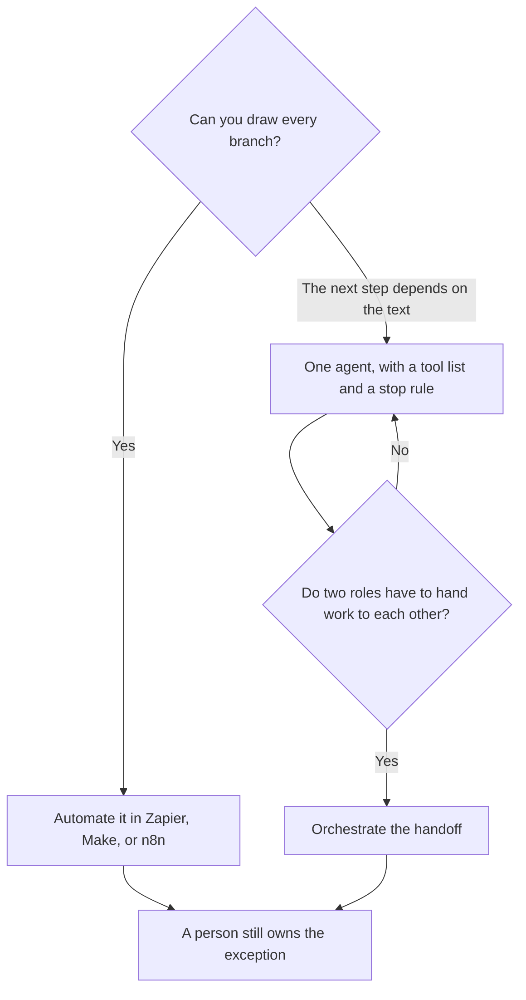

**Automation follows a path you drew in advance. Orchestration decides which step runs next when you could not draw every branch.** A Zap that always does the same four steps is automation, even if one step calls a model. An orchestrator assigns work to an agent, a workflow, or a person because the path depends on what came back. If you can sketch the branches on one page, you do not have an orchestration problem. You have a workflow.

The conductor, once you actually need more than one worker, is [what AI agent orchestration is](/blog/what-is-ai-agent-orchestration-2026/). A single worker with tools is [what an AI agent is](/blog/what-is-an-ai-agent-2026/). The tool call under a step is [what function calling is](/blog/what-is-function-calling-in-ai-2026/).

Prices are US list prices excluding tax from directory pages checked October 16, 2026, except n8n, which was shown in euros. Published October 24, 2026. We did not score how often an agent finishes the task.

## The split

| You can say this | Buy this shape | A directory match | Price to know |
|---|---|---|---|
| "When A happens, always do B, then C" | Automation | [Zapier](/tools/zapier/) or [Make](/tools/make/) | Zapier Professional is $19.99/month annually for 750 tasks. Make Core is from $9/month annually for 10,000 credits |
| "One agent may use these tools, and a person checks the result" | An agent, not a platform | [Lindy](/tools/lindy/) | Team is from $49.99/month for 5,000 credits |
| "When a page changes, run this teammate" | A trigger, then an agent | [Notion AI](/tools/notion-ai/) Custom Agents | Business is $20/seat/month. Credits are $10 per 1,000 after the trial |
| "Two specialists have to hand off" | Orchestration | [Relevance AI](/tools/relevance-ai/) | Pro is $19/month billed annually. The free plan is retired |
| "I will click the next step" | A checklist | A chat seat | The right orchestrator until the handoff is boring |

Calling a model inside a fixed Zap does not turn the Zap into orchestration. The path was yours. The model wrote a field. If that field is sometimes nonsense, the fix is a check, not a second agent. The check is [what human-in-the-loop AI is](/blog/what-is-human-in-the-loop-ai-2026/).

## Stay on the diagram longer than the demo suggests

[Zapier](/tools/zapier/) Free is 100 tasks a month. Professional at $19.99 a month billed annually is the multi-step plan. Filters and Formatter do not count as tasks, on the directory card. [Make](/tools/make/) Free is 1,000 credits a month. Core starts at $9 a month billed annually for 10,000 credits. Most actions cost one credit. The how-to is [how to automate work with Zapier and Make](/blog/how-to-automate-work-with-zapier-and-make/).

[n8n](/tools/n8n/) is the self-host option. The Community Edition is free to self-host. Cloud Starter was shown at €20 a month billed annually for 2,500 executions on October 16, 2026. This page does not convert euros to dollars. The review is [n8n cloud review](/blog/n8n-cloud-review-2026/). The three-way is [Zapier vs Make vs n8n](/blog/zapier-vs-make-vs-n8n/).

Move to an agent when the branch is "read this and decide," and you have a done state. [Lindy](/tools/lindy/) Team starts at $49.99 a month for 5,000 credits. The trial is $50 in credits for 7 days. Top-ups are $10 per 1,000 credits. The review is [Lindy review](/blog/lindy-review-2026/).

Move to orchestration when two of those workers must hand off, or a trigger must pick a worker. [Notion AI](/tools/notion-ai/) Business at $20 a seat is the trigger-shaped version inside Notion. Custom Agent credits are $10 per 1,000 after you try them. [Relevance AI](/tools/relevance-ai/) Pro is $19 a month billed annually, or $29 monthly, with 2,500 actions. Team is $234 a month annually. The free plan is gone. Do not add a workforce because the diagram looked plain.

A pile of documents that can wait is not orchestration either. That is a queue. The definition is [what batch inference is](/blog/what-is-ai-batch-inference-2026/).

## FAQ

### Is an AI workflow the same as orchestration?

Only if something chooses the next step from the result. A workflow you drew is automation that may call a model. Use the smaller word. It is easier to debug.

### When is orchestration worth it?

When you can name the handoff, the stop rule, and the person who accepts the result. If you cannot name those, another agent will add a log you do not read. The agent-shaped version of this page is the orchestration explainer linked above.

### Can Zapier be the orchestrator?

It can run the steps you drew, including a model step. It does not become a conductor because the model wrote a paragraph. If the path changes every time, you have outgrown the diagram. Say so, and then look at an agent product.

### Do I need this for a chatbot?

A chatbot that answers from your docs is retrieval, not orchestration. Build that when the docs are current. The method is [what RAG is](/blog/what-is-rag-explained-2026/).

## Last verified

October 16, 2026 for Zapier, Make, Lindy, Notion, and Relevance prices, and for n8n's euro Starter price. Published October 24, 2026.

**Sources:** [Zapier pricing](https://zapier.com/pricing), [Make pricing](https://www.make.com/en/pricing), [Notion pricing](https://www.notion.com/pricing).

*Published by Andrew for [AI Tools Optimizer](https://aitoolsoptimizer.com).*

[Zapier](/tools/zapier/) is in the [automation and agents directory](/tools/category/automation-agents/). Directory pages may use affiliate links. A purchase through them may earn us a commission at no extra cost to you.
