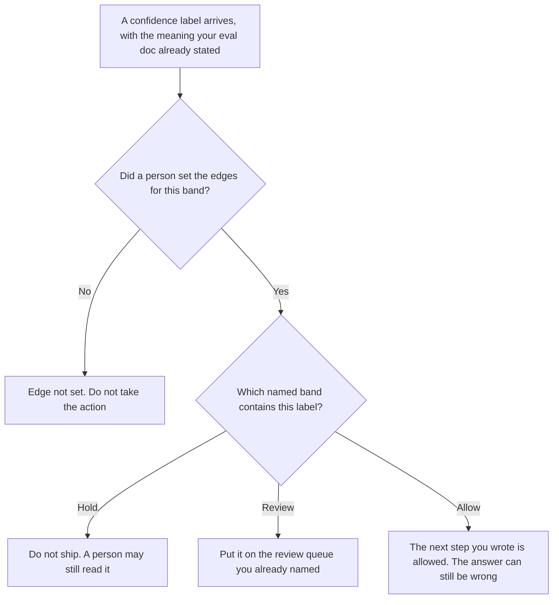

**An AI output confidence band is a range a person defined, with an action attached, that a confidence label must fall into before that action is allowed.** The label is [what an AI output confidence score is](/blog/what-is-ai-output-confidence-score-2026/). The band is your rule for the label: hold, send to a person, or allow a next step you already named. The label does not pick its own band. A band does not make the answer true.

The queue where a person reads the cases you held is [what an AI human review queue is](/blog/what-is-ai-human-review-queue-2026/). A check that the answer has the shape you required is [what an AI output format gate is](/blog/what-is-ai-output-format-gate-2026/). Stripping an identifier on the way out is [what AI output PII redaction is](/blog/what-is-ai-output-pii-redaction-2026/).

This page does not publish a numeric scale. A scale we did not measure would be an invention. The edges below are names. Edge not set stays unset until you write the edge in your own eval doc.

Claude's prices are the October 24, 2026 read of claude.com/pricing recorded in [Claude pricing explained](/blog/claude-pricing-explained-2026/). ChatGPT's Plus price is the October 24 plan-page figure recorded in [ChatGPT pricing explained](/blog/chatgpt-pricing-explained-2026/). Notion and Perplexity prices are from directory pages checked October 16, 2026. Perplexity's $17 annual Pro figure was reconfirmed in the October 24 pricing article. Published October 24, 2026. We did not measure any vendor's confidence number. The directory does not list a confidence-band fee.

## What the band has to name

| Line | Who writes it | A blank means |
|---|---|---|
| The band's name, such as hold, review, or allow | You | A score has no action |
| The edges, in the unit your eval doc defines | You, or Edge not set | Do not ship. A blank edge is not "high" |
| The action inside the band | You, from a list you already approved | The model picks a next step |
| What the band is not allowed to decide | You: truth, policy, or a price | A high band gets treated as a fact |
| Who may move an edge | A named owner | A quiet week moves the line |

A confidence score is a label the system attaches. It can be a number or a word. The score page says the label is not a fact check. This page adds the ranges. If you have not written the edges, you do not have bands. You have a label and a wish. Calling everything above a number you did not write "high" is how a label becomes an approval.

Hold, review, and allow are names you can use. They are not a scale this site measured. If your vendor uses different words, copy the vendor's words and your edges. Do not translate a vendor word into a probability this page did not read.

The format gate can reject an answer that is in the allow band, because the shape is wrong. PII redaction can still strip a field after the band says allow. The band is one gate. It is not the only gate.

## Where you would write the edges

**The eval note.** [Claude](/tools/claude/) Pro is $17 a month billed annually, $200 up front, or $20 monthly. Keep the edges in a Project. A later summary that drops an edge is not a new band. The review is [Claude review](/blog/claude-review-2026/).

**One paste of a label.** [ChatGPT](/tools/chatgpt/) Plus is $20 a month. Ask it to name the band only from the edges you pasted. If the edges are missing, the line is Edge not set. The ladder is [ChatGPT pricing explained](/blog/chatgpt-pricing-explained-2026/).

**The page that holds the rule.** [Notion AI](/tools/notion-ai/) Business is $20 a seat a month on the October 16 card. Link the owner and the date the edges were accepted. Plus at $10 is not the full AI tier. The invoice is [Notion AI pricing explained](/blog/notion-ai-pricing-explained-2026/).

**A source you still have to open.** [Perplexity](/tools/perplexity/) Pro is $17 a month billed annually on the October 24 read in [Perplexity pricing explained](/blog/perplexity-pricing-explained-2026/). A citation about a vendor's score is not your edge. The shipping rule is [what AI grounding citation-required is](/blog/what-is-ai-grounding-citation-required-2026/).

A prompt that holds the line:

"Name the band for the label I pasted, using only the edges I pasted. If an edge is missing, write Edge not set. Do not invent a threshold. Do not say the answer is true."

## What not to delegate

Do not ask which threshold a team "usually" uses. Do not move an edge because the hold queue is long. Do not treat the allow band as a fact check. The owner who wrote the edges is the one who may change them.

## FAQ

### How is this different from a confidence score?

The score is the label on one answer. The band is the range you defined, and the action that range permits. A label with no edges does not authorize an action. An action with no label is a decision you made some other way.

### Does the allow band mean the answer is correct?

No. It means the label fell inside a range you wrote, so the next step you named is allowed to happen. The answer can still be wrong. Other gates still apply.

### What if the vendor does not publish a scale?

Then you do not invent one. Edge not set stays on the page. You can still hold every answer for a person. You cannot draw a number on a scale you have not defined.

### Who may change an edge?

The owner named on the band. A generated "reasonable" cutoff is not a change. The date on the page changes when that owner accepts the new edge.

## Last verified

October 24, 2026 for Claude, for ChatGPT's plan page, and for Perplexity, via the posts cited above. October 16, 2026 for Notion. Published October 24, 2026. No confidence-band fee is recorded in the directory. This page does not publish a numeric threshold.

**Sources:** [Claude pricing](https://claude.com/pricing), [ChatGPT and Codex pricing](https://learn.chatgpt.com/docs/pricing), [Notion pricing](https://www.notion.com/pricing), [Perplexity pricing](https://www.perplexity.ai/pro).

*Published by Andrew for [AI Tools Optimizer](https://aitoolsoptimizer.com).*

[Claude](/tools/claude/) is in the [chatbots and assistants directory](/tools/category/chatbots-assistants/). Directory pages may use affiliate links. A purchase through them may earn us a commission at no extra cost to you.
