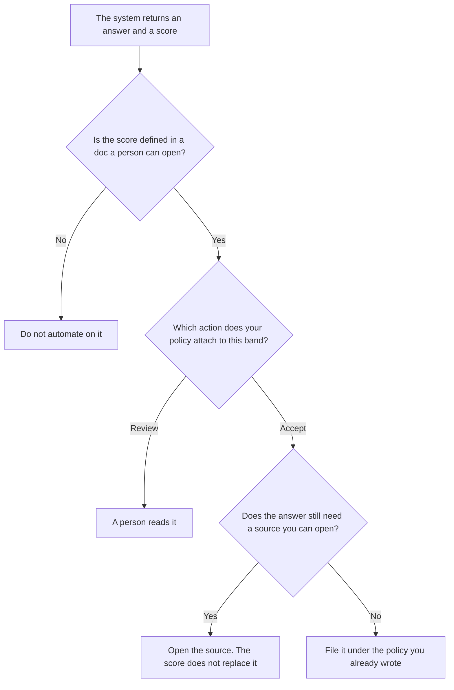

**An AI output confidence score is a label a system attaches to an answer, such as a number or a word like high or low. The label says something about the system's own signal. It does not prove the answer is true.** A person decides what action, if any, that label may trigger. The queue where a person reads the risky cases is [what an AI human review queue is](/blog/what-is-ai-human-review-queue-2026/). How many cases you need before you trust a metric is [what an AI eval sample size is](/blog/what-is-ai-eval-sample-size-2026/).

Claude's prices are from claude.com/pricing on October 24, 2026. ChatGPT Plus is $20 a month on learn.chatgpt.com/docs/pricing that day. Notion and Perplexity prices are from directory pages checked October 16, 2026. Published October 24, 2026. We did not measure any vendor's confidence number. This page does not publish a scale, because a scale we did not read on a vendor card would be an invention.

## What you write down before you use a score

| Question | An acceptable answer | A reason to ignore the score |
|---|---|---|
| What does the number mean? | A definition the vendor or your eval doc states | "It means the model is sure" |
| What did you compare it with? | A sample a person labeled, of the size you required | One dramatic miss, or one dramatic hit |
| What may a low score do? | Route to the review queue | Auto-delete a customer record |
| What may a high score do? | Skip a second model, if the policy says so | Skip the source check on a price, a date, or a name |

A model that writes "confidence: 0.92" because you asked for a vibe is producing a costume. That sentence is not this score. A score you will automate on has a definition, a sample, and a person who owns the threshold. Pulling fields out of a document, which is a different control, is [what AI structured extraction is](/blog/what-is-ai-structured-extraction-2026/). An extracted field can be confident and still be the wrong field.

## Where the label gets discussed

**The eval write-up.** [Claude](/tools/claude/) Pro is $17 a month billed annually, $200 up front, or $20 monthly. The Project holds the definition of the score so every report uses the same words. The review is [Claude review](/blog/claude-review-2026/). The report shape is [how to create a model eval report with AI](/blog/how-to-create-a-model-eval-report-with-ai-2026/).

**One paste of outputs.** [ChatGPT](/tools/chatgpt/) Plus is $20 a month. Ask it to table the labels you already have. Discard a column of new scores it invented. The review is [ChatGPT review](/blog/chatgpt-review-2026/).

**The page the team reopens.** [Notion AI](/tools/notion-ai/) Business is $20 a seat a month if the threshold policy lives in the wiki. Plus at $10 is not the full AI tier on the October 16 card. The invoice is [Notion AI pricing explained](/blog/notion-ai-pricing-explained-2026/).

**A sourced check, when the claim is a fact on the web.** [Perplexity](/tools/perplexity/) Pro is $17 a month billed annually on the October 16 card. A citation you open beats a confidence word. The invoice is [Perplexity pricing explained](/blog/perplexity-pricing-explained-2026/).

A prompt that holds the line:

"Table only the scores present in the paste. If a row has no score, write Score missing. Do not invent a number. Do not recommend that we auto-accept any row."

## What not to delegate

Do not let the model pick the threshold. Do not average a vendor score with a number the model just wrote. Do not hide a low score because the prose sounds finished.

## FAQ

### Is a high score a fact check?

No. A high score means the system followed its own definition of confidence. A price, a date, a name, and a legal line still need the source your policy already requires.

### Can I compare two vendors' scores?

Only after you have written what each number means and you have labeled a sample. A 0.8 from one product and a 0.8 from another are two labels. They are not one scale.

### Should a low score block the whole workflow?

Only if the owner wrote that action. Many low scores should enter the review queue. A block that deletes work is a separate decision, and it belongs in the policy, not in the model's closing sentence.

### Who changes the threshold?

The owner of the eval. A week of quiet traffic is not a reason for the agent to raise the bar. A change to the threshold is a change request with a sample.

## Last verified

October 24, 2026 for Claude and for ChatGPT Plus. October 16, 2026 for Notion and Perplexity. No confidence-score fee is recorded in the directory. Published October 24, 2026.

**Sources:** [Claude pricing](https://claude.com/pricing), [ChatGPT and Codex pricing](https://learn.chatgpt.com/docs/pricing), [Notion pricing](https://www.notion.com/pricing), [Perplexity pricing](https://www.perplexity.ai/pro).

*Published by Andrew for [AI Tools Optimizer](https://aitoolsoptimizer.com).*

[Perplexity](/tools/perplexity/) is in the [research and search directory](/tools/category/research-search/). Directory pages may use affiliate links. A purchase through them may earn us a commission at no extra cost to you.
