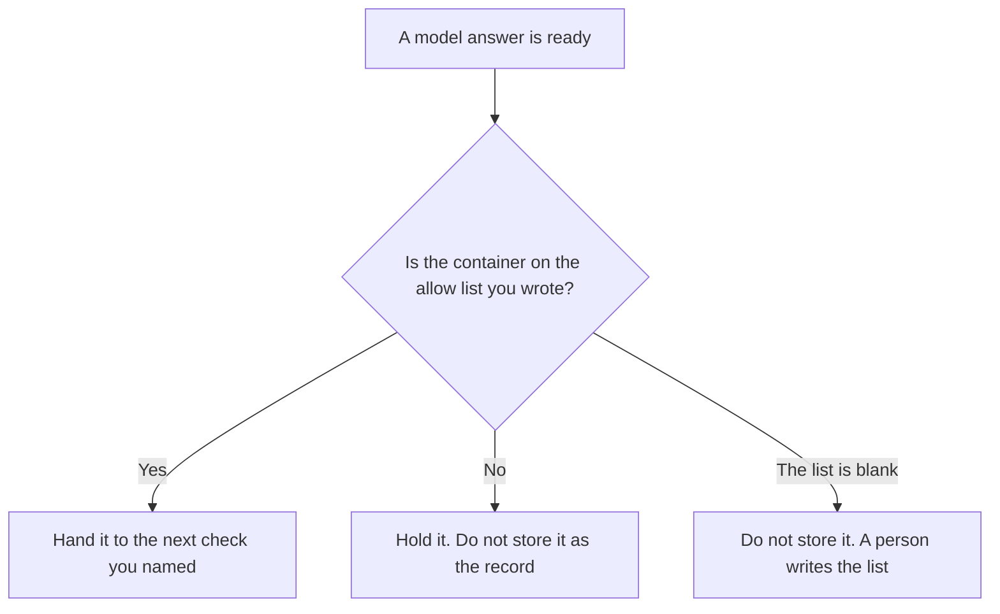

**An AI output format gate stores or sends a model answer only when the container is one a person already allowed.** The allow list is short: JSON, a markdown table, CSV, or prose, or a subset you named. Anything else stays held. The fields inside a JSON object are [what an AI output schema is](/blog/what-is-ai-output-schema-2026/). Refusing to widen those fields is [what an AI output schema lock is](/blog/what-is-ai-output-schema-lock-2026/). This page is the container. It does not check the keys.

Which version of the schema is in force is [what an AI response schema version is](/blog/what-is-ai-response-schema-version-2026/). A scan for personal data in the text is [what an AI output PII scan is](/blog/what-is-ai-output-pii-scan-2026/). A classifier that must return allow before anyone sees the text is [what an AI safety classifier gate is](/blog/what-is-ai-safety-classifier-gate-2026/). Those checks can all run. They look at different things.

Claude's prices are the October 24, 2026 read of claude.com/pricing recorded in [Claude pricing explained](/blog/claude-pricing-explained-2026/). ChatGPT's Plus price is the October 24 plan-page figure recorded in [ChatGPT pricing explained](/blog/chatgpt-pricing-explained-2026/). Notion and the schema-lock discussion of Cursor use directory and help-center dates stated below. Published October 24, 2026. We did not score how often models obey a format. The directory does not list a format-gate fee.

## What the gate has to say

| Line | Who writes it | A blank means |
|---|---|---|
| Allowed containers | You | Prose and JSON both pass |
| What a mismatch does | You: hold, or reject | The answer is stored anyway |
| Whether a preamble is allowed | You | "Here is the JSON" plus an object counts as JSON |
| Who may add a container | A person | The model adds Markdown because it was easier |
| The next check | You name it, or Next check not set | A format pass is treated as a schema pass |

JSON that is missing a required key can pass this gate and fail the schema lock. That is the point of keeping them separate. Prose that a safety classifier allowed can still fail this gate when the list is JSON only. A PII scan can still flag a phone number inside a container that passed. Passing the format gate means the shape of the file matched. It does not mean the facts are true. Checking values after the fact is [what AI output validation is](/blog/what-is-ai-output-validation-2026/).

A preamble is a container change if you said so. If the allow list is "JSON only, no sentences before the object," then a sentence before the object is a reject. The model does not get to explain the JSON in front of it unless you allowed that.

## Where the list is kept

**The definition of the containers.** [Claude](/tools/claude/) Pro is $17 a month billed annually, $200 up front, or $20 monthly. The Project holds the allow list so a later task does not add prose. The review is [Claude review](/blog/claude-review-2026/).

**One answer, from a paste.** [ChatGPT](/tools/chatgpt/) Plus is $20 a month. Discard a version that wraps the object in a paragraph when the list forbids it. The ladder is [ChatGPT pricing explained](/blog/chatgpt-pricing-explained-2026/).

**The file the team keeps.** [Notion AI](/tools/notion-ai/) Business is $20 a seat a month on the October 16 card. The row names the task, the allow list, and the owner. Plus at $10 is not the full AI tier. The invoice is [Notion AI pricing explained](/blog/notion-ai-pricing-explained-2026/).

**The diff, if the gate lives next to the parser.** [Cursor](/tools/cursor/) Plus is $8 a month, or $80 a year, on the October 24 help page recorded in [Cursor Business pricing explained](/blog/cursor-business-pricing-explained-2026/). You review a diff that adds CSV to a JSON-only list.

A prompt that holds the line:

"Draft the format-gate row from the containers and the mismatch action I pasted. If the list is missing, write Allow list not set. Do not add a container. Do not treat a format pass as a schema pass."

## What not to delegate

Do not ask the model which format is "easiest to read." Do not store a rejected answer because the content looked right. Do not skip the schema lock because the file was JSON. The owner of the task sets the list. A pretty table is not an allow list.

## FAQ

### How is this different from a schema lock?

The schema lock refuses a response that does not match fields a person accepted, and it refuses to widen that schema. The format gate only checks the container. An object can be valid JSON and still fail the lock. A locked schema can still receive prose if nobody checked the container first. Run the format gate, then the lock.

### How is this different from a schema version?

The version says which accepted schema is in force. The format gate does not pick a version. A version change can stay on JSON. A format change can happen with no schema at all, when the allow list is prose or a table. Point at the version page when the fields changed. Point at this page when the file type changed.

### How is this different from a safety classifier gate?

The classifier returns allow or holds the output for a reason you named, such as a blocked category. The format gate holds the output because the container was not on the list. A safe paragraph can be the wrong container. An allowed JSON object can still fail the classifier. Neither gate checks the other's job.

### Who may add a container?

The person named on the row. Adding CSV, or allowing a preamble, is a new version of the list, with a date. Answers already stored stay in the container they passed. The model does not widen the list after a rejection.

## Last verified

October 24, 2026 for Claude, for ChatGPT's plan page, and for Cursor's help page, via the posts cited above. October 16, 2026 for Notion. Published October 24, 2026.

**Sources:** [Claude pricing](https://claude.com/pricing), [ChatGPT and Codex pricing](https://learn.chatgpt.com/docs/pricing), [Notion pricing](https://www.notion.com/pricing), [Cursor pricing](https://cursor.com/help/account-and-billing/pricing).

*Published by Andrew for [AI Tools Optimizer](https://aitoolsoptimizer.com).*

[Claude](/tools/claude/) is in the [chatbots and assistants directory](/tools/category/chatbots-assistants/). Directory pages may use affiliate links. A purchase through them may earn us a commission at no extra cost to you.
